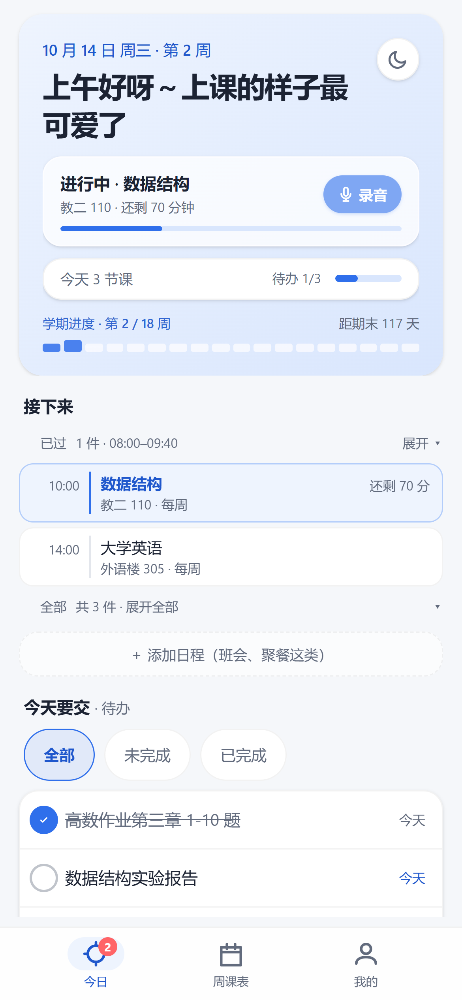
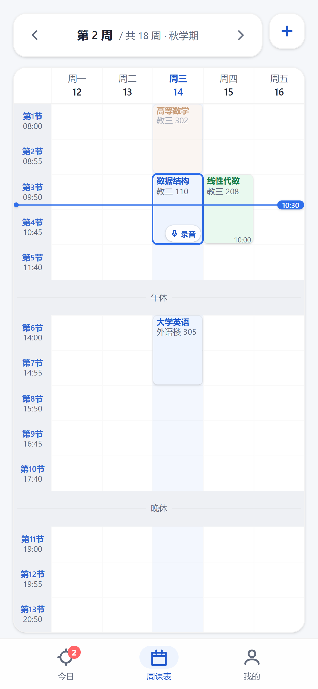
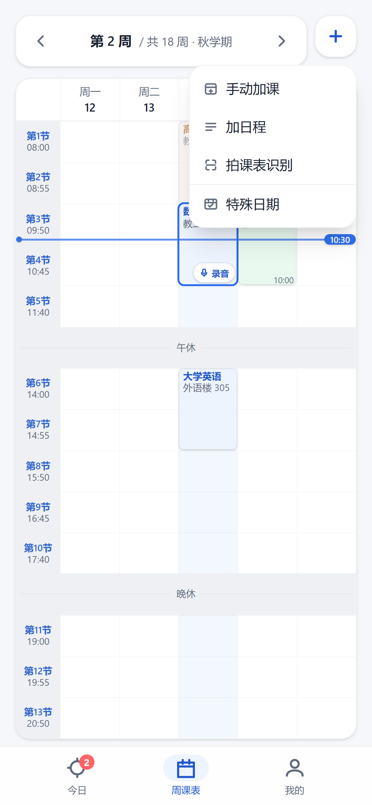
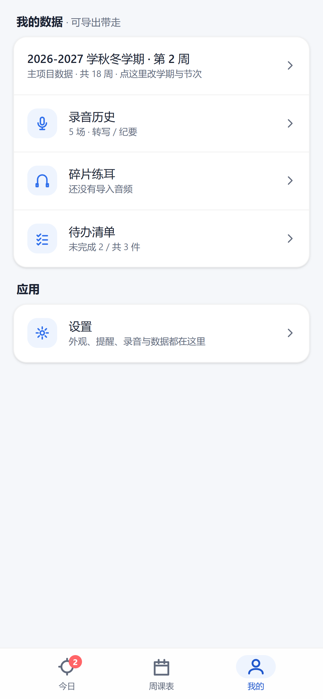
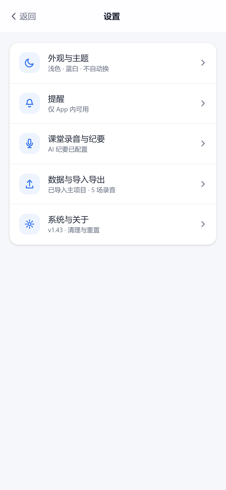
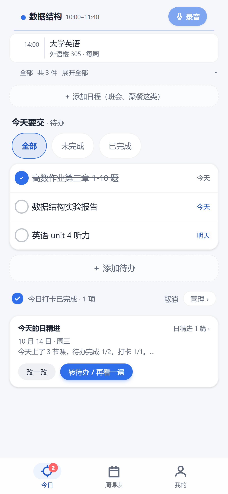
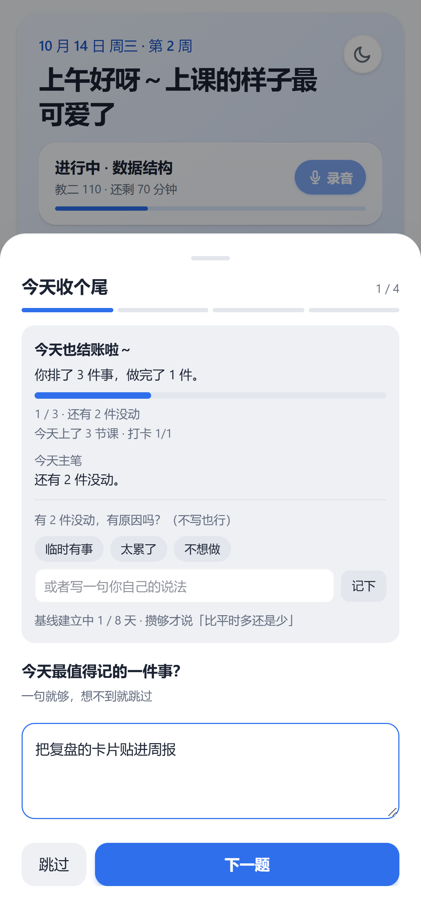
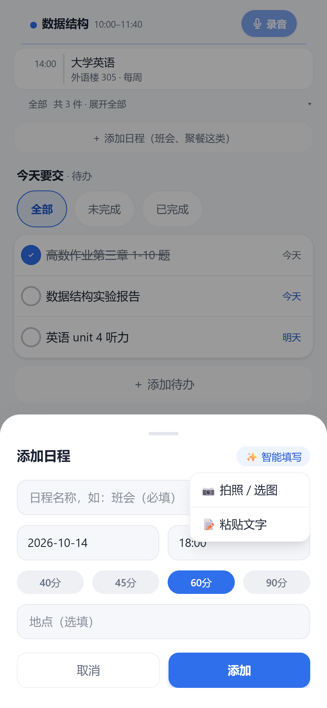
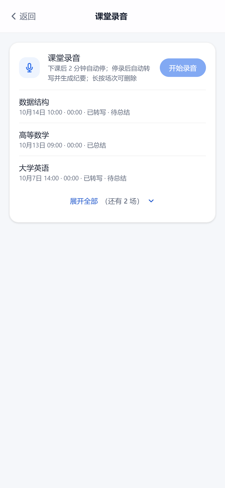
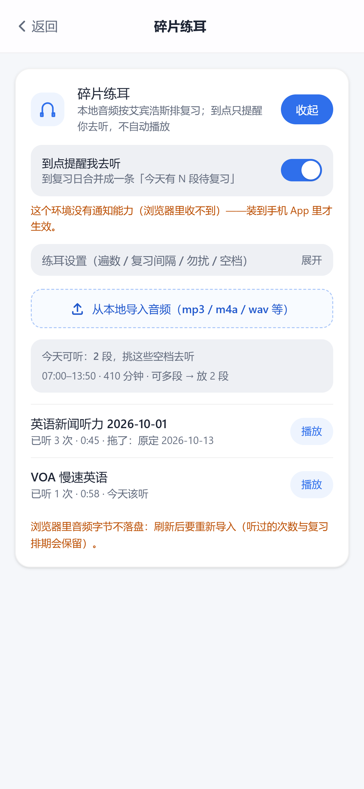

# 大学生日程助手

一款大学生自用的日程管理工具：**课表 + 待办同屏**的轻量网页应用。纯前端、本地保存、无账号、无服务器。

> **正式版代码位置（Day 15 起）**：正式版界面是 `web2/` 子目录下的 Vue 3 实现（`npm install && npm run build`，产物在 `web2/dist`），在线站点与手机 App 都由它构建；根目录的原生实现是 Day 1–14 的版本，已封存不再迭代。

## 功能

- **今日页**：顶卡告诉你「现在该做什么」（正在上的课 / 该复盘 / 没安排），下面按时间列出「已过 / 接下来」，今天要交的待办就在同一屏，上下滑只滚中间那块
- **周课表**：按周翻页，每周每一节都画在网格里；右上 `＋` 是一个选单（手动加课 / 加日程 / 拍课表识别 / 特殊日期），放假与调休走「特殊日期」
- **课表识别**：拍一张教务课表或选图，「✨ 智能填写」把文字 / 图片变成表单里的一条日程或一门课，**只填表不落库**，核对完再点添加；一段通知里说了好几件事时走「一次多条」，抽出一个可勾选、可就地改的**核对列表**，再「添加所选」
- **课堂录音**：三个入口（今日页顶卡 / 课表页正在上的卡 / 通知栏状态框），下课 2 分钟自动停，停录后自动转写并生成纪要，历史默认露最近 3 场、按需展开全部
- **每日复盘「日精进」**：晚上四道题收个尾（今天结账 → 状态 → 最值得记的 → 明天最重要的一件事），自动生成一段可回顾的小结
- **碎片练耳**：本地导入 20 秒–1 分钟的音频，按艾宾浩斯排复习；到点只提醒你去听，不自动播放
- **待办与打卡**：待办按截止日落位、可打勾；打卡项在今日页一键完成
- **数据自己拿着**：全部存在本机 localStorage，可导出 / 导入 JSON，换设备自己搬
- **手机 App**：Capacitor 打包成 Android 应用，同一份 `web2/dist` 产物

## 界面截图

在项目自身的 `web2/dist` 产物上拍摄（Chrome 无头，390×844 手机视口、dpr 3、浅色主题，时间冻在周三 10:30 以便一屏看到「已过 / 正在上 / 接下来」三态；**不是真机截图**，真机外观以自己上手为准）：

| 今日页 | 周课表 | 周课表 ＋ 选单 |
| --- | --- | --- |
|  |  |  |

| 我的 | 设置索引页 | 日精进入口 |
| --- | --- | --- |
|  |  |  |

| 每日复盘浮层 | 添加日程 · ✨ 智能填写 | 课堂录音历史 |
| --- | --- | --- |
|  |  |  |

| 碎片练耳 |
| --- |
|  |

复现这组图：先在 `web2/` 下起静态服务并固定端口 `PORT=4177 node serve.js`，再 `node tmp/readme-shots.mjs`，产物写到 `docs/shots/`（脚本读 `BASE` 环境变量，默认就是 `http://127.0.0.1:4177`）。

## 这个项目是怎么长出来的

一期从「课表和待办分在两个 App 里、来回切」这个问题出发，一路做到今天这样：

1. **先解决最痛的一件事** —— 课表 + 待办同屏，纯前端、本地保存、不要账号。
2. **从原生迁到 Vue 3** —— Day 15 起用 `web2/` 重写界面，原生版封存；原因是后面的功能（录音、识别、复盘）靠手写 DOM 会失控。
3. **每加一个功能先砍一遍** —— 「十段简化」是常态：录过原型的「课堂录音大卡」「我的页一长串设置」都被压成一行或一个入口。
4. **真机上复验，不靠感觉** —— 每一项动过界面都写进 [`docs/真机复验清单.md`](./docs/真机复验清单.md)，在真机上按清单逐条看。
5. **把踩过的坑变成检查器** —— 近百个 `web2/tmp/*-check.mjs` 自检脚本 + 发布前检查 Skill，改完就跑，红了先修再提交。
6. **后端从只读到写闭环** —— CloudBase 云函数先只服务「课表识别」的读接口，后来补上写入与鉴权，形成今天的闭环。

## 如何运行

**正式版（`web2/`，推荐）**：

```bash
cd web2
npm install
npm run build     # 产出 web2/dist
node serve.js     # 静态服务，默认 3000 端口，可用 PORT 改
# 浏览器打开 http://localhost:3000
```

开发模式：`npm run dev`（Vite，默认 http://localhost:5180）。

**在线版**：https://vibecoding-test-d5fqmhbb955e19dd-1499011319.tcloudbaseapp.com/app/ （首次打开会过一个腾讯云的风险提醒中间页，点「确定访问」即可）。

**根目录原生版（Day 1–14，已封存）**：解压后双击 `index.html` 就能跑，不需要任何工具。

## 数据保存在哪？

全部数据存在**本机浏览器的 localStorage** 里，不上传任何服务器。注意：

- 不同浏览器、不同打开方式（`file://` 与 `http://localhost`）的数据**互相独立**；
- 清除浏览器数据会连带清掉课表，请定期用「导出 / 备份 → 导出 JSON 备份」存档；
- 换设备：旧设备导出 JSON → 新设备「导入 JSON 数据」即可完整迁移。

## 手机上提醒怎么来？

导出 `.ics` 文件 → 发到手机 → 导入系统日历（或 Google 日历等）→ 每节课在课前 15 分钟由系统日历提醒。**修改课程后需要重新导出并重新导入，提醒才会更新。**

## 技术栈与目录结构

**正式版：`web2/`**（Day 15 起）—— Vue 3（`<script setup>`）+ Vite + Tailwind 4，有构建步骤。

```
web2/index.html              入口页面
web2/src/main.js             启动入口（挂载 Vue）
web2/src/App.vue             应用外壳：导航、头卡、浮层与二级页挂载
web2/src/pages/              页面：TodayPage / WeekPage / MePage
web2/src/pages/sub/          二级页：录音历史 / 练耳 / 待办 / 设置（5 个面板）
web2/src/sheets/             浮层：添加日程、课程编辑、复盘、特殊日期等
web2/src/components/         通用组件：BottomSheet / RowItem / TimeWheel / NumberWheel / …
web2/src/style.css           全局样式（Tailwind 4 + 设计令牌）
web2/src/data/               数据与逻辑层（22 个模块），几个关键的：
  store.js                     数据唯一闸门（localStorage），负责增删改查
  periods.js / weekGrid.js     节次表与周网格（纯函数）
  recognizer.js                课表识别：图片 → 课程（走大模型）
  eventParser.js               日程识别：图片 / 文字 → 表单字段（✨ 智能填写）
  recorder.js / transcriber.js 录音与语音转写（浏览器 / App 原生桥两条路径）
  summarizer.js                录音总结
  review.js / listen.js        每日复盘 / 碎片练耳
  ics.js                       导出层：.ics 生成与下载
web2/serve.js                线上发布用静态服务（读 PORT，serve dist/）
web2/dist/                   构建产物（npm run build 生成，不入库）
web2/tmp/                    自检脚本与一次性探针（*-check.mjs 进仓库，截图与中间产物不入）
```

```bash
cd web2
npm install
npm run build    # 产出 web2/dist
npm run dev      # 本地开发（http://localhost:5180）
```

**根目录：Day 1–14 的实现，已封存不再迭代** —— 原生 HTML/CSS/JavaScript，无框架、无构建工具、无 ES Module（双击 `index.html` 就能跑）。

```
index.html        入口页面
css/style.css     样式（含移动端适配）
js/store.js       数据层：localStorage 唯一出入口
js/rules.js       规则层：周次换算 / 冲突检测 / 今日结算（纯函数）
js/ics.js         导出层：.ics 生成与下载
js/views.js       渲染层：把数据画成界面
js/app.js         入口层：绑定事件，串起取数→校验→存数→重渲染
```

## 自检 Skill（交付前跑一遍）

`skills/` 下是可复用的检查清单，每条规则都来自项目**真实踩过的坑**。

**发布前检查 `verify-project`** — 推代码 / 出 APK / 发演示链接**之前**跑一遍，把「可能悄悄坏掉」的环节全查一次（密钥卫生、两份 `errors.js` 是否逐字节一致、`APP_CTX` 漏解构、安全区、构建、质量门、测试基线、APK 三方一致、版本号、推前连通性、文档同步），逐项给 `PASS/FAIL/SKIP` + 一行证据：

```bash
node skills/verify-project/verify.mjs          # 全量（含构建 / 质量扫描 / 基线 / 验包，几分钟）
node skills/verify-project/verify.mjs --fast   # 快档：跳过构建与出包链，改前端小逻辑时用
```

退出码即结论：**任一 FAIL → 1；全 PASS（SKIP 不算 FAIL）→ 0**。明细同时写进 `skills/verify-project/last-run.txt`。说明见 [SKILL.md](./skills/verify-project/SKILL.md)。

> 规矩：**新增检查项必须先自证会报红**（故意造个坏样例确认真 FAIL 再恢复）——静默假通过的检查器比没有更危险。

另有 `skills/frontend-guidelines` — 前端改动检查清单。

## 文档

- [设计方案](./大学生日程助手-设计方案.md) — 产品定位与五期路线
- [research.md](./research.md) — 竞品研究
- [PRD.md](./PRD.md) — 一期功能清单与验收标准
- [TECH_DESIGN.md](./TECH_DESIGN.md) — 技术设计
- [交接说明](./docs/交接说明.md) — 当前状态与「接着做从哪看」
- [PROJECT_MAP](./docs/PROJECT_MAP.md) — 目录地图与当前事实
- [下一轮施工单](./docs/下一轮施工单.md) — 还剩什么没做
- [真机复验清单](./docs/真机复验清单.md) — 上真机要看什么

## 状态

- **正式版（`web2/`）**：一期功能已全部实现，在线运行 —— https://vibecoding-test-d5fqmhbb955e19dd-1499011319.tcloudbaseapp.com/app/
  - 旧地址 https://college-schedule-assistant.app.workbuddy.host/ 指向更早的 v1.38，**不再更新**，请用新地址。
- **手机 App**：Capacitor 外壳工程 `vibe-coding-project-app`（独立目录）打包同一份 `web2/dist` 产物
- **根目录原生版**：Day 1–14 的实现，已封存
- 后续按五期路线迭代（课表识别 / 录音总结 / 打卡 / 练耳 / 复盘），**开发主线在 `web2/`**。详见设计方案。
