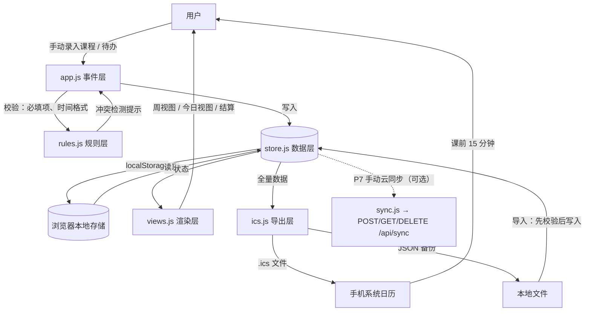

# TECH_DESIGN.md — 大学生日程助手 · 一期技术设计

> 版本：v1.2 ｜ 日期：2026-09-20（Day 5 技术设计）｜ 最近更新：2026-10-09（今日页头部上拉收缩（乙）：头部改绝对定位浮层 + `stripInstant`；校正过期数字）
> 输入文档：`PRD.md`（一期功能与验收标准）、`大学生日程助手-设计方案.md` v1.1（数据模型与分期）、`research.md`（规则优先原则）
> 本文档只定义一期范围内**怎么搭**，不重复定义**做什么**（那是 PRD 的职责）。
> **注意**：根目录 vanilla 实现自 Day 14 起封存；**Day 15 起正式版在 `web2/`**，其数据层与本机键约定见 §4.3（第四节其余内容是封存版的内部接口记录，仍有参考价值）。
> **当前事实（2026-10-09 实测，以这行为准；正文里带日期的历史章节保留原数字不追改）**：版本 **1.43.0**、最新提交 `f81623f`（其上「今日页头部上拉收缩」待提交）；`web2/src/App.vue` **5205 行**、`APP_CTX` **827 个绑定**、`sheets/*.vue` **13 个**；测试基线 **97 个脚本 / 非 0 退出 0 个**、质量门 **0 处问题**。项目现状与剩余施工项看 `docs/PROJECT_MAP.md` 头部与 `docs/下一轮施工单.md` §5b。

---

## 一、技术路线（含选型理由）

### 1.1 候选路线比较

| 维度 | A 原生 Web（HTML/CSS/JS）✅ 选定 | B Vue 3 + Vite | C React / Next.js |
|---|---|---|---|
| 学习成本 | **低**：无 npm、无构建、无配置文件，代码即所见 | 中：需学 .vue 单文件组件、构建命令、npm 报错 | 高：JSX、hooks、状态管理，Next.js 另需理解服务端渲染 |
| 线上持久化 | **静态文件直接托管，零配置** | 构建产物托管，需配 base 路径 | 可托管，但 Next 默认依赖 Node 运行环境 |
| 费用 | **0**（GitHub Pages 免费） | 0 | 0（Vercel 免费档，国内访问稳定性一般） |
| 排错难度 | **最低**：浏览器报错行号 = 源文件行号 | 中：浏览器运行的是构建产物，依赖 sourcemap 回溯 | 中高：同上，且调用链更长 |
| 主要代价 | 代码量变大后需自觉分层（用文件拆分 + 全局命名空间约束） | 多一层工具链，对零基础是额外认知负担 | 收益在本期为零 |

**选定：路线 A（原生 Web）+ localStorage。**

**理由（四条）**：
1. **每一步可见**。零构建意味着改完刷新即见效，出问题时能亲眼定位——对当前阶段最有价值。
2. **排错成本最低**。构建工具会在源码与运行代码之间加一层，而本项目复杂度（周视图 + 打勾 + 导出）不需要框架。
3. **PRD 的功能不需要响应式框架**。一期只有一张周表和一个列表，整表重渲染的开销可以忽略。
4. **将来迁移成本可控**。等代码量真的撑不住时，数据模型与业务规则已稳定，换框架只是换渲染层；反过来（先上重工具再减负）才难。

### 1.2 存储方案比较

| 维度 | localStorage ✅ 选定 | IndexedDB |
|---|---|---|
| 学习成本 | **低**：键值对 + JSON 序列化，两行代码存取 | 高：异步 API、事务、对象仓概念 |
| 容量 | 约 5MB——本项目几十条日程不足 100KB，余量数十倍 | 大得多，本项目用不上 |
| 排错 | **直观**：F12 → Application → Local Storage 能直接看见存了什么 | 需翻对象仓，不直观 |
| 风险 | 清除浏览器数据会丢失 → **对策：JSON 导出/导入兜底（PRD F9）** | 同样会丢失 |

### 1.3 一个必须遵守的工程约定

**不使用 ES Module（`<script type="module">`）。** 原因：`file://` 协议下浏览器会拦截模块加载，导致本地双击 `index.html` 直接白屏。一期改用普通 `<script>` 标签按顺序加载，各文件挂到全局命名空间（`Store` / `Rules` / `Views` / `Ics`）上共享——**保住「双击就能用」这个体验**，也便于你直接看懂加载顺序。

---

## 二、项目结构

```
vibe-coding-project/
├─ index.html                    # 唯一页面：视图容器 + 弹窗骨架
├─ css/
│  └─ style.css                  # 全部样式（含移动端/桌面端媒体查询）
├─ js/                           # 按职责分层，加载顺序即依赖顺序
│  ├─ store.js                   # 数据层：localStorage 唯一出入口
│  ├─ rules.js                   # 规则层：周次换算、单双周、冲突检测、今日统计
│  ├─ ics.js                     # 导出层：.ics 生成、JSON 导入/导出
│  ├─ views.js                   # 渲染层：周视图、今日视图、结算条
│  └─ app.js                     # 入口：事件绑定、增删改流程编排
├─ AGENTS.md                     # 项目规则（Day 1）
├─ PRD.md                        # 产品需求（Day 4）
├─ research.md                   # 需求研究（Day 3）
├─ 大学生日程助手-设计方案.md      # 产品方案 v1.1（权威）
└─ .gitignore                    # 敏感文件保护清单（Day 2）
```

**分层原则（与「规则优先，AI 兜底」对应）**：`store.js` 是数据进出的唯一闸门，`rules.js` 只做纯计算（不碰 DOM、不碰存储），`views.js` 只负责把数据画出来。这样将来接云同步或 AI，只需改一处。

**将来新增文件的位置约定**：AI 相关代码进 `js/ai/`，页面拆分成多视图时进 `js/views/`——现在不建，只约定。

### 2.1 前端设计约定（Day 9 前端审查后固化）

审查依据：`emilkowalski/skills` 的 `mobile-native` 与 `emil-design-eng` 两个 skill，加上 WCAG 对比度计算。

| 约定 | 值 | 为什么 |
|---|---|---|
| 触摸设备输入框字号 | **≥16px**（`@media (pointer: coarse)`） | iOS 聚焦 <16px 的输入框会自动放大页面且不缩回，整页布局歪掉 |
| 所有 `:hover` | 必须包在 `@media (hover: hover) and (pointer: fine)` 内 | 触摸屏会被浏览器伪造 hover，点完颜色卡住不恢复 |
| 可点元素按下反馈 | `:active { transform: scale(0.97) }` + `transition` 100–160ms `ease-out` | 手指落下的瞬间就要有回应，否则「点了没反应」 |
| 文字对比度 | 正文 ≥ **4.5:1**，弱化文字用 `--c-faint`（4.83:1） | 原「无课」用 `#c3c8cf` 只有 1.68:1，等于看不见 |
| 最小字号 | **11px**（10px 已在 Day 9 全部上调） | 手机上 10px 要凑近才看得清 |
| 底部固定区域 | 必须加 `env(safe-area-inset-bottom)`；`index.html` 的 viewport 需带 `viewport-fit=cover` | 否则在带 home 指示条的设备上被压住 |
| 触屏交互基线 | `-webkit-tap-highlight-color: transparent`、`touch-action: manipulation`、外壳 `overscroll-behavior: none` | 去掉「这是网站」的三处典型信号 |
| 媒体查询顺序 | **能力类**（`pointer`/`hover`）放文件末尾；**版面类**（`max-width`）必须排在它要覆盖的规则之后 | 同优先级下靠书写顺序决定胜负，顺序错了覆盖就失效 |

> 检查脚本：`.workbuddy/tmp/css-audit.js`（35 项，含括号配平、断裂选择器、hover 门控、对比度实算、最小字号、媒体查询顺序、字号/字重令牌体系）。
> 故障注入自证：`.workbuddy/tmp/inject-type2.js`（6 条注入必须全部报红，验证检查真的有检出力）。

### 2.2 字号与字重令牌（Day 9 第二轮审查，字体/信息层级）

审查依据：SkillHub 安装的 `ui-typography`（源自 Matthew Butterick《Practical Typography》）与 `typography`（含 CJK 专属规则）。**中文字距/行宽按中文口径取，不照搬西文数值。**

**核心结论**：原先把「层级」全压给字号，导致 11 级字号里有 5 级挤在 15/14/13/12.5/12 的窄区间（17→16→15 只差 1px，人眼无感）。规则给的解法相反——**先加字重，字号级数能砍一半**。

| 令牌 | 值 | 用途 |
|---|---|---|
| `--t-display` | 30px | 时间面板滚动大数字（全站唯一） |
| `--t-h1` | 20px | 页面主标题 |
| `--t-h2` | 17px | 区块标题（顶栏、错误页） |
| `--t-h3` | 15px | 小节标题、表单标题、弹窗标题 |
| `--t-body` | **14px** | **正文基准**（按钮/输入框/标签页/课程名） |
| `--t-small` | 13px | 次要文字（字段标签、说明、元信息） |
| `--t-caption` | 12px | 最小可用（错误提示、节次轴、角标） |
| `--w-body` / `--w-label` / `--w-strong` / `--w-title` | 400 / **500** / 600 / 700 | 正文 / 标签 / 小标题 / 主标题 |
| `--lh-tight` / `--lh-body` | 1.2 / 1.5 | 标题 / 正文（**必须无单位**） |

约束（已写进检查脚本，违反即报红）：

- **字号一律写 `var(--t-*)`，不写裸 px**。唯一例外：`@media (pointer: coarse)` 里的 `16px`，那是「防 iOS 自动缩放」的设备硬下限，不属于语义层级。
- **`line-height` 禁用 px**（不随字号缩放）。需要固定高度的表头对齐，改用 `height` + flex 居中，别用行高凑。
- **`letter-spacing` 禁用 px**，用 `em`。字号越小越需要**正**字距（把渲染糊住的字腔打开），大字反而略收。中文字距比西文敏感，幅度取西文规则的一半左右。
- **字重是层级的第一手段**：能靠 400↔500 区分开的，不要靠改字号。原来只有 400/600 两档，「次要强调」只能动字号，这是字号碎片化的根因。

> 教训（值得记住）：迁移时用「按行号替换」是脆的——加了几行注释后行号全偏。**要按「选择器 + 当前值」匹配**。此外项目文件是 **CRLF** 换行，脚本里写 `\n` 拼目标串会静默匹配不上，看着像「检查器没检出问题」，实际是注入没生效；**注入脚本必须断言「文件内容确实变了」**，否则自证会假通过。


> **Day 9 前置（2026-09-24，提前做）**：`js/ai/ai.js` 已落地（提前做 AI 课表识别模块，接入时再补第七节完整设计）。当前是**指令桩版**：
> - 分层：`Ai.recognizeRaw()`（接口层，现在是桩，返回内置样例；接真 API 只换它，key 存中转服务端）→ `Ai.parseCourses()`（解析层，纯函数：抠 JSON / 星期 / 时间 / 节次换算 / 周次规则，坏行进 `skipped` 不整体失败）→ 确认弹窗（views `aiImportModal()` + app `open-ai-import` / `ai-save`，勾选制）→ `Store.saveSchedule()`（`manual_edited:false`，重新导入可覆盖）。
> - 入口：「导出 / 备份」弹窗里的「AI 导入课表（示例）」，弹窗标题明示是样例数据。
> - `ai.js` 不碰 DOM、不碰 localStorage；候选形状与 schedules 表（type='course'）完全对齐，未改任何数据结构与存储键。
> - **重导去重**（Day 9 实测反馈）：AI 导入时同名同星期且 `manual_edited:false` 的已有课程**原地更新**（`Rules.aiDuplicateOf`，id 不变），手动建的 / 手动改过的一律不碰——这正是 `manual_edited` 字段预留的语义。

### 2.2.1 颜色令牌与触控基线（A4 全页扫描，Day 20 v1.41.8）

**验收门**：`web2/tmp/quality-scan.mjs`（`cd web2 && node tmp/quality-scan.mjs`）跑 2 个视口（360×640 / 390×844）× 2 个主题 × 12 个状态，检查 E0 异常文案（`NaN`/`Invalid Date`）/ E1 横向溢出 / E2 元素出界 / E3 触控目标 / E4 对比度 / E5 被遮挡 / E6 浮层超屏 / E7 文本节点。**当前 0 处问题**（剩 13 条 `触控目标 24–32px` 提示，达 AA 未达 44px，不计问题）。`SHOT_ALL=1` 出 32 张 `qa-*.png` 供肉眼复核。

首次全页扫描查出 278 处（E1/E2/E5/E6 **本来就是 0**——布局健康；1 处真 bug + 258 处对比度 + 触控目标），据此定下这些不许再犯的规则：

1. **说明文字一律实色**：`text-ink-dim` 上不叠透明度。`/60`~`/90` 的合成结果只有 2.3–3.9（基色 4.4 也不够），已全部改成实色；浅色 token `--color-ink-dim` 由 `#6b7486` 压深到 `#626b7d`（白底 5.4 / `bg-ink/5` 4.88）。**inactive 组件豁免**（未打勾圆圈、已过去日期、周格 `future`/`locked`、`·` 分隔符）——WCAG 1.4.3 不要求它们达标。
2. **主色当文字只能 `text-primary-600`**（浅 6.38 / 暗 `#9dbdfa` 8.9）；`text-primary-500` 只留给图标与底色（需 3:1）。**暗色主题没有覆盖 `--color-primary-500`**，这就是暗色文字只有 3.69 的根因。
3. **语义色成对写**：`text-amber-700 dark:text-amber-500`、`text-red-600 dark:text-red-400`（浅色 amber-500 2.15、red-400 2.89）。
4. **周网格课卡**：课名用色板 `pal(c).text`，暗色走新增的 `textDark`（≥4.87；原先直接用饱和 `bar` 只有 3.04–3.11）；节次时间轴 / 地点 9→10px、右下真实时间 8→9px。
5. **触控目标 ≥ 24×24**（WCAG 2.5.8）：今日页待办打勾圈 `h-5.5 w-5.5` → `h-6 w-6`。
6. **测试不要用 class 认状态**：导航按钮已带稳定钩子 `:data-nav` / `:data-active` / `aria-current`，脚本一律用 `nav button[data-active]`——`text-primary-500 → 600` 这种换色不该弄红测试。

**两条给下一个人的教训**：① Tailwind v4 的透明度修饰符与调色板色在 `getComputedStyle` 里给的是 `oklab(0.557801 … / 0.7)` / `oklch(0.769 0.188 70.08)`，**只 match `rgba?(` 的对比度检测会静默跳过一大类文字**（初版就漏了 13 种格式，解析器补上 oklab/oklch 后才吃全，并加了 `unparsed` 计数自曝）；② 成批改样式要用**幂等 + 可预览**的脚本（`web2/tmp/a4-apply-fixes.mjs`：默认 dry-run、`--apply` 才写、按 `'\n'` split/join 保 CRLF、跑第二遍 0 命中），并给结构加锚点断言——手术式替换错一个标签就是 `Element is missing end tag`。

### 2.3 正式版结构与开发主线（Day 15 起）

一期在根目录的 vanilla 实现上完成验证后，**正式版界面**切换为 `web2/` 子目录下的 Vue 3 实现（原独立仓库 `vibe-coding-project-web2`，Day 15 并入本仓库）。根目录结构（见上一节）为 Day 1–14 的一期实现，**自 Day 14 起封存、不再迭代**；数据模型与业务规则口径不变（`store.js` 仍是数据唯一闸门，纯逻辑与渲染分离）。

```
vibe-coding-project/
├─ web2/                          # 正式版（Vue 3 + Vite + Tailwind 4），Day 15 起开发主线
│  ├─ index.html                  # 页面骨架（Vite 入口）
│  ├─ vite.config.js              # 构建配置（产物输出 dist/）
│  ├─ serve.js                    # 线上静态服务入口（单端口，读 PORT）
│  ├─ package.json                # 依赖与脚本（dev / build / preview）
│  ├─ src/
│  │  ├─ App.vue                  # 主壳：3 个 tab（今日/周课表/我的）+ 页面内子视图 + 引导流程 + 浮层接线
│  │  ├─ main.js                  # 挂载入口
│  │  ├─ style.css                # 全局样式与设计令牌
│  │  ├─ components/              # TimeWheel / MonthCalendar / NumberWheel / PeriodsEditor / DropdownSelect / BottomSheet（底部浮层外壳）
│  │  └─ data/                    # 数据与纯逻辑：store / periods / recognizer / summarizer / recorder / transcriber / notify / listen / listenStore / statusFrame / ics / mock
│  ├─ docs/                       # 测试与决策记录（如 Day 14 真人测试）
│  └─ tmp/                        # 检查脚本（截图不入库，见 web2/.gitignore）
├─ index.html  css/  js/          # 一期 vanilla 实现（已封存）
└─ AGENTS.md  PRD.md  TECH_DESIGN.md  research.md  大学生日程助手-设计方案.md
```

**构建**：`cd web2 && npm install && npm run build` → 产物 `web2/dist/`（`node_modules/` 与 `dist/` 均不入库）。

**发布与打包**：
- 线上：静态托管 `web2/dist`（当前入口 `https://college-schedule-assistant.app.workbuddy.host/`）
- Android：同一份 `web2/dist` 打进 Capacitor 外壳（App 工程 `scripts/` 链路）

**存储键**：vanilla 用 `sched.v1.*`，web2 用 `web2.*`（`web2.data` 主表 / `web2.added` 自加课 / `web2.todos` / `web2.courseOv` / `web2.events`）。键名不同，**导出 JSON 结构一致**——已实测「web2 导出 → vanilla `store.js` / `ics.js` 读入」互通。

### 2.4 Android 壳工程与常驻状态框（Day 19 增补）

网页版跑在 Capacitor 外壳里。**壳工程是独立仓库** `D:\Document\Project\vibe-coding-project-app`（没有远程，只在本机）：

```
vibe-coding-project-app/
├─ scripts/
│  ├─ native/            # 原生源码的「唯一真本」（入库）
│  │   ├─ TranscriberPlugin.kt     # M3 本地转写（sherpa-onnx）
│  │   ├─ RecorderService.kt       # 课堂录音前台服务（microphone）+ 下课后自动停
│  │   ├─ RecorderBridgePlugin.kt  # 录音保活 / 强制停止 / 通知权限
│  │   ├─ StatusFrameStore.kt      # 状态框：快照 + 待领动作队列 + 文案规则（纯 Kotlin/org.json）
│  │   ├─ StatusFrameService.kt    # 状态框前台服务（specialUse）+ 通知构建
│  │   ├─ StatusFrameReceiver.kt   # 录音态通知的「停止录音」广播落库（状态框那三枚按钮已于 P5 收窄时删除）
│  │   └─ StatusFramePlugin.kt     # 网页侧桥：pushSnapshot / setEnabled / isRunning / consumeActions
│  ├─ patch-android.js   # 生成 android/：版号、权限、manifest 声明、MainActivity、拷贝 kt
│  ├─ sync-web.js        # 把 web2/dist 拷成 www/ 并注入壳层
│  └─ inject-shell.js    # 往 index.html 注入 shell.css / shell.js
├─ android/              # ← .gitignore（生成物，别手改）
└─ dist-apk/             # ← .gitignore（归档的 APK）
```

**加 / 改原生能力必须同时改三处，否则「改了没生效」**：① `scripts/patch-android.js` 的拷贝列表 + 权限数组 + manifest 的 service/receiver 声明；② 该脚本里 `MainActivity` 模板的 `registerPlugin(...)`（**必须在 `super.onCreate` 之前**：bridge 在 `super.onCreate` 里 `load()` 固化插件表，晚了真机报 unable to find plugin）；③ `scripts/native/*.kt` 本身。改完跑 `node scripts/patch-android.js`（幂等）→ `cd android` → `gradlew assembleDebug`。

**常驻状态框的数据流（Day 19）**——网页与原生之间是**一份快照 + 一个动作队列**：

```
web2 (App.vue watch / visibilitychange)
   └─ pushFrame(snapshot JSON)  ──→  StatusFramePlugin.pushSnapshot
                                         └─ mergePending(补回按钮已产生的标记) → StatusFrameStore.writeSnapshot
                                              └─ StatusFrameService.refresh → 前台服务 → notify(8811)
通知按钮 ──(broadcast)──→ StatusFrameReceiver：就地改快照 + appendAction + 立刻重画（不拉起 App）
「开始录音」──(getActivity + extra)──→ MainActivity.captureFrameAction → appendAction
                                          └─ 网页启动 / 回前台时 consumeActions() 领走 → startRec()
```

- **文案在原生算**（`StatusFrameStore.frameText`），因为后台 WebView 的 JS 会被系统冻结——靠网页每分钟重画会停在旧文案上。
- **刷新**：30s tick + 运行时 `ACTION_SCREEN_ON` / `ACTION_USER_PRESENT` 接收器（亮屏 / 解锁立刻重算，保证用户下拉通知栏时数字是对的）；不做 AlarmManager 边界唤醒，不做开机广播重建。
- **录音时让位**：`RecorderService.running == true` 时状态框 `stopForeground(REMOVE)` 摘掉自己的通知但 **不 stopSelf**（进程由录音的前台服务保活），由录音服务那条通知承载录音态，**通知栏始终只有一条**；录音启停都调 `StatusFrameService.refresh()` 让状态框按新状态重画。
- **为什么是 `specialUse` 而不是 `dataSync`**：Android 15 给 `dataSync` 型前台服务加了 6 小时超时，到点被系统掐掉；`specialUse` 没有这个限制（代价是 manifest 里必须用 `android.app.PROPERTY_SPECIAL_USE_FGS_SUBTYPE` 声明用途，并在权限里加 `FOREGROUND_SERVICE_SPECIAL_USE`）。
- **降级**：网页侧的 `web2/src/data/statusFrame.js` 在没有原生桥时一律返回 `{ok:false,unsupported:true}` 且不抛；设置页那一行开关用 `v-if="frameIsApp"` 兜住——**浏览器里跑同一份代码，行为零变化**。
- **同一条纪律**（与录音保活一致）：网页侧状态是唯一真相，原生只是「画出来的副本」——网页每次推快照都会覆盖原生，所以按钮产生的效果必须先落进 `pending`，再由 `mergePending` 合并回去，否则会被下一次网页快照吞掉。
- **真机反馈修正（v1.41.1）——两条硬性纪律**：
  1. **按钮动作必须有"当场看得见"的回执**。原生把动作记下只是第一步：App 侧唯一的历史回执文案 `frameMsg` 藏在「我的」页的设置折叠里，而录音卡又在今日页最底部——真机上按了「开始录音」看起来就只是"跳回今日页"。现在任何 `frameActions` 到达都额外播一条置顶轻提示 `data-frame-toast`（4.2s 自动消失），录音中另有常驻小条 `data-rec-banner`（点它 → `switchTab('me')` 去停录）；`startRec()` 失败的原因（权限/桥）也一并播出来，不再只落进那张看不见的卡。**新加需要用户感知的原生动作时，同时给它一条 App 内的可见回执。**
  2. **领动作不能只挂在 `visibilitychange` 上**。**下拉通知栏不会让 WebView 失焦**——而"拉下通知栏点按钮"恰好是最常见的手势，于是原生已记账、网页一直没领（表现为按钮消失、App 里什么也没发生）。现在领动作有四个入口：冷启动（`initFrame`）/ `visibilitychange` / `window focus` / Capacitor `appStateChange`·`resume`，外加 **前台 6 秒兜底轮询** `startFrameDrainLoop()`（只在 `document.visibilityState === 'visible'` 时领；`consumeActions` 取走即清，所以轮询不会重复触发）。
  3. **回传数组不能走 `JSArray.from`（v1.41.2 真机根因）**。给网页交多个值必须自己逐项构造 `JSArray`：`JSArray.from(arr)` 内部是 `new JSArray(array)`，而 Android 的 `JSONArray(Object)` 只接受真数组 / Collection，传 `JSONArray` 会抛异常、被 `from()` 吞掉后**返回 `null`**；紧接着 `JSONObject.put(key, null)` 会把 key 整个删掉——原生已把动作取走清空，网页却只收到 `{}`，动作被静默丢弃（症状与"完全没修"一模一样）。现在 `StatusFramePlugin.toJsArray()` 逐项 `put`；网页侧 `consumeFrameActions()` 把"回值里没有 `actions` 数组"直接判成失败并弹回执；`initFrame()` 也改成**先挂监听与 6 秒轮询、再推快照**（一次卡住的推送不能把收动作的通道一起拖死）。**凡是原生 → 网页的多个值，都要有一条"没拿到就报出来"的判据。**

  4. **「甲」精修（P5，2026-10-07，v1.43.0）——通知栏从「能看」改成「一眼是它、一直在那儿」**。改动的五件事，**策略全部只在网页侧定义一处，原生只照着画**（与 `listen` 同一条纪律）。**其中「按钮按场景换」当天就被用户继续收窄成「只剩一枚开始录音」**，见第 4 项表格末行与设计方案「P5 按钮收窄」：

     | 改什么 | 落在哪 | 怎么做的 |
     |---|---|---|
     | 自己的通知小图标 | 壳仓 `scripts/native/res/ic_frame_notify.xml`（矢量钟面，24dp） | `build()` 里 `setSmallIcon(R.drawable.ic_frame_notify)`。**`android/` 整个目录被 gitignore**，所以资源必须由 `patch-android.js` 第 **4b** 段（`scripts/native/res/` → `android/app/src/main/res/`，逐目录 `mkdirSync(recursive)` + `copyFileSync` 覆盖）每次落盘；漏了这步就是编译期「找不到符号 `R.drawable.ic_frame_notify`」。通知小图按 alpha 当遮罩重着色，只画形状、不画颜色 |
     | 标题只留课名 | `StatusFrameStore.frameText` | 原来 `现在 · ${name}` 里的「现在 ·」是废话（通知一直在，现在不现在是它自己说的）；标题改成纯课名，时间信息交给倒计时与状态栏胶囊 |
     | 倒计时自己走 | `StatusFrameService.build()` | `定时课`：`chronoTo > 0` 时 `setWhen(chronoTo).setUsesChronometer(true).setChronometerCountDown(true)`——由系统每帧自己减，不再靠网页/node 30 秒重画一次「还剩 N 分」。`chronoTo = System.currentTimeMillis() + remain*60_000L` |
     | 状态栏胶囊 | 同上 | Android 16 的 promoted ongoing：`b.extras.putBoolean("android.requestPromotedOngoing", true)` + 非空时 `b.extras.putString("android.shortCriticalText", t.chip)`（chip ≤7 字，如「还剩 11 分」/「今天没课了」）。**用裸 Bundle 而不是 setter 是因为 `compileSdk = 35` 而这两个 API 36 才进 `android.jar`**（本机 `javap` 对着 `android-35/android.jar` 实测缺 `setRequestPromotedOngoing` / `setShortCriticalText`，`android-37.0/android.jar` 才有；两个键字面值已在 `Notification.java` 确认）。胶囊要求 `hasPromotableCharacteristics()`，其中 `hasPromotableStyle()` 现有 `BigTextStyle` 已满足，而 `containsCustomViews()` 让 RemoteViews 自绘路线与胶囊互斥（所以「丁」不做） |
     | 按钮收窄为只剩一枚 + 点通知跟着场景走 | **策略在网页侧**：`web2/src/data/statusFrame.js` 的 `export const LEDGER_FROM = 18*60` + 快照新字段 `tapLedger`；`web2/src/App.vue` 的 `pushFrameNow()` 多推 `nowMin: nowTime.value` + `ledgerFrom: LEDGER_FROM` | **按钮已在同日收窄为只剩一枚「开始录音」**（`build()` 里只剩 `if (t.canRec)` 一段 addAction），原三枚「上完了 / 我去听了 / 结账」全删。**`Notification.MAX_ACTION_BUTTONS = 3`**（`sources/android-37.0/android/app/Notification.java:322`，:7435 计数到 3 就 break，注释明写故意不让第 4 枚折进来）是当初「只能换不能加」的依据；收窄后换成更严的三条判据——**①此刻真需要 ②比开 App 明显省事 ③不重复通知本体**，逐条过完没有一枚站得住（详见设计方案「P5 按钮收窄」）。**点通知本体仍走 `tapLedger`**：`tapIntent(ctx, true)` 带 `EXTRA_FRAME_ACTION = ACT_OPEN_LEDGER`，网页领到后 `openReview('ask')` 直接开「日精进」；`tapLedger = afterLedger && !inClass`（**在上课中即便过了 18:00 也回今日页**——上课中点开日精进没意义） |

     **两个真机没有、只有跑起来才会翻出来的坑**：① **`requestCode` 必须区分** —— `PendingIntent` 的相等性看 action/data/component/`requestCode`，**不看 extras**，所以「点通知开日精进」(`REQ_TAP_LEDGER=8814`) 与「点通知回 App」(`REQ_TAP=8810`) 必须是两个不同的码，否则互相覆盖、点了没反应（原「结账按钮」的 `REQ_LEDGER=8815` 已随按钮一起删掉）。② **`minOf` 只认 `'HH:MM'` 字符串** —— `statusFrame.js` 原来拿 `listen.js` 的 `minOf(v)`（正则 `/^(\d{1,2}):(\d{2})$/`，非法回 `-1`）去解析 `nowMin`，而 `pushFrameNow()` 传的是**数字**分钟数 ⇒ 恒 `-1` ⇒ `tapLedger` 永远 `false`、点通知永远只回今日页。新增 `minAny(v)`（number 且 0..1440 用 `Math.round`，否则回落 `minOf`）；`tapLedger: afterLedger && !inClass`（**拿不到时间就不给结论**，与 `dndMin()` 的「省掉 ≠ 0」同一条纪律）。

     自检 `web2/tmp/status-frame-check.mjs` **63 过 / 0 挂**（A17–A22 `tapLedger` 纯逻辑六项：`LEDGER_FROM === 1080`、17:59 不给 / 18:00 整给 / **上课中即便 19:00 也回今日页** / 快照里不再有 `canLedger`/`classDone` / 条目带 `teacher`；B14 已砍的 `classDone` 动作被无声忽略、不写记号、不报错；C5–C7 已砍动作不写脏数据 + `window.__frame.fire({type:'openLedger'})` → `[data-sheet-review]` 出现 **且 `web2.frame.marks` 仍为 null**）。

  5. **跨层字段的类型要在网页侧就对齐（v1.41.2 验收时翻出，v1.41.3 已修）**。状态框快照里 `today[].start/end`、`tomorrowFirst.start` 都已经过 `minOf()` 转成"从零点起的分钟数"，**而 `dndStart/dndEnd` 当初是原样透传的字符串 `'23:00'`**（`web2/src/data/statusFrame.js:109-110`）；原生用 `JSONObject.optInt("dndStart", 23*60)` 读（`StatusFrameStore.kt:181-182`），`Integer.valueOf('07:00')` 抛 `NumberFormatException` 后回落到默认值——**状态框的勿扰窗口于是永远是 23:00–07:00，用户在「练耳设置」里改的时段从来没传过去**。**修法（v1.41.3 已落地）**：`web2/src/data/statusFrame.js` 新增 `dndMin()`，两个字段按分钟转整数；拿不到就**整个省掉这个键**（省掉 ≠ 0：0 是"00:00 起勿扰"这个有效值）；`web2/tmp/status-frame-check.mjs` 加 A9–A13 五项 → **48 过 / 0 挂**。教训：**同一条快照里同类语义的字段必须同一种类型**，别让"能跑"（`optInt` 有默认值兜着）掩盖"没生效"。

### 2.5 今日页头部上拉收缩（Day 28 续）

今日页顶部问候卡随上拉等比压缩成一行状态条；**折到底后钉在顶上，不再继续滑走**（2026-10-10 按用户 m01369 修订，原「再整块滑出视野」已废止），「接下来」列表顶到它下面。

**（2026-10-12 三次修订，用户 m02029 拍板）钉住带来的两处必修**：① **浮层必须铺底色**。钉住后这一行与下方滚动内容长期共处一屏，而头卡已塌成 `height:0`；浮层原本无背景（实测 `rgba(0,0,0,0)`）⇒ 下方待办文字从状态条背后透上来叠字。today 分支加 `bg-canvas`（`--color-canvas`，随浅/深主题走）；实测重叠区暗像素占比 33.87% → 19.91%。② **收起高度 44 → 52px**。状态条按钮本体 34px，靠 `after:-inset-y-1.5` 撑到 46px 触区，但浮层 `overflow-hidden` 把 `after` 下沿裁掉，而 `heroMinH` 只有 `heroBarH + HERO_WRAP_PAD = 32 + 12`（底部留白 0）⇒ 实际可点高度只有 39px。新增 `HERO_WRAP_PAD_BOTTOM = 8` 加进 `heroMinH` 后为 `12 + 32 + 8 = 52`，触区补满。

**（2026-10-12 四次修订，用户 m02386）切页硬跳的真凶：学期进度带在塌缩格之外。** 2026-10-10 只修了 `heroHeaderStyle` 的 `heroP <= 0 → null`（让位给 CSS 过渡），切页**仍**硬跳，且**两个方向都跳**：`周课表 → 今日` 首帧 `76 → 120`（+44px）、`今日 → 周课表` 首帧 `273 → 229`（−44px），都发生在 `postSync` 之后第一个 rAF 内。`tabswitch-boxdump.mjs` 逐子元素量盒模型：今日态 header 273px 有三个 kid，其中 kid#2 为 `data-term-ribbon`（高 32.5 + `mt-3` 的 12px = **44.5px**）；周课表态只有两个 kid、kid#2 不存在。`tabswitch-ribbon-check.mjs` 运行时注入 `[data-term-ribbon]{display:none !important}` 后六帧全停在 `hH=76`，跳变消失 ⇒ 根因确认。**修法**：把学期进度带**搬进 header 内「主体」那个 `1fr/0fr` 塌缩格**，并**去掉 `tab === 'today'` 条件**（只留 `v-if="termInfo"`）。别的 tab 上该格本来就是 `grid-rows-[0fr]` + 内层 `min-h-0 overflow-hidden`，整块被裁掉，不会露出来撑高。修后 `tabswitch-full.mjs`：`今日 → 周课表` 首帧 `273 → 263`、`周课表 → 今日` 单帧最大变化 **11px**，两方向均在 ~370ms 内平滑走到位。**规矩：凡是切页要增减高度的东西，必须放进那个塌缩格、由它统一裁切。**

**（2026-10-12 五次修订，用户 m03248）切页改「整页平移」：删掉卡片收缩动画。** 用户原话要点：「今日和周课表之间切换还是非常割裂，从今日到周课表切换的时候上面的卡片先是消失然后页面才切换，反正现在周课表上面的卡片和首页的卡片已经不是一个东西了，干脆就删除这两页之间切换的时候卡片收缩的动画，直接把整个页面平移过去就行了。」（同轮 m03289 拍板：**「我的」页不再显示问候卡**。）

- **前四次修订为什么都没解决观感**：那四次都在调「怎么把卡片收得平滑」，从没质疑「切页时卡片该不该收」。真实结构是 —— header 是**浮在三页之上的一层**（不属于任何一页），切页时先走完自己的 280ms 竖向塌缩，平移层还被 `stripDelay` 多等 110ms ⇒ 眼睛看到的就是「卡片先没了、页面才切」。而且周课表页顶端是它自己的周次条、今日页顶端是这张问候卡，**本来就不是同一个东西**，再怎么对齐过渡也圆不回来。
- **修法（四处，`web2/src/App.vue`）**：① `data-hero-wrap` 从「共享浮层 + 按 tab 竖向塌缩」改为**只属今日页的浮层**，加 `transform: translateX(-tabIndex·100% + swipeDx)`，用**和平移层完全同一组参数**（280ms / `cubic-bezier(0.32,0.72,0.35,1)` / 同一个 `swipeDx`）一起横向滑走；非今日页加 `pointer-events-none`；`swiping` 时 `transitionProperty:'none'` 与平移层同步，拖动手势照样跟手。② header 内「主体」那个 `1fr/0fr` 塌缩格（含 `transitionDelay:110ms`）**整段删除**，改普通 `div`。③ header 去掉随 tab 变的 padding 类，只留展开版。④ `switchTab` 删掉 110ms 错峰逻辑，`stripDelay` 恒 `'0ms'`。
- **配套：头卡计算量一律不再看 tab**（`heroActive` / `heroWrapH` / `heroHeaderStyle` 三处去掉 `tab === 'today'` 判断）。切页那一瞬 `tab` 已变成目标页，若还带 tab 判断，头卡会在**滑走的那 280ms 中途**弹回展开态。
- **复测口径（自检整份改写）**：`web2/tmp/tab-switch-check.mjs` 改为守「整页平移」——A1 首帧不硬跳（<20px）、A2 相邻帧无大台阶（<98px）、**A3 切页全程头卡高度极短差 ≤2px**（旧做法的竖向塌缩这里是 279→0，故能真抓住「又改回收缩」）、A4 尾帧浮层已滑出；B 组接头卡归属（周课表 / 我的页上 `wrap.right ≤ 2`）；C 组学期进度带只在今日页可见。同轮 `hero-collapse-check` F1 与 `week-fit-check` H2 的口径也从「竖向裁切」改成「横向滑出视口」。
- **实测（390×844）**：`今日 → 周课表` 首帧 `left 0 → 0`、稳态 `left -390`、头卡高 `273~273`；`周课表 → 今日` 首帧 `left -390 → -390`、稳态 `left 0`、头卡高 `273~273`。浮层位置 今日 `0` / 周课表 `-390` / 我的 `-780`。`tab-switch-check` 13/0。

**唯一的结构决定：头部必须是 `absolute` 浮层，不能留在文档流里。**
若头部在流内、上拉时收掉自身高度 `s`，则「滚动窗口的顶」也上移 `s`，而窗口 `scrollTop` 也是 `s` ⇒ **列表内容以 2× 速度飞走，且 `scrollTop` 会被反复夹回原位**。要让内容 1:1 跟手，只有让滚动窗口自己不动：头部 `position: absolute` 浮在上面，`main[data-page="today"]` 的高度 = 整块可用高度（顶到 root 顶），滚动内容加一段**与展开态等高的常量 `padding-top`**（`heroContentPad = heroOpenH + HERO_CONTENT_PAD`，**刻意不随滚动变** —— 变一下就又变回 2×）。压缩全程是纯视觉（`height` 裁切），**不触发布局**，窗口高度恒定 ⇒ 不存在「底部空一条」。

`web2/src/App.vue` 里的量：`HERO_WRAP_PAD = 12`（浮层顶部留白，原 header 的 `mt-3` 搬进来）、`HERO_WRAP_PAD_BOTTOM = 8`（收起后浮层底部留白，2026-10-12 加，专为撑住状态条按钮触区）、`HERO_CONTENT_PAD = 16`（内容原本的 `pt-4`）；`heroFullH` / `heroBarH` 由 `measureHero()` 量 `heroRef` / `heroBarRef` 的 `offsetHeight`：

| 量 | 含义 |
|---|---|
| `heroActive` | `!heroLocked && heroOpenH > heroMinH` —— 没被锁、且确实有得收时才参与（**2026-10-12 五次修订后不再带 `tab === 'today'`**，否则切页滑走途中会弹回展开态） |
| `heroP` | `clamp01(heroScroll / heroCompressLen)`，0 展开 → 1 只剩一行（1:1 跟手；**折到底后不再变化**，状态条钉住） |
| `heroWrapH` | 浮层高度 = `heroOpenH − heroCompressLen·heroP`。**2026-10-12 五次修订后不再对别的 tab 返回 `null`** —— 浮层现在是**只属今日页**的一层，靠 `translateX` 跟今日页一起滑走，高度始终按今日页折叠状态算 |
| `heroHeaderStyle` | **仅当 `heroFullH && heroP > 0`** 才返回 `{ height, paddingTop, paddingBottom, transitionProperty:'none' }`，三者都乘 `(1 − heroP)` —— 头卡**真收缩**（2026-10-10 由 `heroFullOpacity` 淡出改来：header 是 border-box，光把 height 归零会留 `2×20px` padding 的渐变底，纵向 padding 必须一起塌）。⚠ `heroP === 0` 必须返回 `null`：否则切回今日页那一帧内联样式会掐死 header 自己的过渡（2026-10-10 用户报的 bug）。**2026-10-12 五次修订后不再带 `tab === 'today'`**，理由同 `heroActive` |
| `heroBarOpacity` | `clamp01((heroP − 0.9) / 0.1)`（状态条只在最后 10% 露出，避免中途两套文案叠着看不清） |
| `heroMinH` | `heroBarH + HERO_WRAP_PAD + HERO_WRAP_PAD_BOTTOM` = `32 + 12 + 8 = 52px`（2026-10-12 由 44 上调：底部那 8px 买触区，见上） |
| `heroLocked` | `!!recActiveId \|\| !!reviewSheet` ⇒ 录音中 / 复盘浮层开着时 `heroP` 恒 0，头部停展开态（按钮位置永远稳定） |
| `onTodayScroll()` | 用 `requestAnimationFrame` 去抖，回调里读 `todayRef.scrollTop` 写 `heroScroll` |

**`measureHero()` 只涨不跌**（`if (h > heroFullH.value) heroFullH.value = h`）：切回今日页时 `header` 的 padding 类从紧凑版切回展开版有 280ms 过渡，`watch(tabIndex)` 的 `nextTick` 会量到「还没长开」的值；一旦写小，`heroContentPad` 跟着变小 ⇒ `scrollHeight` 变小 ⇒ 浏览器立刻把 `scrollTop` 夹掉，位置丢失（实测 246 → 73；与文件既有 `todayTopOffset`「只涨不跌」是同一条理由，2026-10-05 已为它实证过一次）。

**带出的一处真回归（务必记住）**：内容平移层的 strip 内联 `height: stripH + 'px'` **同时带 280ms 的 `transition-property: height`**。外壳让位（`--sat` 生效）让课表页高度 839 → 811 正好一个状态栏，这 280ms 的「慢慢降」期间 strip 比 root 的 `min-height` 高，文档就多出最多 23px 可滚 —— 头部浮层化把今日页的自然高从 501px 抬到 863px，于是原本「由低向高涨、不会超」的过渡变成了「由高向低降、中途超」。修法是新增 `stripInstant`（`markStripInstant()` 在 `onWinResize()` 第一行调用，压 `transition-duration` 到 0ms 并 300ms 后恢复）：**外壳让位不是导航、是布局重定义，本来就该瞬时；切 tab 的滑动过渡不动**。

**踩坑留档**：判断这类高度问题必须**同时打印 `strip.style.height` 与 `strip.offsetHeight`** —— 浏览器对 flex 容器在 `height` 过渡期间的 `offsetHeight` 读取会滞后/取整，两者能差几百 px，只看一个会得出互相矛盾的结论。

自检 `web2/tmp/hero-collapse-check.mjs` **28 过 / 0 挂**（关键四条：A1 头部不在滚动窗口里 `header.closest('[data-today-scroll]') === null`、B1 内容位移 = `scrollTop` 而非 2×、B4 窗口高度全程恒定、F1 课表页头部**整块滑出屏幕**〔浮层 `right <= 2`，2026-10-12 五次修订后由「父级裁切盒高 < 2」改来〕），另有 `today-shell-check` 17/0、`week-fit-check` 19/19、`week-menu-check` 22/0、`tab-switch-check` 13/0、质量门 0 处问题。口径与历次修订对比见 `docs/结构动效前置约定.md`。

### 2.6 「我的 / 设置」收纳（2026-10-12，用户 m03781 / m03868 / m03887）

用户原话「设置的二级界面堆放了超级多的按钮，完全是乱放的」。根因：`SettingsPanel.vue` 是**一页到底**（643 行），学期 / 导出 / 主题 / 提醒 / LLM / 复盘 / 清理 / 关于全平铺，靠 `order-*` 类硬排顺序；找一项要滑很久。拍板改**索引页 + 子页**，分批做。

- **地基：二级页从「单值」改成「栈」**。原来 `const meSub = ref(null)` 一次只装一层，返回键链只有「有二级页就关掉」这一步 —— 而设置索引 → 子页本身就是两层，退子页会直接退出整个二级页。改法（`web2/src/App.vue`）：`meSubStack = ref([])` + `meSub = computed(() => meSubStack.value[meSubStack.value.length - 1] || null)`；`openMeSub(k)` 压栈、`closeMeSub()` 弹一层（`slice(0, -1)`）、`resetMeSub(k)` 直接铺成 `[k]` 单层。`closeMeSub()` 必须真的是**弹一层**而不是清空 —— 这是本批唯一的逻辑改动，因此专门做了负向验证。
- **进二级页的入口一律 `resetMeSub`**：从别的页面直接深链（如今日页点「复盘」而 LLM 没配、或练耳卡片跳「碎片练耳」）应当**只有一层**，返回一次就回我的页；而设置里的 5 个子页是 `openMeSub` 压在索引之上，返回一次回索引。`App.vue` 的 `startSummary` 缺配置时铺的是 `['settings', 'settings-recording']` 两层。
- **目录切分**：`web2/src/pages/sub/SettingsPanel.vue` 从 643 行重写为约 120 行的索引页；原 markup **逐字**搬进新目录 `web2/src/pages/sub/settings/`（`SettingsAppearance.vue` / `SettingsRemind.vue` / `SettingsRecording.vue` / `SettingsData.vue` / `SettingsSystem.vue`）。**搬运纪律：绑定名一个都不改**，靠 `toRefs(app)` 按原名接出（`APP_CTX` 是 provide 的 reactive 对象，模板里自动解包），这样搬完不会漏接、也不需要改上半段逻辑。
- **特殊日期搬家**（第三次）到 `web2/src/sheets/DayoverSheet.vue`，入口挂周课表页 ＋ 选单（见 §4.2 对应行）。数据层一行没改。
- **录音历史列表**（2026-10-12 二次改版，用户 m04810「以周为单位还是容易一次性展开很长，建议换一个展示方式」）：`web2/src/pages/sub/LecturesPanel.vue` 由「按周分组折叠」改为「**默认最近 3 场 + 展开更多**」——`RECENT_COUNT = 3`、`lecExpanded = ref(false)`、`lecVisible = computed(() => lecExpanded.value ? lectures.value : lecRecent.value)`、`lecHiddenCount` 算出剩余场数，列表下方一枚 `data-lec-toggle` 按钮（收起态文案「展开全部（还有 N 场）」/ 展开态「收起（只留最近 3 场）」，带 `aria-expanded`）。第一版按周分支的三个坑随之作废（不再需要 `mondayKeyOf` 本地日期转换、也不需要「首帧只定一次」防弹回状态）。每场仍带 `data-lec-item="<id>"` 锚点，长按删除与「试听」照旧。
- **自检**：`web2/tmp/me-nest-check.mjs` **27 过 / 0 挂**（A 索引页结构与旧平铺项确实消失 / B 进子页 / C 返回不跳级 / D 5 子页可达 / E 删除的入口确实没了 / F 无报错），`web2/tmp/me-lectures-check.mjs` **14 过 / 0 挂**（默认恰 3 场且倒序 / 按钮文案与 `aria-expanded` / 展开收起来回 / 每场内容与试听按钮仍在 / 无报错）。两者都做了负向验证：`closeMeSub` 改成清空栈 → 27 中挂 5；默认展开改成全展开 → 原 19 项中挂 4。

### 2.7 「添加日程」的 ✨ 智能填写（2026-10-12，用户 m06155）

需求原话（m06155）「我想在新建日程界面里加一个小按钮用来放这个功能」—— 把「根据上传的图片或文字自动创建日程」收进 `web2/src/sheets/EventSheet.vue` 里的一颗小按钮，不新开页面。三项设计口径已拍板：**① 识别结果只填表单、不直接落库**（用户核对后再点「添加」）；**② 一颗按钮点开两条路**（拍照/选图、粘贴文字；2026-10-12 增补第三条「一次多条」，见 §2.7.1）；**③ 文字走弹框粘贴或手打，不读剪贴板**。

- **新模块 `web2/src/data/eventParser.js`**（纯函数 + 薄网络层，便于单测）：
  - 导出 `EVENT_PARSE_PROMPT_VERSION = 2`（1 → 2 = 加批量，见 §2.7.1）、`EVENT_DURATIONS = [40, 45, 60, 90]`、`buildEventPrompt({ today, weekdayCN, isImage })`、`buildEventListPrompt(...)`、`snapDuration(min)`、`parseEventJson(text)`、`parseEventListJson(text)`、`parseEventText(text, opts)`、`parseEventImage(file, opts)`、`eventParserAvailable()`。
  - **提示词必须带今天锚点**：把「【今天是哪天】今天 = YYYY-MM-DD（周X）。所有『明天』『后天』『下周三』『这周五』都要基于这一天算成具体日期」写死。没有锚点模型会把「下周三」算成训练时见过的某一年。
  - **输出契约**：`{"title","date","place","start","duration","notes":[]}`，`duration` 是**数字**（分钟）。请求体 `max_tokens: 800` / `temperature: 0.1` / `thinking: {type:'disabled'}` / `response_format: {type:'json_object'}`，**模型固定 `deepseek-flash`**（视觉只有它有，与课表识别同一条路）。图片走 `content: [{type:'text'}, {type:'image_url'}]`，先 `compressImage(file, { maxEdge: 2000, quality: 0.9 })`（复用 `recognizer.js` 的压缩与错误映射，**提示词/解析不共用**——课表识别只认 weekday/节次且明令不采信图上时间，日程口径正好相反）。
  - **合法性把关（宁空不错）**：`:63 DATE_OK = /^\d{4}-\d{2}-\d{2}$/`、`:64 TIME_OK = /^\d{1,2}:\d{2}$/`；`normTime` 归一全角冒号并校验 0–23 时 / 0–59 分；`normDate` 用 `new Date(y, mo-1, da)` **反查真实存在性**（挡 `2026-02-31`）。**date / start 非法 → 置空并 push warning**，不硬塞。
  - 错误映射 401 / 402 / 429 / 400 与 `recognizer.js` 逐条对齐，文案改日程口径。
- **`EventSheet.vue`（85 → 251 行；§2.7.1 加批量后 452 行）**：`fillForm(ev, warnings)` **只覆盖识别到的字段**（`if (ev.date) f.date = ev.date` …）；填完给 `smartHint`「已按识别结果填入：…；请核对后再点『添加』」；**没认出但表单原有值时追加点名**「日期保留你原先选的 …」——表单 `openEventAdd()` 预填了今天，不点名用户会把预填值当成识别结果。组件本地状态（`smartOpen`/`textOpen`/`smartBusy`/`smartErr`/`smartHint`/`smartText`/`smartFile`）**不进 APP_CTX**（`gen-app-ctx --check` 827 绑定，§2.7.1 加 `submitEvents` 后 **828**）；`watch(evtForm)` 每次打开表单重置；`anchorWeekday()` 由 `todayStr` 算「周X」。锚点：`data-event-smart` / `data-event-smart-image` / `data-event-smart-text` / `data-event-smart-input` / `data-event-smart-run` / `data-event-smart-hint` / `data-event-smart-err` / `data-event-smart-file`。
- **负向验证**：把 `fillForm` 改成无条件 `f.date = ev.date`（空值也覆盖下去）→ **3 条 FAIL**（B11 原值被冲、E5 提示没点名、E6 保留值不对），改回即 **41 过 / 0 挂**。
- **自检 `web2/tmp/event-smart-check.mjs`（41 过 / 0 挂）**：stub `window.fetch` 拦 `api.deepseek.com`（请求体记到 `window.__aiCalls`），六组 —— A 入口形态 8 / B 文字回填 13（**B9 未点「添加」前不落库**）/ C 请求体 5（模型、今天锚点、`json_object`、`thinking` 关闭）/ D 缺 Key 2 / E 非法字段 6 / F 图片路径 7（走真实 `<input type=file>`）。**踩坑**：断言日期/时间钮**不能用 `nth(0)/nth(1)`**——表单里还有「✨ 智能填写」，下标会错位，必须按文本形状取（`/^\d{4}-\d{2}-\d{2}$/`、`/^\d{2}:\d{2}$/`）。
- **回归**：`routine-add-check` 40/40、`routine-today-check` 26/0、`ui-identical` 16 张 0 错误、`quality-scan` 0 处问题。

#### 2.7.1 一次多条：批量识别（2026-10-12 增补，用户 m07172）

落库口径由用户拍板为「**列表核对 + 一次『添加所选』**」——不是静默批量入库，也不是逐条填表。

- **解析层**（`eventParser.js`，`EVENT_PARSE_PROMPT_VERSION` 1 → 2）：
  - 新增 `buildEventListPrompt({ today, weekdayCN, isImage })`，输出契约 `{"events":[{title,date,start,duration,place,notes:[]}]}`。与单条提示词**共用 `anchorLine(today, weekdayCN)`**——两处锚点文案必须逐字一致，否则同一个「下周三」在两条路里会算出两个日期。
  - 新增 `parseEventListJson(text)`：容忍模型直接把顶层数组丢出来；逐条走**同一个 `oneEventFrom(obj)`**（单条/批量共用一套字段收敛，否则批量里某条的容错会跟单条漂移）；**一条都认不出时抛错**，不返回空数组（空数组在界面上表现为「点了没反应」，用户无法区分「真的没有」和「识别坏了」）。
  - 顺带把三处重复的请求构造收进 `postToDeepseek({key, signal, body})`、三处 Key 校验收进 `requireKey()`、响应处理收进 `readEventResponse(res, list)`（`list=true` 走批量解析）。`parseEventText` / `parseEventImage` 新增 `opts.list`。
- **`EventSheet.vue`（251 → 452 行）**：选单第三条路 `data-event-smart-multi`；批量面板 `data-event-smart-input-multi` / `data-event-smart-run-multi` / `data-event-smart-image-multi`；核对列表 `data-event-batch-list` / `-count` / `-all` / `-item` / `-check` / `-title` / `-add`。`batchItems` 非空时模板用 `v-else` 让单条表单整块让位。每条卡可就地改标题（input）、日期/时间（复用 `openDateField` / `openTimeField`）、时长（`DURATIONS`）、地点；每条的 `warnText` 写在**它自己那张卡**里（堆顶部会让人不知道改哪条）。
- **`App.vue` 新增 `submitEvents(list, confirmed)`**（配 `APP_CTX` 827 → **828** 绑定）：过滤掉「标题/日期/开始时间不全」的条目后逐条 `addEvent`，返回 `{added, conflicts, invalid}`；**冲突拦截口径与单条 `submitEvent` 完全一致**（第一次只提示 + 返回 conflicts，`confirmed=true` 再点照样添加）——同功能两套规则会让人猜不透到底拦不拦。`EventSheet` 收到 conflicts 时把明细写成「「班会」撞「高等数学」；…再点一次『添加所选』照样添加」。
- **两个坑**（都写进了代码注释）：
  1. `toRefs(app)` **把函数也包成 ref** —— 模板里自动解包，`<script setup>` 里必须写 `submitEvents.value(...)`。漏了 `.value` 是**运行期** `s is not a function`（Vue 的点击处理器里被吞掉），编译期与 `gen-app-ctx --check` 都不会报。
  2. 批量列表勾选框配色**不能**用 Tailwind 的 `accent-primary-500` 工具类、也不能内联 `accent-color` —— 两者的字符串里都有 `accent`，会被 `tmp/gen-app-ctx.mjs` 的「模板用了但没解构」扫描当成 `app.accent`（App.vue 真有这个绑定，故不能只靠收窄正则）。配色收进 `web2/src/style.css` 的 `.evt-batch-check { accent-color: var(--color-primary-500) }`。
- **负向验证**：把 `addSelected` 里的 `batchItems.value.filter((i) => i.checked)` 改成 `batchItems.value`（故意无视勾选）→ **G12 / G14 两条 FAIL**，改回即 **64 过 / 0 挂**。教训：第一版负向验证「没咬住」是因为被取消勾选的那条**本来就没有日期**（`submitEvents` 无论如何都会把它过滤掉，没有区分力）⇒ 夹具必须让「被取消勾选的那条」字段完整。另：**改完源码必须重新 build 再跑检查**，否则 dev server 还在发旧的 `dist/`，会得到假结果（踩过一次）。
- **自检 `web2/tmp/event-smart-check.mjs`（64 过 / 0 挂，41 → 64）**：新增 G 组 17（批量列表形态、未点「添加所选」前不落库、标题按序落位、拿不准落在对应那条、请求体走列表提示词且带锚点、取消勾选后只落勾选且字段齐全的）、H 组 2（空数组必须明确报错而非静默）、I 组 3（取消退回单条表单且不落库）。**落库位置坑**：`addEvent` 在「已导入主项目数据」时写进 `data.schedules`（`type:'event'`），没有 `data` 时才落 `web2.events` 叠加层 —— 断言必须两种都数（第一版只数 `.events` 导致 G12/G13 假 FAIL）。
- **验收图**：`web2/tmp/evt-batch-shots.mjs` → `tmp/evt-batch-shots/`（`1-three-ways.png` / `2-multi-panel.png` / `3-batch-list.png`；目录被 `web2/.gitignore:16 tmp/*-shots/` 忽略，脚本入库）。

### 2.8 周课表「＋」选单去重 + 删「其他日程」子视图（2026-10-12，用户 m04810 / m04849 / m04881）

用户原话「周课表右上 的小选单里面的选项功能好像有些重复的，改一点」。选单原 5 项里，「手动加课」（周期课程）/「加日程」（一次性事件）/「其他日程」（切子视图）三者的语义被「课程」「日程」二字搅在一起；用户进一步判断「其他日程」本身就是重复入口（待办在今日页与「我的 → 待办清单」都有，独立日程翻到那一周就在网格里看到），于是整块删除。

- **删掉的东西（`web2/src/App.vue`）**：`weekSub = ref('week')` 与 `setWeekSub(v)`（后者还兼 `closeWeekMenu()` + `syncBodyScrollLock()` + `setTimeout(measureGridTop, 320)`）、`menuOpenList()`、返回键里 `tab==='week' && weekSub==='list'` 那一层拦截，以及六个列表专用绑定 `listTotalCount` / `listFixedCount` / `listDateLabel` / `listGroups` / `listBarColor` / `listMeta` / `onListItem`。**`WDN`（周名数组）必须留**：`AddSheet` / `ReviewGridSheet` / `PressTypeSheet` / `DetailSheet` / `OnboardingPage` 与 `App.vue` 自身都还在用。`weekSubTerm` 也留（模板 `data-week-subterm` 仍用）。
- **滚动锁退化**：`syncBodyScrollLock` 由 `anySheetOpen || (tab==='week' && weekSub==='week')` 简化为 `anySheetOpen || tab==='week'`，`watch` 依赖去掉 `weekSub`——课表页只有网格这一种形态了。
- **删掉的东西（`web2/src/pages/WeekPage.vue`）**：顶部行的 `v-if="weekSub === 'week'"` 与整个 `v-else`（含 `data-week-sub-week` 回按钮 + 「其他日程」标题）、两个选单项上的 `v-if`、网格 section 的 `v-if`，以及文件尾整块「其他日程」div（`data-list-page` / `data-list-week-hint` / `data-list-empty` / `data-list-group` / `data-list-item` / `data-routine-mark` 六个锚点全部消失）。文件 410 → 385 行。
- **选单剩 4 项**：手动加课 / 加日程 / 拍课表识别 / 特殊日期（`data-week-menu-dayover` 排在末位、带 `border-t`）。`aria-label` 由「…/ 其他日程」改「…/ 特殊日期」。
- **自检口径连带改动**：删 `web2/tmp/list-page-check.mjs`（整份围绕已删视图）；`step1-check` B 组、`step4-check` A6、`step5-check` D5–D7、`week-menu-check` B1/C7–C9 全部由「切子视图」改为「守它不存在 + 选单恰 4 项」；`quality-scan.mjs` 的 `week-list` 截图场景换成 `week-menu`；`step1-shot` / `stage8-shot` 的截图锚点同步。另有两处**陈旧计数**在同一批里修掉：`step5-check` C1 的浮层数 8 → **9**（`DayoverSheet.vue` 是本批新增的第 9 个外壳使用者），`week-menu-check` A4 的「课表页看不到问候卡」判据由「裁剪盒高 ≤ 2」改为「浮层右缘 `right <= 2`」（头卡 2026-10-12 已改成随今日页**横向平移**离场，竖向高度本来就是满的）。
- **负向验证**：把 `App.vue` 的选单项临时改回 5 项 → `week-menu-check` B1 / C7 立即 FAIL（输出 `["手动加课","加日程","拍课表识别","其他日程"]`），改回即 22/0。

### 2.9 云同步接进 App（P7，2026-10-12）

**一句话**：设置 → 数据里一张卡，三颗按钮（上传 / 从云端取回 / 清空云端），用「同步串」当身份，**手动整份同步**。

**分层（与前三个云函数同一条边界）**：

| 层 | 文件 | 管什么 |
|---|---|---|
| 接口层 | `cloudfunctions/sync/index.js`（283 行） | HTTP 方法分发 / 串→uid / 参数与体积校验 / 冲突判定 / 错误码 / 响应组装 |
| 数据访问层 | `cloudfunctions/sync/db.js`（116 行） | 环境变量（钥匙）/ PostgREST 端点与请求头 / 超时 / HTTP 错误码翻译 |
| 错误文案 | `cloudfunctions/sync/errors.js`（9174B） | 三份 `errors.js` 里**唯一不是逐字节副本的那一份**——比 `write`/`list` 那对 8992B 多了 sync 专属文案 |
| 前端数据层 | `web2/src/data/sync.js`（246 行） | 白名单 / 整份收集与落盘 / `callSync` / 三个动作 |
| 前端界面 | `web2/src/pages/sub/settings/SettingsData.vue`（393 行） | 串输入与保存 / 三颗按钮 / 冲突面板 / 二次确认 / 回执 |

**三个关键数字**：

- `MAX_DOC_CHARS = 90000`（`sync/index.js:52`）—— 撞**网关**撞出来的：实测 **100,081 字节的 body 能进**（HTTP 200），**120,081 字节被网关自己挡在函数外**（HTTP 413 `EXCEED_MAX_PAYLOAD_SIZE`，报文里没有我们的 `ok`/`kind` ⇒ 请求根本没跑到 node）。前端 `SYNC_MAX_DOC_CHARS` 必须同值，否则前端先一步用不同阈值报错。
- `MIN_PASS = 6` / `MAX_PASS = 128`（`sync/index.js:54-55`）—— 6 字符下限只挡「123」这种，真安全靠用户自己起长串（串是唯一凭据）。
- `SYNC_DOC_VERSION = 1`（`sync/index.js:40`）—— doc 里自带的形状版本，将来换形状靠它分流；与接口版本无关。

**`owner_uid` 的算法（`sync/index.js:126-131`）**：
`crypto.createHmac('sha256', WRITE_TOKEN).update('sched-sync-v1|' + pass, 'utf8').digest('hex')`

- 服务端**不存 pass 本身**，只存算出来的 64 位 hex；库被看到也爆不出串（HMAC 的钥匙 `WRITE_TOKEN` 只在云函数环境变量里）。
- ⚠️ 换 `WRITE_TOKEN` ⇒ 同串算出不同 uid ⇒ **旧数据取不回**（本地不受影响，重新上传即可）⇒ 它属「装上就不该动」的配置。
- 只回前 8 位（`shortUid()`）给前端显示，拿不到也拼不出别人的 uid。

**冲突判定（`index.js:180-201`）**：`cur.doc_rev > baseRev` → 409（**`kind:'input'`**，带 `cloudRev` + `cloudUpdatedAt`）；否则 upsert、`doc_rev = baseRev + 1`。`force:true` 时用 `baseRev:-1` 绕过比较。**新设备 baseRev 缺省按 0**，不会静默覆盖云端。

**upsert 为什么用 `Prefer: resolution=merge-duplicates`（`db.js:13-15`）**：写用「先查再决定 insert / update」的话，两次请求之间失败会留下「查到了但没写成」的中间态，调用方以为成功了。merge-duplicates 让服务端一次搞定，主键（`owner_uid`）冲突就覆盖、没有就插入 —— 语义正好是「把这一份存成现在这样」。

**前端侧两个必须同值的常量**：`SYNC_MAX_DOC_CHARS`（与后端 90000 对齐）、`SYNC_MIN_PASS`（与后端 6 对齐）。

**为什么整份而不是逐条 CRUD**：逐条要发几百个请求，中途断网就得到半份数据 —— 半份比没有更坏；整份 PUT 是原子的（要么旧版要么新版）。

**表**：`sync_docs`（`owner_uid` 主键 / `doc` jsonb / `doc_rev` / `updated_at`，**没有 `created_at`**）。DDL 已补进 `db/schema.sql` 第 4 节（2026-10-12；**对着线上真实库用 PostgREST 的 OpenAPI 描述逐列核对过**：`required: ["owner_uid","doc","doc_rev","updated_at"]`、`owner_uid` 是 `character varying` 主键、`doc` 是 `jsonb`、`doc_rev` 是 `int64`、`updated_at` 是 `timestamp with time zone`）。

**契约**：`docs/api-contract.md` §6c（三条路由 / 鉴权 / 白名单六键 / 冲突 / 错误码表，全部对线上环境实测过）。

**验证**：`web2/tmp/sync-check.mjs` **69 过 / 0 挂**（stub `window.fetch` 逐条断言请求体与回执，13 组 A–M）；**负向验证**两组咬住（`web2.llm` 加进白名单 → 66/3；下载不做删除 → 68/1）。后端另在线上环境逐条实测（上传 / 下载 / 409 / 短路串 / 超大 doc / 405 / 清空）。

**未做（用户未要求）**：实时后台同步、自动合并、云端录音备份、多版本历史回滚（每行只留最新一版）。

---

### 2.10 手机使用时间栏（P6，2026-10-13）

**分层**：原生桥（壳仓 `scripts/native/UsageStatsPlugin.kt`）→ 数据层（`web2/src/data/usageStats.js` 274 行）→ 展示层（`web2/src/sheets/ReviewSheet.vue` 的账卡副栏，状态在 `web2/src/App.vue`）。

**原生桥 `UsageStatsPlugin.kt`**（`@CapacitorPlugin(name = "UsageStats")`，四个 `@PluginMethod`）：

| 方法 | 入参 | 回什么 |
|---|---|---|
| `available` | — | `{granted: Boolean}` |
| `openSettings` | — | `{ok: true}`（跳 `Settings.ACTION_USAGE_ACCESS_SETTINGS`）；失败 `call.reject` |
| `today` | — | `{granted, start, end, totalMs, byCategory:[{key,ms}], byHour:[24]}` |
| `ranged` | `start` / `end`（毫秒） | 同 `today`；缺参或 `end <= start` 时 `call.reject("缺少时间窗：…")` |

**权限判定**：`AppOpsManager` + `OPSTR = "android:get_usage_stats"`；API 29+ 用 `unsafeCheckOpNoThrow(OPSTR, Process.myUid(), packageName)`，否则 `checkOpNoThrow`，判 `MODE_ALLOWED`，异常吞成 `false`（**没权限是正常状态，不是异常**）。

**数据源**：`UsageStatsManager.queryUsageStats(INTERVAL_DAILY, start, end)`。同一包名可能返回多条，按包名合并 `totalTimeInForeground`（`lastTimeUsed` 取最大）。

**隐私落点 = 私有函数 `categoryOf(pm, pkg): String`**：先查 40+ 条 `EXACT` 表（微信/QQ/钉钉/飞书/短信/电话 → `comm`；学习通/易班/知乎/中国大学MOOC/Coursera → `study`；抖音/B站/快手/腾讯视频/爱奇艺/网易云/QQ音乐/王者荣耀/原神等 → `fun`），未命中退 `ApplicationInfo.category` 映射（2→comm，1/3/4/5→fun），最后 `other`。**返回给 JS 的只有类别 key，包名在这个函数内就被丢弃。**

**web 侧再收一道闸**：`normalizeCats(v)` **只取 `key` 与 `ms`**，其余字段（含 `pkg` / `appName`）一律不落进返回值、不落盘、不进 DOM。**两道闸任一道单独坏了还有另一道拦着** —— 这条在自检里是硬断言（C1）。

**时区**：`dayWindow(dateKey)` 用 `new Date(y, mo-1, da)` 造**本地**日 00:00，`end = start + 24*3600*1000`。**不能用 UTC**，否则「今天」会错开 8 小时。

**分时段口径（如实标注）**：`byHour` 是把每个包的**最后一次使用时刻**用 `Calendar.HOUR_OF_DAY` 归桶（24 桶）。拿不到逐条 `UsageEvents`（要另一个更重的权限），所以界面上明写「**按时段归桶，非逐条记录**」，不装精确。展示时折成 8 个 3 小时段，柱高按当天最大值归一（1..18px，全 0 给 1px）。

**基线**：`usageBaseline(book, 8)` 只数**有授权的天**；不满 8 天时界面写「基线建立中（N/8 天）」，**不下「比平时多/少」的结论**（设计稿 §1.7）。

**权限三态（`usageLineText`）**：① 无插件（浏览器）→「手机 · 仅 App 内可用」，**不给**「去开启」；② 有插件未授权 →「手机 · 未开启」，给**一次**「去开启」；③ 已授权 →「手机 NhNm」。

**无权限时清今天**：`refreshUsage()` 在未授权时会 `upsertUsageDay(…, {granted:false, totalMs:0})` 把今天那条抹掉 —— 否则昨天开的权限今天关了，界面会拿旧数字骗人。`upsertUsageDay` 的 `same` 判定包含 `granted`，所以权限状态变化也算「有变化」。

**不上云**：`web2.usage` **不在** `web2/src/data/sync.js` 的 `SYNC_KEYS` 六键白名单里。自检 G 组直接断言这两条（键不在名单 **且** 名单仍是 6 键），将来谁手滑加进去会立刻红。

**Android 侧配置**（`scripts/patch-android.js` 四处）：kt 落地清单加 `UsageStatsPlugin.kt`；`MAIN_TPL` 的 `registerPlugin(UsageStatsPlugin.class);` **必须排在 `super.onCreate` 之前**；日志文案补上插件名；`AndroidManifest.xml` 补 `android.permission.PACKAGE_USAGE_STATS` + `tools:ignore="ProtectedPermissions"`，根标签补 `xmlns:tools`（都有 `indexOf(...) === -1` 守卫，可重复跑）。

**验证**：`web2/tmp/usage-stats-check.mjs` **42 过 / 0 挂**（纯逻辑 + 假插件：环境三态 / 读一天 / 隐私 / 存档 / 展示 / 基线 / 白名单 / 抛错如实上抛）；`web2/tmp/usage-ui-check.mjs` **27 过 / 0 挂**（playwright 走 `dist` + 假插件注入：A 默认折叠 / B 展开 / C 无权限 / D 无插件 / E 隐私 / F 幂等 / Z 无报错）。**负向验证**两组咬住（`normalizeCats` 原样返回带包名 → 38/4；无权限不清今天 → 26/1）。原生 `gradlew assembleDebug` → **BUILD SUCCESSFUL**。

**未做（须真机）**：手动去系统里开「使用情况访问」权限（侧载包 `installerPackageName = null`，Android 13+ 可能落在「受限设置」里锁灰）。

---

### 2.11 全项目不用原生表单控件（2026-10-13，用户 m11022 / m11655）

**起因**：教务核对页的「开学时间」是 `<input type="date">`，用户点开看到的是**手机系统日历**，跟项目自己的月历长得不一样（用户原话：「而且还是系统日历，不是之前自己做的日历 ui」）。同类漏网全仓共 10 处，用户拍板**一次换干净**（含小学期），原生 `<select>` 与 `type="file"` 保留。

**复用既有基建，不新造轮子**：三件套在 `web2/src/App.vue:509-520` —— `openDateField(opt)` / `openTimeField(opt)` / `openNumberField(opt)`，opt 形状 `{ value, restrictMonday?, min?, max?, step?, unit?, title?, onDone }`；渲染在 `web2/src/sheets/PickerSheet.vue`（日期走 `MonthCalendar`，数字走 `NumberWheel`，时间走 `TimeWheel`）。

**唯一的基建改动**：`PickerSheet.vue` 的遮罩与面板 `z-index` 由 `z-40`/`z-50` 抬到 **`z-[90]`**。原因：教务核对页 `web2/src/App.vue:5216` 是 `fixed inset-0 z-[70]`，是当时最高层；从它里面点「开学时间」，原来的 z-40/50 会被整个盖住 —— 这正是用户报的那个 bug 的**第二层原因**（第一层是字段用错了控件）。同时给两颗按钮补锚点 `data-picker-cancel` / `data-picker-ok` 供自检驱动。

**改动的 10 处**：

| # | 位置 | 文件 | 原控件 | 现走 |
|---|---|---|---|---|
| 1 | 教务核对页「开学时间」 | `web2/src/App.vue` | `input[type=date]` | `openDateField`（`restrictMonday` 语义由 `eduPickStart` 内部归一，见下） |
| 2 | 教务核对页「本学期周数」 | `web2/src/App.vue` | `input[type=number]` | `openNumberField({min:1,max:30,unit:'周'})` |
| 3 | 学期设置「总周数」 | `web2/src/sheets/SemesterSheet.vue` | `input[type=number]` | `openNumberField` |
| 4–5 | 学期设置小学期「起 / 止」周 | `web2/src/sheets/SemesterSheet.vue` | 两处 `input[type=number]` | `openNumberField`（**上界随总周数收窄**：`max = Number(semForm.total_weeks) || 30`，避免选到比学期还大的周） |
| 6 | 节次编辑器段内「每节时长」 | `web2/src/components/PeriodsEditor.vue` | `input[type=number]` | `props.openNumber`（`min:10,max:180,step:5`） |
| 7 | 节次编辑器段内「课间时长」 | `web2/src/components/PeriodsEditor.vue` | `input[type=number]` | `props.openNumber`（`min:0,max:120,step:5`） |
| 8–9 | 练耳设置「勿扰开始 / 结束」 | `web2/src/pages/sub/ListenPanel.vue` | 两处 `input[type=time]` | `openTimeField` |
| 10 | 练耳设置「短槽上限 / 最短空档」 | `web2/src/pages/sub/ListenPanel.vue` | 两处 `input[type=number]` | `openNumberField`（`min:1,max:120,unit:'分钟'`） |

**顺带修掉的一个真 bug（改日期匹配不到）**：`web2/src/sheets/DayoverSheet.vue` 原 `<input type="date" :value="ov.date" @change="(e) => patchDayOverride(ov.date, { date: e.target.value })">`。`patchDayOverride(date, patch)`（`web2/src/App.vue:582-595`）是**按旧 `date` 当 key** 在数组里 `map` 匹配的。换 `openDateField` 后必须把**旧 date 闭包带进来**：`openDateField({ value: ov.date, onDone: (v) => { if (!v || v === ov.date) return; patchDayOverride(ov.date, { date: v }) } })`（见 `DayoverSheet.vue` 的 `pickDayoverDate`）。日期显示也从原生自带格式改成自己写的 `dayoverLabel(date)`（用 `WEEKDAY_CN` 拼「10 月 13 日 周二」）。

**`toRefs` 的函数陷阱（本次踩到，必记）**：`web2/src/pages/sub/ListenPanel.vue` / `SemesterSheet.vue` / `DayoverSheet.vue` 都用 `const { ... } = toRefs(app)` 接出绑定。**`toRefs` 把函数也包成 ref**：在 `<script setup>` 正文里调用必须写 **`.value`**（`openTimeField.value({...})`），**模板里**才自动解包。漏了 `openDateField({...})` 这种写法 ⇒ 运行期 `TypeError: ee is not a function`，**编译期不报、`gen-app-ctx --check` 也不报**（它只检查绑定名在不在名单里）。实测负向验证：把 `ListenPanel.vue` 的 `openTimeField.value({ value: cur ...` 改回 `openTimeField({ value: cur ...` → `listen-ui-check` 的 `M11` 在 `page.waitForSelector('[data-picker-mask]')` 3s 超时 FAIL；还原后 92/0。

**为什么不能在 `</script>` 顶部解构成普通函数**：那会让「搬运纪律」失效（组件 markup 与绑定名逐字照搬，靠 `toRefs` 按原名接出），改一处就要动 `mk-component.mjs` 生成的名单。

**验证**：`periods-editor-ui-check` **38/38**（A7b 断言 `[data-seg-dur="1"]` 的 `tagName === 'BUTTON'`，改值走「点开 → 点 `[data-wheel-val="50"]` → 点 `[data-picker-ok]`」）；`listen-ui-check` **92/0**（M10–M15 全覆盖，含「恢复默认后入口回显默认值」）；`subterm-check` **22/0**；`dayover-check` **56/0**；`status-frame-check` **63/0**（B21 改勿扰改成点滚轮）；回归 `onboard-choice-check` **37/0**、`step5-check` **28/0**、`obrec-periods-check` **14/14**、`rec-dedup-check` **9/9**、`recognize-ui-check` **30/30**、`event-smart-check` **64/0**、`hero-collapse-check` **28/0**、`today-shell-check` **17/0**、`week-fit-check` **19/19**、`me-nest-check` **27/0**、`day27-fix-check` **11/0**；`gen-app-ctx --check` **859 绑定 ✓ 最新**；`quality-scan` **0 处问题**（14 张截图）。

**未换（拍板保留）**：`<select>` 6 处（识别结果核对 / 格子补课 —— 出戏感轻）、`input[type=file]` 各处（选文件本就该用系统文件选择器）、`inputmode="numeric"` 的自由文本输入（练耳复习间隔 `1,2,4,7,15,30` 这类需要手打逗号串的）。

---

### 2.12 应用内「今天 / 第几周」跟随系统时间（2026-10-14，用户 m12586）

**问题**：用户报「应用内时间和系统时间对不上，只有导入课表的时候会去同步」。三处根因：

| 位置 | 原来 | 问题 |
| --- | --- | --- |
| `web2/src/App.vue` 头卡日期链 | `const today = new Date()` / `const todayIdx = …` / `const todayStr = …` **模块级常量** | setup 执行时算一次就冻住；模板头卡那行、待办/日精进/复盘/用量/课表三态全是它 |
| `web2/src/App.vue` 30 秒自走定时器 | 只写 `nowTime.value = d.getHours()*60 + d.getMinutes()` | **钟点走了、日期不走** ⇒ 「时间对不上」 |
| `web2/src/data/store.js:462` | `week: currentWeekNo(sem.first_monday)`，只在 `buildFromExport()` 里算 | 学期第几周只在 `loadDataset()`（导入 / 恢复 / 清数据）时算一次 ⇒ 「只有导入课表才同步」 |

**改法**：

1. 新增 `const todayVersion = ref(0)` + `let todayKeyCache = todayKeyOf()`，把三个常量换成基于 `todayVersion` 的 computed：
   - `const today = computed(() => { todayVersion.value; return new Date() })`
   - `const todayIdx = computed(() => (today.value.getDay() + 6) % 7)`
   - `const todayStr = computed(() => todayKeyOf(today.value))`
   - `const dateText = computed(() => …today.value…)` / `const weekDay = computed(() => …today.value…)`
2. 新增 `syncToday()`：`const k = todayKeyOf(); if (k === todayKeyCache) return; todayKeyCache = k; todayVersion.value += 1`，然后**只在 `source === 'import'` 且有 `firstMonday` 时**重算 `semester.value = { ...semester.value, week: currentWeekNo(semester.value.firstMonday) }`（示例数据的 week 是写死的 4，不重算）。
3. 挂两个触发点：30 秒定时器内加 `syncToday()`；`onFrameVisible()` 第一句加 `syncToday()`（该函数挂在 `visibilitychange` / `window focus` / `appStateChange` / `resume` 四个钩子上）。
4. 连带把打卡那套常量改成 computed：`habitToday` → `computed(() => todayStr.value)`；`habitGrace` → `computed(() => new Set(graceKeysOf(habitToday.value)))`；`habitTodayText` 由 IIFE 改 computed。所有 `habitToday` 用法补 `.value`。
5. `web2/src/App.vue:3` 的 import 行补 `currentWeekNo`；`gen-app-ctx` 重生成（859 → **865** 绑定）。

**为什么不是「每次 new Date()」**：`today` 在 24 处被当 Date 对象用（`.getDay()` / `.getDate()`），且 `weekAll` / `weekDays` / `gridStatus` / `termInfo` 等一堆 computed 依赖它。做成 `todayVersion` 版本号 + computed，才能让整条链**只在真跨天时**重算一次，而不是每帧 new 一个 Date（那会让所有依赖它的 computed 每帧失效）。

**验证**：`web2/tmp/day28c-today-check.mjs` **15/0** —— 用 `addInitScript` 换掉 `window.Date` 造假钟（2026-10-13 → 10-20 → 10-27），A1 起始态 `10 月 13 日 周二 · 第 5 周`；A2 派发 `focus` 后变 `10 月 20 日 周二 · 第 6 周`；A4b 不碰页面、等真实 30 秒定时器后变 `10 月 27 日 周二 · 第 7 周`；B1 示例数据仍是写死的 `第 4 周`。负向验证：把 `syncToday()` 首行插 `if (true) return` → A2/A3/A4b 三条 FAIL（12/3），还原后 15/0。

**真机实测**：设备日期从 10-13 跨到 10-14 后重新出包装机，`https://localhost/` 头卡自动显示「10 月 14 日 周三 · 第 5 周」，页内 `new Date()` = `2026-10-14`。

---

### 2.13 删周课表页录音钮 + 开学日期如实显示（2026-10-14，用户 m12586）

**(a) 删周课表页录音钮**：`web2/src/pages/WeekPage.vue:281-296` 整个 `<button v-if="gridStatus(it) === 'now'" data-week-rec-now …>` 块删除；紧随的「让位」条件 `v-if="!isAligned(it.c, periods) && gridStatus(it) !== 'now'"` 去掉 `&& gridStatus(it) !== 'now'`（已无叠放冲突）；`toRefs` 名单里删掉 `recActiveId` / `startRec` / `stopRec`（已无人用）。
- 录音入口现在只剩两处：今日页顶卡那颗（`data-today-rec-start` / `data-today-rec-stop`，随「正在上课」出现）、「我的 → 课堂录音」二级页那条常驻入口。
- 同步改的自检：`web2/tmp/device-s1s8-check.mjs` 的 **S4b 断言反转**（原「课表页录音钮存在」→ 现「课表页不再有录音钮」）；`web2/tmp/rec-entry-check.mjs` 整份重写（16/0，5 条围绕 `[data-week-rec-now]` 的断言全部改为「应为 0」）。

**(b) 开学日期如实显示**：归一本身不能去（`store.js:1541` 要求 `first_monday` 是合法周一，第几周才算得对），但界面原先把用户点的日期**悄悄改掉**、只显示归一后的周一 ⇒ 看起来像「选了没生效」。
- 新增 `const obPickedDate = ref('')`（引导页）/ `const eduPickedDate = ref('')`（教务核对页），在 `openDateField` 的 `onDone` 里先记原始选择、再归一写 `first_monday`。
- 摘要文案改成：选周一 → `✓ M 月 D 日（周一）开学`；选非周一 → `✓ 你选的是 M 月 D 日（周X）· 第 1 周从 M 月 D 日（周一）起算`。
- 清空点：`goObForm()` 里清 `obPickedDate`；`eduPreviewOf()` 里清 `eduPickedDate`。
- **不给月历加 `restrictMonday`**：任意日仍可点，只是文案不再骗人（用户 m12641 拍板口径）。
- 验证：`day28c-today-check.mjs` C1–C6（月历点 `2026-10-15` 周四 → 文案含「10 月 15 日（周四）」+「第 1 周从 10 月 12 日（周一）起算」+ 右端 `2026-10-12`）。

**验证汇总**：`rec-entry-check` **16/0**、`day28c-today-check` **15/0**、`onboard-choice-check` **37/0**、`obrec-periods-check` **14/14**、`today-shell-check` **17/0**、`week-fit-check` **19/19**、`dayover-check` **56/0**、`me-nest-check` **27/0**、`onboard-import-check` **10/10**、`subterm-check` **22/0**、`gen-app-ctx --check` **865 绑定 ✓**。

**已知非本轮回归**：`hero-collapse-check` 的 Z1「全程无 pageerror」在**本机**红，报 4 条 `net::ERR_PROXY_CONNECTION_FAILED` —— 根因是页面拉外网节假日 CDN `https://cdn.jsdelivr.net/gh/NateScarlet/holiday-cn@master/2026.json` 不可达（本机无代理）；`git stash push -- src/` 收起本次全部改动后**同样红**，与本次无关。

---

## 三、数据对象及字段

存储键命名：`sched.v1.<表名>`。数据模型沿用设计方案第三节，只落地一期所需字段。

### 3.1 `sched.v1.semesters`（学期）

| 字段 | 类型 | 必填 | 说明 |
|---|---|---|---|
| id | string | ✅ | 唯一标识（`sem_` + 时间戳） |
| name | string | ✅ | 学期名，如「2026 秋」 |
| first_monday | string `YYYY-MM-DD` | ✅ | 第一周周一日期——**周次换算的锚点** |
| total_weeks | number | ✅ | 总周数，如 18 |
| periods | array | ⬜ | 各节次的起止时间表（**Day 8 新增**），形态与约定见下方说明；不填则回落到默认 10 节模板 |
| sub_terms | array | ⬜ | **小学期的周次划分（P13，2026-10-06 新增）**：`[{name:'秋',from:1,to:8},{name:'冬',from:9,to:16}]`。一个「大学期」分两半，课程上的 `term`（秋/冬/秋冬）据此决定它出现在哪些周。**默认按 `total_weeks` 对半分**（16 周 → 秋 1-8 / 冬 9-16），在学期设置里可编辑（名字也能改，所以春夏学期填 春/夏 即可）。**老数据没有这个字段 → 走对半分兜底，不做迁移**（`subTermsOf()` 两种拼写都认：主项目 snake `sub_terms` / 界面 camel `subTerms`）。短学期（暑假）**暂不参与** |
| created_at | string ISO | ✅ | 创建时间 |

**`periods` 的存储形态（Day 8 增补）**

```json
"periods": [
  { "no": 1, "start": "08:00", "end": "08:45" },
  { "no": 2, "start": "08:55", "end": "09:40" }
]
```

- `no`：节次序号，整数 **1–15** 且不重复；`start` / `end`：`HH:mm`，`end` 必须晚于 `start`
- 为什么做成数组而不是写死：**各校各专业的上课节次时间不同**（有的 45 分钟一节、有的 50 分钟，午休长短也不一样），所以它是"可编辑的模板"而非常量
- 允许空数组（`[]`）＝ 用户表示"不设置节次"。**「没这个字段」与「空数组」必须区别对待**（Day 8 修正）：
  - 缺字段（加这个字段之前的老数据）→ 渲染时回落到 `Store.defaultPeriods()` 的默认 10 节，让他至少能看见、能改
  - 空数组（`[]`，用户把节次全删了）→ 渲染成 0 行，并露出「当前不设置上课节次」提示 +「恢复默认 10 节」按钮
  - 早期写法两者都回落成 10 节（判断条件里多带了个 `.length`），结果是用户删完保存、下次打开又看到 10 节回来，像没生效 —— 已修，判断只看 `Array.isArray`
- 编辑入口两处：初始设定页（`su-periods`）与学期设置弹窗（`f-periods`），共用 `views.js` 的 `periodsEditor()`
- **当前状态（Day 8 晚更新）**：`periods` 已接上第一批消费者 —— **周视图与今日视图的节次时间轴**（`Rules.effectivePeriods()` 决定画不画格子，`Rules.courseRows()` 把课程按开始时间落到节次行，见 §4.1）。课程卡片显示的仍是课程自己的 `start_time`（绝对时间），节次轴只决定位置、不改变时间。还没接的消费者：添加课程时从节次下拉反推时间（「录课带出参考」的另一半，后续做）。节次表被删空（`[]`）时两个视图自动回落到旧的流式布局，不会画空网格
- **编辑器自动推算（Day 8 用户需求，当晚实现）**：编辑器顶部有「每节时长 / 课间」两个数字输入，默认值从现有数据反推（第一节时长、第 1→2 节间隔），**只在界面帮着算、不落库**。联动规则：① 改某节「开始时间」→ 该节结束 = 新开始 + 时长，其后各节起止整体平移（`Rules.shiftPeriodsAfter()`，午休等大空档原样保留）；② **改「每节时长 / 课间」→ 全表实时重排**（`Rules.reperiod()`，挂在 `input` 事件上边打边算）：第 1 节开始是锚点不动，时长全表统一，相邻空档里等于基准课间的换成新值、午休等大空档长度原样保留（基准 = 重排前第一处间隔，与辅助框默认值的反推口径一致）；③「添加一节」默认时间 = 上一节结束 + 课间（`Rules.nextPeriodAfter()`）。三个实现要点：① 偏移量必须用**覆盖前的旧值**算 —— `app.js applyPicker()` 在写回前记下 `prevStart` 再调联动，等 change 事件再算就永远是 0（测试抓到过）；② 平移 / 重排若会把任何节推过午夜则拒绝（`reason:'midnight'`，提示后原表不动），跨天课表没有意义、硬移只会造出 end<start 的非法行；③ 实时重排对**还没输合法的中间态**（比如想输 15 正打到 1）先不动表，免得节次来回跳

### 3.2 `sched.v1.schedules`（日程：课程 + 独立日程）

| 字段 | 类型 | 必填 | 说明 |
|---|---|---|---|
| id | string | ✅ | 唯一标识（`sch_` + 时间戳 + 随机位） |
| type | `course` \| `event` | ✅ | 课程 / 独立日程（一期只开放这两种） |
| title | string | ✅ | 日程名称（课程名 / 事件名） |
| note | string | ⬜ | 备注（PRD 要求字段） |
| location | string | ⬜ | 教室 / 地点（课程常用） |
| weekday | number 1–7 | course ✅ | 1=周一 … 7=周日 |
| start_time | string `HH:mm` | ✅ | 开始时间 |
| duration | number（分钟） | ✅ | 持续时长 |
| week_rule | `every` \| `odd` \| `even` | course ✅ | 每周 / 单周 / 双周（一期仅三档） |
| weeks | number[] \| null | course ⬜ | **P12a（2026-10-06）扩的**：显式周次集合，如 `[1,3,5,…,15]`=单周、`[1..8]`=1–8 周。教务导出的课表带**任意区间**周次（`{1-8周}` / `{1-8,10-16周}`），三档 `week_rule` 表达不了。**为 `null`/空数组 = 没有周次信息 → 按「每周」处理**；有值时 `matchWeek` 只看它、忽略 `week_rule`。**老数据没有这个字段 → 行为与扩展前逐字一致**（向后兼容靠"缺字段就走老分支"实现，不做迁移） |
| date | string `YYYY-MM-DD` | event ✅ | 独立日程的具体日期（一次性） |
| color | string | ⬜ | 视觉标识色 |
| semester_id | string | course ✅ | 所属学期 |
| manual_edited | boolean | ✅ | 手动改过则重新导入时不覆盖（为后续 AI 识别预留） |
| created_at / updated_at | string ISO | ✅ | 时间戳 |

### 3.3 `sched.v1.todos`（待办）

| 字段 | 类型 | 必填 | 说明 |
|---|---|---|---|
| id | string | ✅ | 唯一标识（`todo_` + 时间戳） |
| title | string | ✅ | 标题 |
| note | string | ⬜ | 备注 |
| due_date | string `YYYY-MM-DD` | ✅ | 截止日期（决定它出现在哪一天） |
| done | boolean | ✅ | 是否完成（PRD F6 打勾） |
| done_at | string ISO | ⬜ | 完成时间（供后续复盘用） |
| source | `manual` \| `lecture` \| `review` | ✅ | 来源，一期固定 `manual`，为二期预留 |
| created_at | string ISO | ✅ | 创建时间 |

### 3.4 `sched.v1.meta`（元信息）

| 字段 | 类型 | 说明 |
|---|---|---|
| schema_version | number | 数据结构版本号，当前为 `1`。**将来改字段时靠它判断是否需要升级函数** |
| exported_at | string ISO | 最近一次导出时间（便于判断备份新旧） |

### 3.5 `web2.listen` / `web2.listen.set`（碎片练耳，四期 Day 18 定稿）

> **口径**：练耳数据是**设备本机的生命记录**，存 web2 独立键，**不进 `exportAll()` / `importAll()`**（同 `web2.lectures` / `web2.habits`）。**不建云表**：`audio_clips` 不在 §3 那三张表里，四期主线不动 `db/` 与 `cloudfunctions/`。**注意主项目 `store.js` 与 `validateSchedule()` 一个字都不用改**——练耳走的不是 schedules 模型（这是它和「routine 进主项目」那次最大的不同，别照着三期的改法改）。

**音频一段 = 一条记录**（`web2.listen`，数组）：

| 字段 | 类型 | 必填 | 说明 |
|---|---|---|---|
| id | string | ✅ | `lis_` + 时间戳 |
| name | string | ✅ | 显示名，默认取导入文件名，可改 |
| file | string | ✅ | 音频**文件名**（如 `xxx.mp3`）——**不存完整路径、更不存二进制**。真机实际路径 = `listen/<file>`，目录是 Capacitor `Directory.Data`（应用私有目录，同课堂录音的 `LECTURE_DIR='DATA'`）；浏览器没有本机文件能力，当前只记记录、提示"刷新后要重新导入" |
| seconds | number \| null | ⬜ | 时长（秒）；导入时读不到就给 `null`，界面显示「—」 |
| played_count | number | ✅ | 已听次数，默认 `0`，**每播完一遍 +1**（验收④） |
| last_played_at | string ISO \| null | ⬜ | 最后收听时间，默认 `null` |
| review_stage | number | ✅ | 走到复习计划的第几档；`0` = 刚导入还没学，`1` = 已完成第 1 档复习…（推进只由**放满一遍会话**触发，见下） |
| next_due_date | string `YYYY-MM-DD` \| null | ⬜ | **下一次该复习的日期**（按 `reviewIntervals` 从最后学习日推算）；`null` = 不在计划里（刚导入 / 已学完全部档 / 已归档）。**以日期判定，不按次数**——按次数会在「今天忘了点、拖到明天」时错乱 |
| repeat_times | number \| null | ⬜ | 本条自己的**会话内重复遍数**（一次坐下来连放几遍）；**`null` = 跟随全局设置** |
| archived | boolean | ✅ | 归档状态，默认 `false` |
| created_at | string ISO | ✅ | 创建时间 |

**设置**（`web2.listen.set`，单个对象）：

| 字段 | 默认 | 说明 |
|---|---|---|
| enabled | `true` | 到点提醒总开关（**2026-10-03 起默认开**：功能就是提醒，默认关着等于坏了；界面里练耳卡顶部有「到点提醒我去听」开关可关） |
| repeatTimes | `3` | **会话内**重复遍数（一次坐下连放几遍，可配范围 3–5） |
| reviewIntervals | `[1, 2, 4, 7, 15, 30]` | **跨天复习间隔**（艾宾浩斯）：单位=天，从「最后学习日」起算。**做成可配置数组、不写死**——这是使用者自己的记忆节奏，土法版实测后校准 |
| dndStart / dndEnd | `'23:00'` / `'07:00'` | 勿扰时段；**必须支持跨零点**（end < start 表示跨天）。存的是 `'HH:MM'` 字符串，**但进状态框快照时必须转成当日分钟数**（v1.41.3 起 `statusFrame.js` 的 `dndMin()`；原生用 `JSONObject.optInt` 读，传字符串会解析失败、悄悄回落到它自己的默认值） |
| shortGapMaxMin | `10` | 短槽上限（分钟）：槽 ≤ 此值 = 短槽，放 1 段 |
| slotMinMin | `5` | 小于此值的空档不排（太碎，放了也听不完） |

> **2026-10-03 起这 6 项都能在界面里改**（练耳卡里的「练耳设置」折叠面板）：连放遍数（3/4/5 三档点选）、复习间隔（手输 `1,2,4,7,15,30` 这种串）、勿扰起止（`type=time`，跨夜自动识别）、短槽上限 / 最短空档（数字框）、一键「恢复默认」。输入一律先过 `listen.js` 的三个纯函数——`parseIntervals(text, fallback)`（认 `,`/`，`/`、`/空格，去重、丢非正数、上限 12 档，全非法就回退到当前值）、`intInRange(raw, fallback, min, max)`（四舍五入后钳位，解析不出来=不改）、`isTimeStr()`；**非法输入不写库、输入框回退成当前值**。改完立刻 `applyListenSchedule()` 重排通知。

**调度口径（两层，先按此做，土法版实测后校准）**

1. **艾宾浩斯层决定「今天该复习哪几段」**：`next_due_date <= 今天` 且未归档 → 到期集合；多条到期合并成**一条**通知（"今天有 N 段待复习（约 X 分钟）"），不逐条弹。
2. **空闲槽层决定「那天什么时候提醒」**：短槽（≤ `shortGapMaxMin`）建议 1 段；长槽（>）可多段，段数上限 = ⌊槽长 ÷ 音频 `seconds`⌋；小于 `slotMinMin` 的空档不排。**可听区间（v1.41.5，2026-10-04）**默认跟随作息边界：`listen.js` 新增 `awakeWindow(settings)` —— 跨零点勿扰（默认 `23:00–07:00`）取补集 `{dayFrom: 420, dayTo: 1380}`（07:00–23:00）；**同日勿扰**（如午休 `13:00–14:00`，`start < end`）与 `start === end`（等于不设）回落 `{dayFrom: 480, dayTo: 1320}`（08:00–22:00）；`freeSlots(clips, settings, opts)` 的 `dayFrom/dayTo` 缺省走它（调用方显式传值仍优先）。落在勿扰里的时刻照旧顺延到边界之后。
3. **会话内重复**由 `repeat_times`（或全局）决定，与上面两层无关；播放时用 `repeatTimesOf()` 取总遍数、`nextPlayRound()` 推轮次，放满才停。

**两个阈值（10 分钟 / 5 分钟）先按上表做，土法版实测后校准。**

**通知形态与进度推进（2026-10-02 按用户决策修订）**

- 通知只**提醒**，**不自动播放音频**（"应用只是弹个通知提醒你可以去听了"）；播放由使用者自己在界面里点。理由：练耳的定位是"借助成熟 App/播放器听"，本工具只做**日程感知的提醒调度**（research.md 第七节），自动播放会让"已听"变成假数据。
- **进度推进＝放满一遍会话自动记账（2026-10-03 用户决策修订，取消手工「已听」按钮）**：`onended` 里 `nextPlayRound()` 返回 0（放满 `repeatTimesOf()` 决定的总遍数）→ 自动调 `listenAutoMark(c)`：**到复习日**（`next_due_date ≤ 今天`）走 `reviewAdvance()`（`played_count +1`、`last_played_at` 更新、`review_stage +1`、按 `reviewIntervals[review_stage-1]` 重算 `next_due_date`，档位用满置 `null` = 已学完）；**还没到复习日**走 `countPlayed()`（只 `played_count +1`、`last_played_at` 更新，**排期原样不动**）。**只点通知、只点一下播放就停、或没放满总遍数 → 一律不推进**（L6 不变）。原口径"每档推进必须人工点「已听」确认"作废：真播完一遍才算听过，再点一次按钮纯属多余。
- **停止 = 暂停**：点「停止」只 `pause()` 并置 `listenPaused`——**遍数（第 N/M 遍）与播放位置都留着**，按钮变「继续」，再点从断点接着放（2026-10-03 修的真机 bug：原来 `stopListen()` 把 id/遍数清 0，用户反馈"停止后再播放播放次数会清空"）。`clearListen()`（清空）只在换段、放满一遍会话、出错时用。

**已落地（Day 18）**：`listen.js` 数据层/校验/艾宾浩斯调度/空闲槽计算 + `listenStore.js` 真机落盘（`writeClipBytes` 写 `listen/<file>`）+ **列表内「播放 / 停止」**（App 走**「`readClipBase64` 读盘 → `makeClipBlobUrl` 自造 Blob URL」**，`resolveListenUri` 只作退回路径；浏览器用导入时留的 blob URL，刷新后失效并提示重新导入）+ **会话内重复遍数 `repeatTimes`**（一遍放完自动接下一遍，放满 `repeatTimesOf()` 决定的总遍数才停；播放中在那条下面显示「第 N/M 遍」）→ **L1（导入 + 列表 + 刷新不丢）、L2（空闲槽建议时段）完成**，App 模式导入后刷新/重开不用重导。**播放不推进复习进度**——只有**放满一遍会话**才自动记一次（2026-10-03 起，见上条）。**练耳设置面板（2026-10-03 补）**：遍数 / 复习间隔 / 勿扰 / 两个空档阈值原来只能改 `DEFAULTS`，真机上没法调（连"改勿扰验 L5"都做不到），现在卡里有「练耳设置」折叠面板（`data-listen-settings-toggle`），落地见上表下方口径。
>
> ⚠️ **真机踩坑（2026-10-03）**：① 播放**不能**把 `convertFileSrc` 拼出的 `https://localhost/_capacitor_file_/…` 交给 `<audio>`——WebView 报「no supported source was found」；改用「读盘拿字节 → `Blob` + `URL.createObjectURL`」，与导入时读时长那条能用的路径对齐。② Capacitor Filesystem **读写二进制一律不传 `encoding`**：插件语义是"不传 = 按 base64 处理（写时解码、读时回 base64）"，传 `Encoding.UTF8` 才会当字符串写；**不存在 `'base64'` 这个取值**，曾误传它导致落盘字节正好多出 1/3（真机被导入后的"回读大小核对"当场抓住 → 已加闸门：写盘后 `statClipFile` 比对原文件字节数，不一致就红字拦下、不落记录）。③ 壳 `android/app/build.gradle` 的 `versionCode` / `versionName` **与网页版号是两套**，一直没同步（安装器显示 1.38.0）——2026-10-03 起同步为 `13903` / `"1.39.3"`，**每次出包记得一起改**。

**L3/L4 已落地（Day 18 同日，与上面同一批）**：练耳复习提醒已接进通知链路——独立渠道 `listen-reminder` + 独立标记 `LISTEN_TAG='web2-listen'`；`applySchedule(items, opts)` 新增可选 `{ src, channelId, actionTypeId, enabled }`（**不传就完全维持旧行为，旧调用一个字不用改**），重排只按 `extra.src` 清自己那一批，因此与课前提醒**互不删**（曾经共用 `web2-m5` 标签，一排练耳就会把课前提醒全部清掉）。行为：`buildListenNotices()` 逐日一条**合并**通知（"今天有 N 段待复习（约 X 分钟）· 挑空档去听"）、提醒时刻取当天第一个放得下的空档起点、落在勿扰则顺延到勿扰结束（顺延超出当天则跳过）、**不挂 action 按钮**（守住 L6），点通知只回「我的」页并展开练耳卡。**顺带修掉一个真实 bug**：`makeItem()` 原来只返回 `{key,at,title,body}`、不带 `start`/`end`，导致 App.vue 的 `durationOf` 恒为 0、`toBusy` 把日程全丢弃，L2 空档建议退化成"整天 08:00–22:00"（现已补上第 10 个参数 `end`）。

> **口径纠正（2026-10-03）**：四期通知**不需要改 APK 壳仓库**。课前提醒早已在用 `@capacitor/local-notifications@7`（`cap sync` 自动注册进 WebView），壳里的桥已经在了，练耳通知走同一条路，**本仓库即可做完**；真机验收要装 APK，但**不需要动壳代码**。

**精确提醒（v1.41.4，2026-10-04）**：`@capacitor/local-notifications@7` 暴露 `checkExactNotificationSetting()` / `changeExactNotificationSetting()`（`definitions.d.ts:152/160`，返回 `{ exact_alarm: PermissionState }`；后者跳到系统「闹钟和提醒」那一页）。**没有这个特权时 Android 12+ 会把定时通知降级成非精确闹钟**——真机 `dumpsys alarm` 实测本应用所有条目都是 `window=+1h0m0s0ms`，到点最多晚约 1 小时。实现：`web2/src/data/notify.js` 导出 `exactAlarmState()`（老壳/浏览器没有该方法 → `{supported:false}`，**不能因此报错、更不能影响正常排程**）与 `askExactAlarm()`；`App.vue` 用 computed `exactHint`（通知可用 && 支持该能力 && 未允许 && 至少一种提醒开着）决定「我的 → 课前提醒」下方那条琥珀色提示，按钮 `data-exact-ask` 授权成功后**必须重排**（`applyNotifySchedule()` + `applyListenSchedule()`）——插件文档写明改这个开关系统会重启应用并清掉已排的精确闹钟。复查时机两处：`initNotify()` 启动一次 + `onFrameVisible()` 回前台一次（用户可能改完直接回 App，本应用没被重启）。测试 `web2/tmp/exact-alarm-check.mjs`（假桥可切 `exact_alarm`）19 项，含「老壳无此方法则不显示且不影响排程」与「浏览器零变化」。另清了 `web2/tmp/notify-ui-check.mjs` 一条陈旧断言（A1 渠道数 2 → 3，四期加 `listen-reminder` 后遗留的红）→ 28 过 / 0 挂。

**可听时段跟随作息边界（v1.41.5，2026-10-04）**：`web2/src/data/listen.js` 新增 `export function awakeWindow(settings)`，把「哪天哪几个钟点可以听」从写死的 `08:00–22:00` 改成跟随用户的作息：**跨零点勿扰**（`dndStart > dndEnd`，默认 `23:00–07:00`）取它的**补集**（`{dayFrom: minOf(dndEnd), dayTo: minOf(dndStart)}` → `07:00–23:00`），**同日勿扰**（`start < end`，只是某一段别吵）与 `start === end`（等于不设勿扰）回落 `{dayFrom: 480, dayTo: 1320}`。`freeSlots()` 的 `opts.dayFrom / opts.dayTo` 缺省值改为调用它（显式传参仍优先，所以既有调用点与单测不受影响）。动机：默认勿扰是 `23:00–07:00`，而人在这两段本来是醒着的，写死 `08:00–22:00` 等于把「早起听 20 分钟」和「睡前听 20 分钟」这两个最真实的碎片时段丢掉了。测试 `web2/tmp/listen-unit.mjs` 加 6 项（`awakeWindow` 三种分支 + 空档起点从 07:00 起 + 整天排满/空档过小的边界），并把两条旧期望改成新口径（整天排满用 `07:00–23:00`、跨零点勿扰当天不再放弃而是排在 07:00）→ **165 过 / 0 挂**；`listen-ui-check` 92/0、`step3-check` 15/0、`today-rec-entry-check` 10/10、`notify-unit-check` 21/0、`status-frame-check` 48/0 全绿。

**「时间感」三件套（v1.41.6，2026-10-04）**：四处都在 `web2/src/App.vue`，**不改数据、不加接口**，只把「现在」画出来。
1. **今日页活进度条**：课卡内 `v-if="courseStatus(c) === 'now'"` 的 `data-now-bar`（底槽 `h-1` + 内层 `width: nowPct(c) + '%'`），「进行中」那行补「· 还剩 M 分钟」（`Math.max(0, minOf(c.end) - nowTime)`）。`nowTime` 是分钟数 ref，测试用 `?t=HH:MM` 冻结（`App.vue:2634-2635`：带 `?t=` 时 30 秒自走定时器不启动）。
2. **周课表「现在」游标**：computed `nowLineY` —— `weekOffset.value !== 0` 或 rows/gridH 为空时返回 `null`（**翻到别的周不画，否则等于骗人**）；遍历 `gridRows`，`type === 'p'` 用 `minOf(r.p.start/end)`、`type === 'gap'` 用「上一节 end → 下一节 start」，命中 `t ∈ [from, to)` 时 `((i + (t - from) / (to - from)) / n) * gridH.value`。模板在 `[data-grid]` 内、`<template v-for="(r, ri) in gridRows">` 之前插 `data-now-line`（`pointer-events-none absolute inset-x-0 z-20`，`:style="{ top: nowLineY + 'px' }"`，全宽 1.5px 线 + 左端圆点 + 右端 `nowClock` 时间胶囊）。
3. **学期进度带**：computed `termInfo` —— 无 `totalWeeks` 返回 `null`（**整条不出现，不猜**）；`wk = min(max(Number(s.week) || 1, 1), total)`；**只有 `firstMonday` 存在时**才算 `daysLeft`（`firstMonday + total*7` 减今天，`ceil`、下限 0），否则不显示「距期末」——示例数据没有 `first_monday`，所以回落示例数据时进度带出、期末日不猜。模板 `data-term-ribbon`（`v-if="termInfo"` —— **不带 `tab` 条件**，2026-10-12 四次修订从 `v-if="tab === 'today' && termInfo"` 改来；**位置在问候卡内**，紧邻今日状态窄条之后）。**2026-10-12 五次修订后**：那个 `1fr/0fr` 塌缩格已随「切页改整页平移」整段删除，问候卡只属今日页、随今日页 `translateX` 一起滑走 ⇒ 别的 tab 上这条进度带是靠**浮层整体移出视口**不可见的（不再是靠 `0fr` 裁掉）。格子 `data-term-w` 便于断言（当前周 `height:10px`、其余 7px）。`web2/tmp/tab-switch-check.mjs` 守「今日可见、周课表/我的不可见」（取代原 `ribbon-tabs-check.mjs`）。
4. **主题随时间呼吸**：`AUTO_THEME_KEY = 'web2.theme.auto'`、`autoTheme = ref(localStorage.getItem(AUTO_THEME_KEY) === '1')`、`AUTO_SLOTS = [{5-9,'mint',浅,'清晨'},{9-17,'blue',浅,'白天'},{17-21,'lavender',浅,'傍晚'},{21-29,'lavender',深,'夜里'}]`、`autoSlot(h)`（`h < 5` 时 `h + 24` 再匹配，于是 21–05 是连续的夜里档）、`autoSlotName`、`applyAutoTheme(force)`：**只在 `key` 变化那一刻接管**（`key = accent + (dark ? '/dark' : '/light')`，`!force && key === autoApplied` 直接 return），命中才写 `web2.accent` / `web2.theme` 并调 `applyAccent()` / `applyTheme()`；关掉清 `autoApplied`；`setAutoTheme(on)` + `setInterval(applyAutoTheme, 5 * 60_000)` + 首帧 `applyAutoTheme(true)`。设置里那行 `data-theme-auto`（`role="switch"`）副文案显示「当前时段：X（深色/浅色）」。
- 验收 `web2/tmp/lively-check.mjs`（**31 过 / 0 挂**：A 段进度带 9 项、B 段活进度条 6 项、C 段游标 6 项、D 段主题 10 项）与截图脚本 `web2/tmp/lively-shot.mjs`（`tmp/lively-today.png` / `lively-week.png` / `lively-theme.png`）。回归：`step3-check` 15/0、`header-status-check` 6/6、`settings-fold-check` 18/0、`today-rec-entry-check` 10/10、`status-frame-check` 48/0；`week-grid-check` 仍红 2 项（A2 列数、G3 列宽）——**改版前就红、与本次改动无关**（本次 diff 对 `App.vue` 纯新增 169 行、没碰网格列逻辑）。

**待实现 / 待验（Day 18 之后）**：四期功能代码已到齐（L1 导入+列表、L2 空档建议、L3/L4 提醒排程 + **卡上「到点提醒我去听」开关**、**练耳设置面板**、L6 不自动播放，见上）。**剩下的只有真机验收**：装 APK，确认通知在真机上按点响、点通知只展开卡片不出声（本仓库不含 APK 工程，见附录速查）。壳工程（隔壁 `vibe-coding-project-app`）侧 2026-10-03 补过两处：`android/app/build.gradle` 的 `versionCode`/`versionName` 要跟网页版手动同步（安装器显示的是它）、README 记录了 JDK 21 命令行打包的**有效解法**与两个无效招数。

> **2026-10-03 真机反馈三连修的落点**（对应 1.39.1 → 1.39.2 → 1.39.3 三个包）：① 播放不出声 → 改「读盘 → Blob」；② 导入后"大小对不上" → Filesystem 不传 `encoding`；③ 停止后遍数被清空 → `pauseListen`/`clearListen` 拆开；④ 通知栏没通知 → `enabled` 默认 `true` + 卡上加开关（此前默认 `false` 且界面上没开关，练耳通知永远排不出来）；⑤ 安装器版本号没更新 → 壳 `build.gradle` 同步。
> **明确不做**：通知里的一键播放——它与 L6「不自动播放」直接冲突，已按 2026-10-02 的用户决策去掉，**不要再加回来**。

> 预留但一期不使用的表：`habits_records`（三期）、`lectures`（二期）、`reviews`（五期）。数据模型已按方案建全，此处不实现。**Day 20 说明**：五期的每日复盘先只落本机 `web2.review`（见 §3.7），**仍未启用 `reviews` 云表**——归档到云端留后续。
>
> **四期（练耳）不在此列**：练耳数据走 web2 本机独立键、**不建云表**，字段定义见 §3.5。

> **三期落地（2026-10-01）**：`sched.v1.schedules` 新增 `type:'routine'`（固定循环日程），字段与 `course` 同形（`weekday` + `start_time` + `duration` + `week_rule`；`semester_id` 可空 = 跨学期常驻），未采用方案里 `repeat_rule` 那层抽象。主项目改动两处：`validateSchedule()` 增 `routine` 分支、`normalizeSchedule()` 把周期型字段（`weekday`/`week_rule`/`semester_id`）的判定从 `type==='course'` 放宽为「非 event」。
>
> ⚠️ **踩坑提醒**：`importAll()` 是**保真写入**（`writeTable(KEYS.schedules, data.schedules)` 直接落原始数组，**不重新归一化**），所以「routine 缺 `week_rule` 时补 `every`」必须由产出方显式写死（web2 的 `fullRoutine()`），指望主项目补是补不上的——`normalizeSchedule` 只在主项目 UI 的新增/编辑路径生效。
>
> 主项目 UI（`Rules.coursesOfWeek()`）与 `Ics.build()` 仍只认 `course`/`event` → routine 在主项目界面和导出的 ics 里**不显示**（数据完整、不报错）。三期只在 web2 前端渲染循环日程。

### 3.6 `sched.v1.ui`（界面偏好，Day 10 新增）

| 字段 | 类型 | 说明 |
|---|---|---|
| theme | string | 主题：`default`（蓝白）/ `anime`（薰衣草紫），默认 `default` |

- **只存本机、不进 `exportAll()` / `importAll()`**：备份带走的是课程数据；主题是「这台设备」的偏好，跟着备份走会在换设备导入时被意外覆盖。
- 皮肤机制：`app.js` 启动时按 `getTheme()` 给 `<html>` 设/删 `data-theme` 属性；颜色全部在 `css/theme-anime.css` 里以变量覆盖实现（只动品牌色系 8 个变量），**没有任何组件级样式**，红绿警示色、字号、圆角均不变。默认主题不设属性，走 `style.css` 原变量——分享出去的链接看到的永远是蓝白版。

### 3.7 `web2.review` / `web2.review.set`（每日复盘，五期 Day 20 定稿）

**`web2.review`** —— 复盘存档数组（本机，**不进导出**）：

| 字段 | 类型 | 说明 |
|---|---|---|
| date | string `YYYY-MM-DD` | 一天一条；同一天再复盘是**覆盖**，不新增 |
| mood | number | 状态五档 `1 很累😞 / 2 一般😐 / 3 还行🙂 / 4 不错😄 / 5 很爽🤩`；`0` = 这题跳过了（**与 1 区分**，不是「很差」） |
| answers | object | `{proud, keep, focus}`：今天最值得记的一件事 / 没做完的 / 明天最重要的一件事；空串 = 跳过 |
| stats | object | 生成当时的当日数据快照 `{courses, todosDone, todosTotal, habitsDone, habitsTotal, listenToday}`（**只读快照**，用于回看时对得上当时的日精进） |
| summary | string | 本地模板拼出的日精进正文（不联网） |
| created_at / updated_at | string ISO | 首次生成 / 最后一次改 |

**`web2.review.set`** —— 设置：`{enabled: boolean, at: 'HH:MM'}`，默认 `{enabled:true, at:'23:00'}`；`at` 只给三档 `21:00 / 22:00 / 23:00`。

- **只存本机、不进 `exportAll()`**：口径同 §3.6 的 `ui`、§3.5 的练耳——复盘是个人反思，导出给主项目的数据保持「课程 + 日程 + 待办」的干净契约；将来要归档再扩 `reviews` 云表（见 §3.5 末尾的预留说明）。
- **日精进本地生成，不联网**：先一句当日数据（`今天上了 N 节课，待办完成 x/y，打卡 a/b，练耳听满 n 段。`；空项不写，全空写「今天没有排课、也没有待办和打卡」），再按有值追加状态 / 最值得记的 / 没做完的 / 明天最重要的一件事。**AI 润色留后续**（复用 `summarizer.js` 的同一条 LLM 通路，不新开）。
- **不产生隐式破坏性操作**：四题里只有第四题（明天最重要的一件事）带「转待办」，转出的是**明天**的待办且**连点不叠加**（同内容不重复建）；第三题「没做完的」**只记进日精进、不动任何待办**。
- **提醒**：渠道 `review-reminder`（importance 3：响、不弹横幅，符合「轻提醒」口径），批次标记 `web2-review`；`noticeItem({date,at})` 生成 `{key:'r_<date>', title:'今天过得怎么样？', ...}`，`noticeDate()` 对「今天这一刻已经过了」的日子直接跳过（**不补发**）。点通知（`extra.src === 'web2-review'`）打开应用并**直达复盘浮层**。与课前提醒（`web2-m5`）、练耳提醒（`web2-listen`）三批互不干扰。

### 3.8 `web2.dayOverrides` / `web2.holidayCache`（调休与特殊日期，P14 Day 26 定稿）

**`web2.dayOverrides`** —— 覆盖表数组（本机，**不进导出**）。一条一天，按日期升序：

| 字段 | 类型 | 说明 |
|---|---|---|
| date | string `YYYY-MM-DD` | 唯一键。**必须真实存在的日期**——`2026-02-30` 这种不能收（`new Date('2026-02-30')` 不返回 NaN、会自己滚到 03-02，只判 `Number.isNaN` 会把错日子悄悄收下） |
| kind | `'off' \| 'swap' \| 'info'` | **放假** / **补课** / **只提示**；其它值一律丢弃 |
| useWeekday | number 1–7 或 `null` | 仅 `swap` 用：这天**按周几的课表上**（1=周一）。`swap` 没有合法 1–7 就整条丢弃 |
| note | string | 人写的说明，界面上显示；空串可以 |

三个 kind 的语义（**这是产品的核心口径，代码里只有一处实现**）：

| kind | 课怎么上 | `isDayOff` | 界面上 |
|---|---|---|---|
| `off` | **课全空**（`effectiveWeekdayOf` 返回 `null`） | `true` | 今日页「接下来」挂「放假」小标 + 原因；周课表那一列头挂「放假」 |
| `swap` | **按 `useWeekday` 的课表上** | `false` | 挂「补课」小标，文案「按周X的课表上」；周课表那列显示那天的课 |
| `info` | **照常上课，什么都不改** | `false` | 只挂「提示」小标 + 说明（校运会、考试周、临时调课通知这类**只想知道、不想改课表**的日子） |

- **唯一入口**：`dayOverrideOf(dateStr, overrides)`（查一条）/ `effectiveWeekdayOf(dateStr, overrides, naturalWd)`（这天实际按周几上；`off`→`null`、`swap`→`useWeekday`、`info`/无覆盖→`naturalWd`）/ `isDayOff(dateStr, overrides)`（只有 `off` 算放假）。**所有消费方都必须走这三个函数**，不允许自己 `find()` 覆盖表。
- **`info` 绝不藏课**：早期实现里 `info` 也返回 `null`，与它自己的注释「只提示、不动课程」矛盾——一个挂提示的标记会静默把用户的课藏起来。要某天没课就用 `off`，**藏课必须是显式的**。
- **老数据零变化**：键不存在 ⇒ 三个函数都返回「无覆盖」，`matchWeek` / 周视图 / 提醒 / ics 全部与加这层之前逐字一致；**不做数据迁移**。所有消费方的 `overrides` 参数都**可选**，不传就是旧行为。
- **抓取（第 4 步）**：`holidays.js` 抓 `https://cdn.jsdelivr.net/gh/NateScarlet/holiday-cn@master/<年>.json`（国务院口径）。**服务端能取 ≠ 浏览器能取**——同一份数据走 `raw.githubusercontent` 浏览器取不到（无 CORS 头），走 jsDelivr 可以。`mergeNationalOffs()` **只补空缺、绝不覆盖**用户手标的条目；抓回来的只写 `kind:'off'`。**打开 App 时静默拉一次**（`syncHolidaysOnBoot`，防重入 + 全异常吞掉 + 不挡启动），失败就用缓存或什么都不做。
- **为什么不自动填补课日**：政府公告只说「哪天放假 / 哪天上班」，**不说「补哪天的课」**——那是学校自己的安排（浙大校历才写「10 月 17 日补 10 月 2 日的课」）。猜「上班日 = 补周一」会把一整天的课排到错的日子，比不填更糟。所以补课日的星期**必须用户自己选**。
- **学校层没有可抓的结构化源**：一校一策，只有 PDF/图片（浙大 2026-2027 校历的 PDF 是**纯矢量、无文字层**，`pdftotext` 出 2 个字符）。**抓不到就不调休**（用户拍板），绝不猜。
- **独立日程不受影响**：`swap`/`off` 只换**课表**（`type==='course'` 与 `routine`），用户自己排的独立日程（`type==='event'`）在 `ics.js` / `notify.js` / 周视图 / 今日页四处都**照常出现**——调休不该动用户自己排的事。

**`web2.holidayCache`** —— `{fetchedAt: number, byYear: {'2026': [{date,name}]}}`；抓成功才写。清数据时**两个键都要删**（`doClearData` 有一条显式提醒：加新数据键必须同时加到那里和 `tmp/clear-data-check.mjs` 的 `DATA_KEYS`——历史上已漏过两次）。

---

## 四、API 列表

> **一期没有后端，因此不存在 REST API。** 本节分两部分：① 前端各模块之间的内部接口（约定传什么数据）；② 用到的浏览器 API。

### 4.1 内部模块接口

**`Store`（数据层 · store.js）** — 数据进出的唯一闸门

| 方法 | 输入 | 输出 | 说明 |
|---|---|---|---|
| `Store.load()` | — | `{semester, schedules, todos, meta}` | 一次性读出全部数据；解析失败返回空结构并记录错误 |
| `Store.saveSemester(obj)` | 学期对象 | `{ok, error}` | 保存/更新学期（单学期） |
| `Store.saveSchedule(obj)` | 日程对象 | `{ok, error}` | 新增或更新（按 id 判断） |
| `Store.deleteSchedule(id)` | id | `{ok, error}` | 删除日程 |
| `Store.saveTodo(obj)` / `Store.deleteTodo(id)` | 待办对象 / id | `{ok, error}` | 待办增删改 |
| `Store.toggleTodo(id)` | id | `{ok, error}` | 切换完成状态（打勾） |
| `Store.exportAll()` | — | JSON 字符串 | 全量导出（含 meta 版本号） |
| `Store.importAll(text)` | JSON 字符串 | `{ok, error, counts}` | **先校验后写入**，校验失败不覆盖现有数据 |
| `Store.getTheme()` / `Store.setTheme(theme)` | `'default'` / `'anime'` | string / `{ok, error}` | 读/写主题偏好（键 `sched.v1.ui`，§3.5；白名单校验，不进备份） |

**`Rules`（规则层 · rules.js）** — 纯计算，不碰 DOM 与存储

| 方法 | 输入 | 输出 |
|---|---|---|
| `Rules.currentWeekNo(semester, date)` | 学期、日期 | 当前第几周（number）；学期未开始返回 0 |
| `Rules.matchWeek(schedule, weekNo)` | 日程、周次 | 该日程本周是否发生（boolean，含单双周判断） |
| `Rules.coursesOfWeek(schedules, semester, weekNo)` | 全部日程、学期、周次 | 本周课程数组（按 weekday、start_time 排序） |
| `Rules.findConflicts(target, list)` | 待校验日程、已存在日程 | 冲突日程数组（时间区间重叠且周次相交） |
| `Rules.todaySummary(todos, date)` | 待办、日期 | `{done, total}`——**只统计待办**（PRD F7） |
| `Rules.todayGreeting(now, courses, sum)` | 日期、今日课程数组、待办结算 | `{axis, key, face, line}`——今日问候文案（PRD F12）：时段轴 6 档 + 状态轴，优先级 soon(临近下一节≤30min) > free(没课) > done(全上完) > todo(待办清零) > 时段轴；语气表集中在 `GREET_TIME` 常量，改文案只改那一处 |

**`Ics`（导出层 · ics.js）**

| 方法 | 输入 | 输出 |
|---|---|---|
| `Ics.build(schedules, semester)` | 日程、学期 | `.ics` 文本（每节课展开为独立事件，默认提前 15 分钟提醒） |
| `Ics.download(filename, text)` | 文件名、文本 | 触发浏览器下载 |

**`Views`（渲染层 · views.js）**

| 方法 | 说明 |
|---|---|
| `Views.renderWeek(state, weekNo)` | 画周网格：课程填格、待办显示在截止日对应列的待办区；有生效节次表时最左多一条节次时间轴，课程卡片按节次行定位（`grid-row` 内联），节次删空则回落流式布局 |
| `Views.renderToday(state, date, todoFilter)` | 画今日视图 + 结算条「今日完成 N / 共 M」；「今天的课」同样接节次轴网格（`today-grid`）。**`todoFilter`（Day 12 新增，可选）**：`'all'` / `'open'` / `'done'`——到期待办的状态筛选，只决定这一屏显示谁，不写存储；白名单外回落 `'all'`；chips 由 app.js 的 `todo-filter` 动作驱动（app 层持有状态） |

> **节次排布规则（Day 8 B 方案）**：`Rules.effectivePeriods(semester)` → 有生效节次表返回数组（缺字段回落默认 10 节），删空返回 `null`（视图不画格子）；`Rules.courseRows(course, periods)` → 返回 `{start, span}`：开始时间精确匹配节次起点就落到那一行，结束时刻落在哪节的区间内就占到哪节，跨几节占几行、至少 1 行。填错时间（不在任何节次内）时就近吸附，卡片仍显示真实时间。轴行高与课程格子共用 CSS 变量 `--period-row-h`，改一处两边一起对齐。
| `Views.showConflict(list)` / `Views.toast(msg, type)` | 冲突提示 / 轻提示 |

### 4.2 web2 数据层与本机键（Day 15 起开发主线，四期 Day 18 补，五期 Day 20 补）

> §4.1 的 `Store` / `Rules` / `Ics` / `Views` 是**主项目（根目录 vanilla，Day 14 起封存）**的内部接口。Day 15 起正式版在 `web2/`（Vue 3 + Vite），数据层在 `web2/src/data/`，**不塞进主项目 `store.js`**。

| 模块 | 落点 | 说明 |
|---|---|---|
| 课程/日程/待办 | `web2/src/data/store.js` | 键 `web2.data`（主表，存「主项目原始导出文本」）/ `web2.added` / `web2.todos` / `web2.courseOv` / `web2.events`；导出仍走主项目 JSON 格式 |
| 课堂录音场次 | `web2/src/data/store.js` 的 lectures 一节 | 键 `web2.lectures`；**本机数据，不进导出** |
| 打卡 | `web2/src/data/store.js` 的 habits 一节 | 键 `web2.habits`；本机数据，不进导出 |
| 通知设置 | `web2/src/data/notify.js` | 键 `web2.notify`；含 `buildScheduleItems()`（按周次规则展开提醒时刻）与 `applySchedule()`（幂等重排）、`onNotificationAction()` |
| LLM 配置 | `web2/src/data/summarizer.js` | 键 `web2.llm`；key 只落本机，不进导出、不进仓库 |
| **碎片练耳（四期）** | **新建 `web2/src/data/listen.js`**（纯逻辑）+ **`web2/src/data/listenStore.js`**（平台桥：落盘 / 读盘 / 解析可播地址） | 键 `web2.listen` / `web2.listen.set`；**与 `notify.js` 同构**（纯逻辑 + 插件调用分离，node 单测友好）。`listenStore.js` 用 Capacitor Filesystem：`writeClipBytes`（写 `listen/<file>`、`Directory.Data`、**不传 `encoding`**——传了会被当字符串写，见 §3.5 真机踩坑②）、`readClipBase64` + `makeClipBlobUrl`（读盘 → Blob URL，App.vue 的「播放」按钮走这条）、`statClipFile`（导入后回读大小核对）、`resolveListenUri`（`getUri` → `convertFileSrc`，**只作退回路径**）；拿不到插件时如实返回"不是 App"。字段定义见 §3.5 |
| **常驻状态框（Day 19）** | **新建 `web2/src/data/statusFrame.js`**（纯逻辑 + 桥） | 键 `web2.frame`（`{enabled}`）/ `web2.frame.marks`（`{date, listenDone[]}`，**隔天自动作废**；原 `classDone[]` 已随 P5 按钮收窄删除）；本机数据、不进导出。纯逻辑导出 `buildFrameSnapshot()`（把今天的课 / 待办数 / 到期练耳段归一化成原生要画的那份快照；含 `tapLedger`、不再含 `canLedger`/`classDone`）、`sanitizeFrameSettings` / `sanitizeMarks`；桥导出 `frameAvailable` / `pushFrame` / `setFrameEnabled` / `frameRunning` / `consumeFrameActions` / `onFrameActions`（无桥一律 `{ok:false,unsupported:true}` 且不抛）。原生侧与数据流见 §2.4 |

| **教务课表导入（P12a，2026-10-06）** | **新建 `web2/src/data/eduImport.js`**（纯函数：zip → 表格 → 课程数组；**不碰 DOM / 网络 / localStorage**，node 可直接单测）+ `store.js` 的 `replaceCoursesFromEdu()` / `hasEduSnapshot()` / `eduSnapshotInfo()` / `restoreEduSnapshot()` | 解析**方正 zfsoft** 导出的课表 xlsx：**自己解 zip**（读中央目录 + 浏览器原生 `DecompressionStream('deflate-raw')`，**不引第三方库**）。表头 8 列：课程代码/课程名称/教师姓名/学期/上课时间/上课地点/选课时间/选课志愿；`上课时间` 按 `;` 拆**多时段**、周次认 `{单周}` / `{双周}` / `{1-8周}` / `{1-8,10-16周}`；`上课地点` 与时段**同序号配对**；中文节次经用户自己的 `semester.periods` 换算钟点（缺的节号进 `missing` 如实报出，不猜）。「学期」列是**小学期归属**（秋/冬/秋冬/短），照实存 `term`、**不据此推算周次**。落库口径（用户拍板「只要一套课表」+「A + 要快照」）：**只替换 `web2.data.schedules` 里 `type==='course'` 的条目**（todos / events / routines / semester **原样不动**）、清掉 `web2.added` 里的**课程**条目（非课程保留）、替换前把旧课表原文与当时手动加的课写进 `web2.eduSnapshot` 可一键恢复。界面：设置页「从教务导入课表」→ **先出全屏预览浮层**（逐门列出星期/节次/钟点/周次/地点 + 「没进课表」与「需要注意」清单）→ **二次确认**才写；解析失败**明确报错且不动本机数据**。自检 `web2/tmp/edu-import-check.mjs`（含真文件分支）+ `web2/tmp/edu-ui-check.mjs`（自造最小 xlsx 跑完整界面链路） |
| **教务直连抓课表（P12b，2026-10-06）** | **新建 `web2/src/data/eduLogin.js`**（纯逻辑 + 网络；**不碰 DOM**）+ `web2/src/sheets/EduLoginSheet.vue`（登录浮层）；壳仓 `capacitor.config.json` 打开 **`plugins.CapacitorHttp.enabled`** | 浙大**统一身份认证（zjuam CAS）**登录三步：`GET /cas/login?service=…` 取隐藏字段 `execution` → `GET /cas/v2/getPubKey` 取 `modulus/exponent` → `POST /cas/login`（`username` / `password`=**无填充 RSA 加密后的十六进制** / `authcode` 空 / `execution` / `_eventId=submit`），随后 `GET …/xtgl/login_ssologin.html` 换教务网会话。取课表：`POST https://zdbk.zju.edu.cn/jwglxt/kbcx/xskbcx_cxXsKb.html?gnmkdm=N253508&su=<学号>`，体 `{xnm: 学年, xqm: 学期码}`（3=秋冬 12=春夏 16=短）。**关键实测（否则必踩）**：① 密码是**教科书式无填充 RSA**，浏览器原生 `crypto.subtle` 只支持 OAEP ⇒ 用 `BigInt` 手写模幂（无第三方库），并用 Python 参考实现做了逐位对照；② 请求里的 `xqm` **服务器完全不认**（3/1/2/12 各问一次返回一模一样），且返回**混着好几个学期**（实测 56 行 = 2026-2027-1 的 14 + 2025-2026-1 的 18 + 2025-2026-2 的 24）⇒ 必须本地筛，判据是 **`xkkh` 前缀 `(学年-学年-学期序号)`**（序号 1=秋冬 2=春夏 3=短），**不能**用 `xxq` 小学期文本（去年秋冬与今年秋冬都写「秋冬」）；③ 没有验证码，但**输错多次锁号** ⇒ 不做自动重试；④ 只手动触发，不轮询。翻译层输出与 P12a **同形**，落库复用 `replaceCoursesFromEdu()` |
| **教务密码存系统密钥库（P12b 后续，2026-10-08）** | **新建壳仓 `scripts/native/SecureStorePlugin.kt`**（`@CapacitorPlugin(name="SecureStore")`）+ **新建 `web2/src/data/secureStore.js`**（网页侧唯一出口）；`patch-android.js` 的 kt 清单与 `MAIN_TPL` 的 `registerPlugin` 各加一处 | **为什么加**：升级前密码明文躺在 `localStorage`（App 私有目录、别的 App 读不到，但确实是明文）——用户要「系统密钥库级」。做法：`AndroidKeyStore` 里生成 AES-256 密钥（别名 `web2.secure.v1`），`AES/GCM/NoPadding` 加密，落盘格式 `base64(iv):base64(密文)`，存进 SharedPreferences `web2_secure`；**私钥永不出系统**，应用只能「用」不能「读」。**刻意不设 `setUserAuthenticationRequired(true)`**：那会要求每次读密码都过生物识别，而这里的用途是「打开 App 自动登录」，加了指纹会把自动登录变成手动。三个方法 `set/get/remove`；**`get` 三态必须分得开**：`{value:null}`=从没存过（首次登录，不是错误）、`{value:"…"}`=读到了、`reject`=存过但解不开（换设备/清过应用数据）——静默返回空会让用户以为「没记住」而不是「密码丢了」。网页侧 `secureStore.js` 按 `window.Capacitor.Plugins.SecureStore` 是否存在判定环境（同 `recorder.js` 范式，便于测试注入假插件）。**储存分工**：`eduLogin.js` 只管「非机密」（学号/记住开关/上次学年学期），密码走 `secretSet('eduPassword', …)`，`localStorage` 里**再也不出现 password 字段**。**老数据自动搬家**：`loadEduAccountAsync()` 发现密钥库空而老 `localStorage` 有密码 → 搬进密钥库并从 `localStorage` 抹掉，用户无感、不用重输。**不勾「记住」= 删密钥库旧值**（否则下次还会自动登录，开关形同虚设）。写密钥库失败时**绝不退回明文**，如实返回 `secretError`。浏览器（无插件）如实退回老办法并在界面标注。自检 `web2/tmp/secure-store-check.mjs`（29/0，假插件可造「解不开」态） |
| **每日复盘（五期 Day 20）** | **新建 `web2/src/data/review.js`**（纯逻辑，**不 import 任何模块**，`notify.js` 反向 import 它） | 键 `web2.review`（存档数组）/ `web2.review.set`（`{enabled,at}`）；本机数据、不进导出。纯逻辑导出：`newRecord` / `summarize`（日精进模板，先数据后四题）/ `moodOf` / `sanitizeRecord` / `sanitizeStats` / `upsertReview`（同日覆盖）/ `findReview` / `loadReviews` / `saveReviews` / `sanitizeSettings` / `loadSettings` / `saveSettings` / `noticeItem` / `noticeDate`；渠道常量 `REVIEW_CHANNEL='review-reminder'`、批次标记 `REVIEW_TAG='web2-review'`。字段定义见 §3.7 |
| **调休 / 特殊日期（P14，2026-10-08；2026-10-12 入口搬到周课表页）** | `web2/src/data/store.js` 新增 dayOverrides 一节 + **新建 `web2/src/data/holidays.js`**（纯数据层，无第三方依赖，只 `fetch` jsDelivr）；界面在 **`web2/src/sheets/DayoverSheet.vue`**（浮层），入口是周课表页右上 ＋ 选单里的 `data-week-menu-dayover` 一项 | 键 `web2.dayOverrides`（覆盖表数组）/ `web2.holidayCache`（抓来的原始结果 `{fetchedAt, byYear:{}}`）；本机数据、**不进导出**（跟着学期走，换学期该重来）。口径与三个 kind 见 §3.8；为什么抓不到就不调休见 §3.8 末。**入口搬迁理由**：设置改索引页后，调休这栏不再有地方放；且它改的是「课在周几上」，与周课表同源，放这里更近 |
| **云同步（P7，2026-10-12）** | **新建 `web2/src/data/sync.js`**（数据层：白名单六键 / 整份收集与替换 / `callSync` / 上传·取回·清空）+ `web2/src/pages/sub/settings/SettingsData.vue`（界面卡） | 键 `web2.sync`（**只存本机的同步配置**：`{pass, rev, at, uid}`）——**云端那份叫 `sync_docs`，是云表不是本机键**。白名单：`web2.data` / `web2.added` / `web2.courseOv` / `web2.todos` / `web2.events` / `web2.dayOverrides`；**绝不上云**：`web2.llm`（API Key）/ `web2.eduAccount` / `web2.lectures`（大件）。整份送、不做逐条 CRUD；下载是**替换**（云端没有的键直接删本机那份）。细节见 §2.9 与 `docs/api-contract.md` §6c |

**约定**：本机数据（练耳/录音/打卡/通知/LLM 配置/复盘）一律**独立键 + 不进导出**——这类数据是「这台设备上的生命记录」，跟着备份走会在换设备导入时被意外覆盖（口径同 §3.6 的 `ui`）。


**`App`（入口 · app.js）**：绑定按钮与表单事件，串起「取数据 → 校验 → 存数据 → 重渲染」四步。

### 4.3 用到的浏览器 API

| API | 用途 | 对应 PRD 功能 |
|---|---|---|
| `localStorage.getItem / setItem` | 读写本机数据 | F10 |
| `Blob` + `URL.createObjectURL` + `<a download>` | 生成并下载 .ics / JSON 文件 | F9 |
| `<input type="file">` + `FileReader` | 读取用户选择的 JSON 文件 | F9 导入 |
| `Date` / `Intl.DateTimeFormat` | 日期与周次计算、显示格式 | F1、F7 |
| `window.onerror` | 全局错误兜底提示（防白屏） | 错误处理 |
| （二期）`Notification` | 浏览器通知 | 本期不用 |

---

## 五、数据流

### 5.1 数据流图



若编辑器不渲染上面的图，等价的文字版：

```
                ┌─────────────── 浏览器（这台设备内）───────────────┐
用户录入 ──→ app.js ──→ rules.js（校验/冲突检测/周次计算）
                │                    │
                │                    ├─→ 冲突提示 ──→ 用户
                ↓
           store.js（唯一数据闸门）
                ↕
        localStorage（本地存储，关浏览器不丢）
                │
                ├─→ views.js ──→ 周视图 / 今日视图 / 结算 ──→ 用户看
                ├─→ ics.js ──┬─→ .ics 文件 ──→ 手机系统日历 ──→ 课前 15 分钟提醒
                │             └─→ JSON 文件（备份 / 换设备）
                │                   ↑
                │            导入：先校验 → 再写入 store.js
                └-→ sync.js ──→ /api/sync（P7 云同步，**手动**触发；白名单六键的原文）
                                     ↕  sync 云函数 ──→ sync_docs 表（一行 = 一份快照）
```

### 5.2 一句话回答「数据从哪来、到哪去」

**数据只有一个来源——你自己手动录入；只有一个落脚点——这台设备的浏览器本地存储；只有两个出口——渲染成屏幕上的视图，以及导出成系统日历（.ics）和备份文件（JSON）。** 默认路线全程不经过任何服务器。

**2026-10-12 P7 增补**：另有**一条可选出口** —— 云同步（`/api/sync`）。它**只在用户点「上传到云」时**把白名单六键的原文送上去，**不是后台自动同步**；数据本体仍以本机 localStorage 为准，云端只是「手动存档的一份」。所以上面那句「只有一个落脚点」仍然成立：云那份是**副本**，不是主库。

### 5.3 数据不共享的三个边界（重要）

1. **本地 `file://` 打开 与 线上托管** = 两个不同的源 → 数据互不相通，靠 JSON 导出/导入迁移（或 P7 云同步）。
2. **换托管平台（如 GitHub Pages → Cloudflare Pages）= 换域名** → localStorage 按域名隔离，**数据不会自动跟随**，必须导出再导入（或走云同步）。
3. **手机与电脑 = 两台设备** → 各自的浏览器各自存储。~~一期不做云同步（用户决策），迁移靠 JSON。~~ **2026-10-12 P7 落地后**：可以手动云同步 —— 两台设备输入**同一个同步串**，各自点「上传到云」/「从云端取回」即可互通；**仍然是手动**（不点不同步），JSON 导出/导入这条兜底保留。

---

## 六、错误处理

| 场景 | 触发条件 | 处理方式 | 用户看到什么 |
|---|---|---|---|
| 数据读取失败 | localStorage 内容被破坏、JSON 解析异常 | `load()` 捕获异常 → 返回空结构；**先把损坏内容原样备份到 `sched.v1.backup`** 再继续 | 提示「数据读取异常，已备份原数据，当前显示为空」 |
| 存储写入失败 | 容量超限（`QuotaExceededError`）、隐私模式限制 | 捕获并中止写入，不改动已有数据 | 提示「保存失败，请导出备份后清理」 |
| 导入文件格式错误 | 不是 JSON、缺 `schema_version`、缺必填字段 | **校验不通过则一律不写入**，现有数据保持原样 | 提示「文件格式不正确，未做任何修改」 |
| 导入版本不兼容 | `schema_version` 高于当前程序支持 | 拒绝导入并说明版本 | 提示「该备份来自更新版本，请先升级页面」 |
| 必填项缺失 | 名称为空、时间格式不对 | 表单内标红提示，不提交 | 字段旁提示，指出哪一项不合格 |
| 时间冲突 | 新日程与已有日程重叠且周次相交 | **提示但不阻止保存**（PRD F4） | 弹提示：与哪门课冲突，可选「继续保存 / 返回修改」 |
| 学期未设置 | 未建学期就进入周视图 | 引导先完成学期设置 | 页面提示「请先设置学期开始日期」 |
| 未知运行错误 | 任意未捕获异常 | `window.onerror` 统一兜底，写一条可读提示 | 顶部提示条，页面不白屏 |

**原则**：数据安全优先——**任何可能导致数据丢失的操作，宁可不执行**；所有失败都要让用户看见原因，而不是静默失败。

---

## 七、环境变量

> **2026-10-07 更新（Day 23）：本节标题里的「一期无环境变量」说的是前端。** 云端自 Day 15 起就有环境变量（CloudBase 云函数），Day 23 做了一次密钥与环境变量的完整审计，见下面 7.1。前端**仍然一个环境变量都没有**（静态页面，无密钥），规矩照 7.2。

**一期前端无环境变量。** 原因：无密钥、无服务端密钥调用，页面是纯静态文件，没有任何需要区分配置的东西。

### 7.1 云端环境变量（Day 15 起，Day 23 审计）

| 变量 | 放哪 | 干什么 | 规矩 |
|---|---|---|---|
| `TCB_ENV_ID` | CloudBase 云函数的**函数环境变量** | 拼 PostgREST / REST API 的地址 | 只放服务端；本机另有 `cloudbaserc.json` 存一份用于部署，**该文件被 `.gitignore` 忽略、永不进仓库** |
| `CLOUDBASE_API_KEY` | 同上 | 服务端 API Key，调用库 | **绝不写进代码、不进 git、不进聊天**；缺失时 `list`/`write` 直接 500 拒服务（fail-closed） |
| `WRITE_TOKEN` | 同上 | 写接口的共享口令（`X-Write-Token`） | 没配 = **拒绝所有写入**（不会因为「没配」而放行）；只报变量名不报值 |

**仓库里的模板**：根目录 `.env.example`（**只有占位符、必须进仓库**）+ `cloudbaserc.example.json`（同上）。真实值只在 `.env` / `cloudbaserc.json`，两者都被 `.gitignore` 忽略。

**Day 23 修掉的一个真漏洞**：`.gitignore` 原第 4 行 `.env.*` 会把模板 `.env.example` **一起忽略掉**（`git check-ignore -v .env.example` 实测命中该行），于是新人拿到项目不知道要配哪几个变量。修法＝在其后补一行 `!.env.example`，让模板放行；`.env` / `.env.local` / `.env.production` 等**仍被忽略，没有放松**。

**审计结论（可复核）**：`git ls-files` 全部 303 个被跟踪文件里，按密钥真实形状（`AKID…` / `-----BEGIN … PRIVATE KEY-----` / `sk-` 长串 / `API_KEY=` 实值 / JWT / 数据库连接串）扫描命中 **0 条**；`git log --all -S <value>` 查全历史 141 个提交也是 **0 命中**，历史上从未提交过 `cloudbaserc.json` 或 `.env`。因此**不需要作废重发密钥**。

### 7.2 将来引入前端配置时的约定

| 将来场景 | 变量放哪 | 规矩 |
|---|---|---|
| AI 中转服务（如 Cloudflare Workers） | 中转服务的环境变量里 | Key 只存服务端，**绝不写进前端代码** |
| 本地开发调试 | 项目根目录 `.env.local` | 被 `.gitignore` 的 `.env` / `.env.*` 规则拦截（`!.env.example` 只放行模板），不会进仓库 |
| 前端需要区分环境 | `js/config.js` 里写常量 | 该文件只放非敏感项（如接口地址），敏感项一律不放 |

### 7.3 三类错误提示（Day 23）

云端所有失败响应统一成 `{ ok:false, kind, message, status }`，`kind` 取 `input`（你填错了，自己改）/ `network`（没送到，可重试）/ `server`（对方坏了，重试没用）。定义与文案只有一处：`cloudfunctions/write/errors.js`，`cloudfunctions/list/errors.js` 是它的逐字节副本（CloudBase 按目录打包，两个函数不能互相 require，用 SHA256 校验两份一致）。**绝不把 Node 的英文异常原文漏给使用者**，也不再用 `String(err)` 兜底（会变 `[object Object]`）。完整口径与验证方法见 `docs/api-contract.md` 第 6、6b 节。

> **2026-10-12 P7 补**：`sync` 云函数也走同一套 `{ok,kind,message,status}`，但它有**第三份** `errors.js`（`cloudfunctions/sync/errors.js`，9174B）——**这一份不是逐字节副本**，比 `write`/`list` 那对 8992B 多了 sync 专属文案（体积超限、冲突、方法不支持）。所以「两份必须 SHA256 一致」这条纪律**只对 `write`/`list` 那对成立**，加 `sync` 时别误以为要三份全同。sync 的错误码表见 `docs/api-contract.md` §6c。

### 7.4 云同步的身份不是环境变量而是「同步串」（P7）

P7 的鉴权**不引入账号体系**，也**不新增环境变量**：复用 `write`/`list`/`sync` 三个函数**同一把** `WRITE_TOKEN`，把用户自定的「同步串」经 HMAC 派成 `owner_uid`（`sync/index.js:126-131`）。因此：

- **`WRITE_TOKEN` 的分量变了**：它不只是「写接口口令」，还是同步身份 HMAC 的钥匙 —— **换掉它，所有同步串算出的 uid 全变，旧数据全部取不回**。这一条在 §2.9 与 `docs/api-contract.md` §6c 都写明了，属「装上就不该动」的配置。
- **不新增机密**：串只存用户本机（`web2.sync`），服务端只落 64 位 hex，仓库里没有新密钥、`.env.example` 无需新增占位符。
- 若将来真要换成 CloudBase 匿名登录 + 真正的 `owner_uid`（`docs/api-contract.md` §6 早先写的升级路径），`db.js` 的读写接口（`getDoc`/`putDoc`/`deleteDoc`）与整个前端**都不用动**，只需换掉 `sync/index.js` 里 `ownerUid()` 的实现。

---

## 八、部署

> **2026-09-30 更新**：一期实际发布采用 WorkBuddy 静态托管（正式版线上入口见 2.3 节），本节 8.1 的 GitHub Pages 是 Day 5 的原始选型、**未启用**；8.2 的子路径约定仍有效（将来若改为子路径部署需遵守）。

### 8.1 选定平台：GitHub Pages（原始选型，未启用）

理由：仓库已在 `XingHo-VibeCoding/vibe-coding-project`，零成本、零配置、无需额外注册。

**部署步骤**：
1. 仓库 → Settings → Pages
2. Source 选 `Deploy from a branch`，Branch 选 `main`，目录选 `/ (root)`
3. 保存后等待约 1 分钟，页面变为 `https://xingho-vibecoding.github.io/vibe-coding-project/`
4. `index.html` 在仓库根目录，因此**首页无需额外配置**

### 8.2 子路径部署的硬性约定（否则上线白屏）

线上地址带子路径 `/vibe-coding-project/`，因此：

- 资源引用**必须用相对路径**：`./css/style.css`、`./js/app.js` ✅
- **禁止绝对路径**：`/css/style.css` ❌（会被解析到域名根目录，404 → 白屏）
- 页面内部跳转同理，不使用以 `/` 开头的链接

### 8.3 上线后自查清单

| 检查项 | 方法 |
|---|---|
| 页面能打开、无白屏 | 打开线上地址，F12 Console 无红色报错 |
| 资源全部加载成功 | F12 Network 无 404 |
| 数据能存住 | 添加一条课程 → 刷新页面 → 数据仍在 |
| 手机能正常访问 | 手机浏览器打开同一地址，布局正常 |

### 8.4 缓存问题

改完代码推送后若页面没变化：强刷（Windows `Ctrl + F5`、手机清除站点数据）。这是浏览器缓存，不是部署失败。

---

## 九、迁移注意事项

### 9.1 迁移到 Cloudflare Pages（你已有账号，后期可能迁）

**结论：可以迁，且不需要改代码。**

| 步骤 | 操作 |
|---|---|
| 1 | Cloudflare 控制台 → Workers & Pages → Create → Pages → Connect to Git |
| 2 | 授权 GitHub，选择仓库 `vibe-coding-project`、分支 `main` |
| 3 | **Build command 留空**（无构建步骤），**Build output directory 填 `/`** |
| 4 | Deploy，得到 `https://<项目名>.pages.dev` 地址 |
| 5 | 可选：绑定自定义域名；也可与 GitHub Pages 并存，谁好用留谁 |

**零改动的原因**：§8.2 已约定全部使用相对路径——相对路径在「带子路径」和「根路径」两种部署下都成立。这正是当初那个约定的回报。

### 9.2 ⚠️ 迁移时最容易踩的坑：数据不会跟着走

**localStorage 按「域名」隔离**，换托管平台 = 换域名 = 换了一个存储空间。**新地址打开会是空的，旧数据不会自动出现。**

**正确迁移姿势（三步）**：
1. 旧地址：点「导出 JSON」保存文件
2. 新地址：打开页面 → 点「导入 JSON」选择该文件
3. 核对：课程数量、待办、打勾状态与旧站点一致

**同理适用于**：本地 `file://` ↔ 线上托管之间互迁、手机与电脑之间互迁。**凡是换「源」的场景，都走 JSON 导出/导入。**

### 9.3 数据结构升级（`schema_version`）

将来修改字段（如加 `priority`、加 `habit` 类型）时的规矩：
1. 改代码里 `meta.schema_version` 的当前值（如 1 → 2）
2. `load()` 里加一段「版本升级函数」：读到旧版本时，为缺失字段补默认值再写入
3. **绝不静默丢弃旧字段**——数据是用户的，升级只能补不能删
4. 升级前提示用户先导出一份 JSON 备份

**实例：Day 8 新增 `semester.periods`，为什么这次没升版本号**

2026-09-23 给学期加了 `periods` 字段，但 `schema_version` **保持 `1`**。理由：这次是**新增可选字段**，旧数据在新代码下不会读出错误结果、也不会丢数据，属于兼容性扩展，不需要升级函数。

| 环节 | 旧数据（没有 `periods`）会发生什么 | 代码依据 |
|---|---|---|
| 读取 | `load()` 原样返回学期对象，`periods` 为 `undefined`，不报错 | `store.js` `load()` |
| 显示 | 缺字段时回落到默认 10 节模板；空数组则显示 0 行 + 恢复按钮（两者必须分开，见 §3.1） | `views.js` `periodsEditor()`、`app.js` `syncPeriodsEmpty()` |
| 保存 | 程序性调用：不传 `periods` 就沿用旧值，旧数据存回去不会把这个字段弄丢。**但从界面点保存时一定会传**，会把页面上显示的节次固化下来（见下方补充） | `store.js` `saveSemester()`、`app.js` `collectPeriods()` |
| 导入校验 | `periods` 是可选字段，文件里没有也通过校验 | `store.js` `validateSemester()` |

**判断标准（记下来，免得下次犹豫）**：只有当**旧数据在新代码下会读出错误结果**、或**保存后丢数据**时，才必须升 `schema_version` 并写升级函数；而"多了个可选字段"不算。但**判断理由必须写在本节**，否则将来回看会疑惑当初为什么漏升。

**反过来，以下情形必须升级**：把 `periods` 从可选改成必填；改动已有字段的含义（如 `week_rule` 从三档变自定义集合）；改变字段的存储类型。

**补充：保存有两个入口，行为不一样（2026-09-23 实测后补记）**

`saveSemester()` 自己是「不传 `periods` 就沿用旧值」的宽容写法，但**界面上那两个入口一定会传**：`app.js` 在提交前用 `collectPeriods()` 从 DOM 逐行收 `[{start, end}]`（设置弹窗收 `f-periods`，初始设定页收 `su-periods`），再把结果赋给 `input.periods`。而页面上的行数＝「这个学期已存的 `periods`；没有时就是回落出来的默认 10 节」。

所以对**旧学期**点一次保存，实际效果是：**回落出来的默认 10 节被固化成了真数据**。这是「所见即所存」，不是 bug —— 屏幕上显示的就是这 10 节，存下来的自然也是这 10 节。但请记住它的两个后果：

- 固化之后就与默认模板脱钩了：以后改 `Store.defaultPeriods()` 里的作息时间，**这个学期不会跟着变**，因为它已经有了自己的 `periods`。
- 想判断某个学期固化没固化：看 `localStorage` 里 `sched.v1.semester` 的 `periods` 是 `undefined`（还没固化，走回落）还是 10 条数组（已固化）。

**修正（2026-09-23 用户实测后）**：上面的「固化」只发生在**缺字段**的旧学期上。如果用户是主动把节次删完（存成 `[]`），界面现在显示 0 行 + 「恢复默认 10 节」按钮，**不再回落成 10 节**，也就不会在下次保存时被偷偷固化。判断依据从「数组为空」改成了「只看 `Array.isArray`」，详见 §3.1。

**实例：Day 10 新增独立键 `sched.v1.ui`，为什么也没升版本号**

2026-09-25 新增界面偏好键（主题，§3.5）。这次是**全新的独立键**，不是给已有表加字段：旧数据里没有它，`getTheme()` 读不到就回落 `'default'`；学期 / 日程 / 待办三张表的读写完全不受影响，属于纯增量，不需要升级函数。同时它不进备份（`exportAll` / `importAll` 均不含 ui），备份文件的 `schema_version` 校验也不受影响。

### 9.4 云同步（P7，2026-10-12 已落地）——与当年预留位置的关系

当年这条写的是：「云同步接入时，**只改 `store.js`**：把读写 localStorage 换成读写云端 + 本地缓存」。**实际落地走了另一条更轻的路**，理由记在这里：

- **没有改 `store.js` 的读写职责**。`store.js` 仍是本机数据的唯一闸门；云同步是它**旁边**的一层（`web2/src/data/sync.js`），干的是「把白名单键的**原文**打包送上云 / 取回来写回 localStorage」。这样本机逻辑一行没动，离线可用性也没被牵连。
- **为什么不做「云端 + 本地缓存」的实时同步**：那需要冲突合并、断线重连、本地缓存失效策略一整套，代价远超收益。用户拍板**手动整份同步** —— 想看云端就点一次，不会有后台悄悄改数据。
- **为什么是「整份」不是「逐条」**：前端本来就是整份 JSON 模型（导出/导入就是整份），逐条 CRUD 要发几百个请求、中途断网得半份数据（半份比没有更坏）。
- 当年的判断「数据模型与导出功能为一期已有基础，后续接入不需重构」**基本成立**：`web2.data` 的导出文本被原样搬到云端再原样搬回来，没有动 `schema_version`、没有写旧数据升级方案。唯一的模型层动作是**补了一张云表** `sync_docs`（一行 = 一份快照），业务表一张没动。

细节见 §2.9 与 `docs/api-contract.md` §6c。

---

## 附录：变更影响速查（余力加练）

改动方案或需求时，先查这张表，避免漏改文件。

| 若发生这种变化 | 需要改的文件 | 说明 |
|---|---|---|
| 新增/修改日程字段（如加「优先级」） | `TECH_DESIGN.md` §3 字段表 + §9.3、`store.js`（必要时写版本升级函数）、`PRD.md`（若涉及功能）、`views.js`（若需显示） | 字段变更必须同时处理老数据；先按 §9.3 判断标准定是否升 `schema_version`，**并把理由写进 §9.3** |
| 新增/修改学期字段（如 Day 8 加 `periods`） | `TECH_DESIGN.md` §3.1 + §9.3、`store.js`（`validateSemester` / `saveSemester` 兼容分支）、`大学生日程助手-设计方案.md` 第三节、`PRD.md` F1 | 同上；学期只有一条记录，用「不传就沿用旧值」保持兼容 |
| 调整一期范围（加/减功能） | `PRD.md`、`TECH_DESIGN.md`、`大学生日程助手-设计方案.md` | 三份文档必须同步，否则互相打脸 |
| 提醒提前量从 15 分钟改成其他 | `PRD.md`（F9/A9）、`ics.js` | 若已导出过 .ics，需重新导出 |
| 换前端框架 | `index.html`、`js/*`、`TECH_DESIGN.md` 第一节 | 数据模型与 rules.js 可复用 |
| 换托管平台 | `TECH_DESIGN.md` 第八、九节；**代码不用改** | 但用户需做一次 JSON 迁移 |
| 接云同步（P7，2026-10-12 已落地） | 后端：`cloudfunctions/sync/`（index/db/errors）、`db/schema.sql`（`sync_docs` 表）、`cloudbaserc.json` + `.example.json`（`sync` 函数与 `/api/sync` 路由）、`docs/api-contract.md` §6c；前端：`web2/src/data/sync.js`、`web2/src/pages/sub/settings/SettingsData.vue`；验证 `web2/tmp/sync-check.mjs`；文档 §2.9 / §9.4、`PRD.md` F21 + A16、设计方案第五节 | **不动 `store.js`、不动业务表、不升 `schema_version`**——云同步是 `store.js` 旁边的一层，传的是白名单键的原文。改白名单（`SYNC_KEYS`）或体积上限时，**前后端两个常量必须同值**（`SYNC_MAX_DOC_CHARS` ↔ `MAX_DOC_CHARS`、`SYNC_MIN_PASS` ↔ `MIN_PASS`） |
| 接 AI 课表识别（后段） | 新增 `js/ai/`、`store.js`（新增录入入口）、`.gitignore`（确认 key 不进库）、`TECH_DESIGN.md` 第七节 | 只多一个录入入口，不推翻数据模型。**桩版已于 Day 9 前置落地（见 §2 分层原则下的补记）**，接真接口时：换掉 `Ai.recognizeRaw`、`index.html` 无需再动、确认弹窗自动变成真数据 |
| 改规则（如周次只支持三档 → 支持自定义） | `rules.js`、`PRD.md`、`research.md`（待核实项） | 直接影响风险表里 🔴 级的课表规则解析 |
| 改节次时间的展示/排布（如行高、节次轴样式） | `css/style.css` 的 `--period-row-h` 与 `.axis-row`、`views.js` 的 `periodAxisHtml()` | 行高是轴与课程格子共用的变量，**改一处即可**；改排布规则只动 `Rules.courseRows()` |
| 给视图加新的排布模式（如日视图也用节次轴） | `rules.js` 的 `effectivePeriods()` / `courseRows()`、`views.js` | 排布逻辑在 rules 层，新视图直接复用；别忘了节次删空时的流式回落分支 |
| 周视图手机端适配（列宽 / 自动定位） | `css/style.css` 的 `.weekgrid`（手机媒体查询内）、`js/views.js`（`weekgrid--noaxis` 修饰类 + 重绘保留横向滚动）、`js/app.js`（`focusWeekToday`） | Day 9 手机实测：7 列在 390px 放不下，收紧列宽 + 落地时定位「今天」列；无节次轴时靠 `weekgrid--noaxis` 去掉 48px 死轨道，否则周一掉进轴位竖排 |
| 加新皮肤 / 改主题色（Day 10 起） | `css/theme-anime.css`（或新建 `theme-*.css` + index.html 引入）、`store.js` 的 `THEMES` 白名单、`views.js` 的 `semesterForm` 选项 | 皮肤 = 只覆盖品牌色变量（照 §3.5 的机制）；红绿警示色不动；纯变量层改动与 `schema_version` 无关 |
| **四期练耳加字段 / 改调度（Day 18 起）** | `TECH_DESIGN.md` §3.5 + §4.2、`web2/src/data/listen.js`（单测 `web2/tmp/listen-unit.mjs`：`cd web2 && node tmp/listen-unit.mjs`）、`web2/src/data/listenStore.js`（落盘桥）、`web2/src/App.vue`（「我的」页练耳入口 + 列表）、`大学生日程助手-设计方案.md` 第四节期、`PRD.md` 五节四期 | **不动主项目 `store.js`、不加云表**；本机键改动与 `schema_version` 无关。改复习节奏只需改 `reviewIntervals` 数组，别把间隔写死进代码。UI 验证：`web2/tmp/listen-ui-check.mjs`（先起 `PORT=4177 node serve.js`，再 `node tmp/listen-ui-check.mjs`；含浏览器模式 + **App 模式假 Filesystem 桥**两段；另有目视截图脚本 `web2/tmp/listen-shot.mjs`） |
| **给 `schedules.type` 加新取值（如四期之后）** | `cloudfunctions/list/index.js` 的 `allowedTypes`、`docs/api-contract.md`、`db/schema.sql` 注释 | **三处同步 + 重新部署函数**；加之前不要对该 type 发起查询 |
| **四期通知 / 播放（已落地，Day 18）** | `web2/src/data/notify.js`（渠道 `listen-reminder` + 标记 `web2-listen` + `applySchedule` 可选参数）、`web2/src/data/listen.js`（`buildListenNotices`）、`web2/src/App.vue`（`applyListenSchedule` + 点通知展开卡片）、`web2/tmp/listen-ui-check.mjs`（K 段假桥） | **不需要改 APK 壳仓库**：课前提醒已在用 `@capacitor/local-notifications@7`，`cap sync` 自动注册，壳里桥已存在。通知**只提醒、不自动播放**；真机验收要装 APK，但不动壳代码 |
| **改界面骨架：底部 tab 数量 / 二级页浮层外壳（2026-10-03 方案 C）** | `web2/src/App.vue`（`TAB_KEYS`、平移层宽度、每页宽度、`nav` 的 `grid-cols-N`、`syncBodyScrollLock()`、`closeTopmostLayer()` 的返回键链）、`web2/src/components/BottomSheet.vue`（浮层外壳）、`大学生日程助手-设计方案.md` 第五节、`PRD.md` F8/A13、`TECH_DESIGN.md` §2 目录树 | **四份联动常量别漏**：增删 tab 时 `TAB_KEYS` 数组、平移层 `w-[N00%]`、每个 `<main>` 的 `w-1/N`、`nav` 的 `grid-cols-N` 必须一起改，漏一处就整体错位。**二级页一律走 `BottomSheet`**（遮罩锚点 `data-sheet-mask`、`max-h-[86vh]` 内部滚动、把手、动画都在组件里），别手写外壳。两个不变量：① 背景滚动锁只认 `syncBodyScrollLock()`（浮层打开或周课表视图才锁）；② 不可见状态不吃返回键（折叠/隐藏的东西必须带 tab 守卫）。验证顺序：`web2/tmp/step1-check.mjs`（tab 骨架）→ `step5-check.mjs`（浮层 / 滚动锁 / 返回键）→ 全量 `node web2/tmp/day19-baseline.mjs`（68 个脚本；改版前就有 6 个红的：compress-real-check / grid-status-check / m2-record-ui-check / m3-bridge-timing-check / notify-ui-check / week-grid-check——**2026-10-04 已全部修绿，见附录「脚本常年变红」那一行**） |
| **加原生能力 / 改常驻通知（Day 19 状态框起）** | 壳仓三处必须一起改：`vibe-coding-project-app/scripts/native/*.kt`（原生真本）、`scripts/patch-android.js`（拷贝列表 + `PERMS` + manifest 的 service/receiver 声明 + `MainActivity` 模板的 `registerPlugin`）、`web2/src/data/statusFrame.js` + `web2/src/App.vue`（网页侧快照 / 动作接线）、`TECH_DESIGN.md` §2.4、`PRD.md` F13/A14、`大学生日程助手-设计方案.md` 第五节 | **只改 `android/` 里的文件等于白改**（那是 `patch-android.js` 的生成物）。`registerPlugin` 必须在 `super.onCreate` **之前**，否则真机 `unable to find plugin`。常驻用 `specialUse` 型前台服务（**别用 `dataSync`**：Android 15 有 6 小时超时），manifest 要带 `android.app.PROPERTY_SPECIAL_USE_FGS_SUBTYPE` + 权限 `FOREGROUND_SERVICE_SPECIAL_USE`。**文案在原生算**（后台 WebView 会被冻结）；通知栏**只允许一条常驻**（录音时状态框让位、由录音通知承载）。验证：`web2/tmp/status-frame-check.mjs`（36 项，含假 `StatusFrame` 桥）+ 真机 |
| **出 APK（Day 18 真机验收起）** | 网页：`web2/package.json` 的 `version`；壳：`vibe-coding-project-app/android/app/build.gradle` 的 `versionCode` / `versionName`；构建：`cd web2 && npm run build` → 壳 `npm run sync` → `cd android` 且 **`JAVA_HOME` 必须是 JDK 21**（`D:\Tools\zulu21.52.203-ca-jdk21.0.12.1-win_x64`，先 `gradlew.bat --stop` 踢掉跑在 JDK 25 上的 daemon）→ `gradlew.bat assembleDebug --console=plain`；归档到壳 `dist-apk\schedule-v<版本>-<日期>.apk`；校验 `web2/tmp/verify-apk.py <APK路径>`（需捆绑 python + `PYTHONIOENCODING=utf-8`） | **两处版号必须一起改**，否则安装器显示不一致；`@capacitor/filesystem` 要 Java 21 工具链，JDK 25 会报 `Cannot find a Java installation … languageVersion=21`；产物时间没刷新就不要复制归档（曾复制出假包） |

| **五期每日复盘加字段 / 改调度（Day 20 起）** | `TECH_DESIGN.md` §3.7 + §4.2、`web2/src/data/review.js`（纯逻辑，**不 import 任何模块**）、`web2/src/data/notify.js`（只加渠道常量 import 与 `createChannel`）、`web2/src/App.vue`（今日页收尾卡 + 「我的」复盘行 + 复盘 `BottomSheet`）、`大学生日程助手-设计方案.md` 第五节、`PRD.md` 五节五期 | **不动主项目 `store.js`、不加云表**（`reviews` 表继续预留）；复盘存档只落本机 `web2.review`，**不进导出**。日精进先本地模板拼，接 AI 润色只换 `summarize` 一处、复用 `summarizer.js` 的同一条 LLM 通路。四题里只有第四题可转待办（转明天、连点不叠加），**第三题只记录绝不动待办**。验证：`web2/tmp/review-check.mjs`（44 项，含 G 段假通知桥排程）、目视 `web2/tmp/review-shot.mjs` |

| **某条 `web2/tmp/*` 脚本常年变红（Day 20 基线归零后新增）** | 先 `cd web2` 直接跑 `node tmp/<脚本名>` 看报错原话，再读脚本定位；改完 `node tmp/day19-baseline.mjs` 复跑全量 | **先假设是脚本的陈旧前提，不是产品坏了**（2026-10-04 归零的 5 条全是这一类，产品代码零改动）：① **日期敏感**——今天没课 / 今天是周日时，写死「今天有课 / 网格 6 列 / 蓝框正好 1 张」的断言必红；改法：按 `TODAY_WD` 算期望值（`week-grid-check` A2 改为 `6 + (TODAY_WD === 7 ? 1 : 0)`、`grid-status-check` 的覆盖课补上今天这一列），确实不适用的用 `skip(name, why)` 打印 `SKIP | 原因`，**不伪装成通过、也不算失败**；② **端口陈旧**——脚本里硬编码过 `4190` / `4187`，而 dist 静态服务在 **4177**、Vite dev 在 **5180**；统一 `process.env.TW_URL` 或按候选列表探测；③ **`import('/src/…')` 只有 Vite dev 有**，dist 上没有；探测时必须校验 `content-type` 含 javascript（静态服务的 SPA 回落会返回 200 + `text/html`，光看 `r.ok` 会被骗）；仓库外的素材（如 `~/.workbuddy/clipboard-images/*.jpg`）缺失就 SKIP；④ **同一句按钮文案在「今日」页与「我的」页各一份**，定位不加 `[data-page="me"]` 就会点到不可见的那份，Playwright 报的是 `element is outside of the viewport` 而**不是**「没找到」——症状几乎总是作用域问题；⑤ **陈旧断言**：文案挪了位置（如录音时长从提示语挪到列表行）、数量变了（浮层 7→8、渠道 3→4），跟着现状改。**当前基线：72 个脚本、非 0 退出 0 个** |

| **改主题色 / 说明文字颜色 / 加新色板（A4 后，Day 20）** | `web2/src/style.css`（`@theme` 浅色组 + `.dark` 暗色组）、`web2/src/App.vue` 的 `PALETTES` / `ROUTINE_PAL` / `pal()`、回归门 `web2/tmp/quality-scan.mjs`、`PRD.md` A15 + 可读性口径、`TECH_DESIGN.md` §2.2.1 | 规则见 §2.2.1。**改色前先跑一遍扫描拿基线，改完必须再跑到 0 处**；暗色必须单独看——`.dark` 里没覆盖的 token 会原样漏进去（`--color-primary-500` 就是漏的那个）。新色板要同时给浅色 `text` 与暗色 `textDark`（≥4.5 on `hexA(bar,0.16)` 叠 `#161d2c`），只给 `bar` 会让暗色课名掉到 3.0。**换色不要弄红测试**：状态断言用 `nav button[data-active]`，不要 match class 名 |

---

*最后更新：2026-10-04（**清单剩下的电脑侧补测（Day 20 第三段，产品代码零改动）**：真机复验清单里 #7 / #10 / #14 / #16 原来只有真机一条路，补成可复跑脚本 `web2/tmp/slots-notify-check.mjs`（**27 过 / 0 挂**，跑法同其它 Playwright 脚本：先起 4177 再 `node tmp/slots-notify-check.mjs`）。A 段 #7/#10 **老壳形态**（`window.Capacitor` 在、但 `Plugins` 里没有 `StatusFrame` / `LocalNotifications`）：设置里不出现 `[data-frame-row]`、不出现 `[data-exact-row]`，设置页其余项完整、能切周课表、全程无报错——补上了「有壳但插件缺失」这一形态（浏览器形态早就由 `status-frame-check.mjs` B18 与 `exact-alarm-check.mjs` E 段覆盖）。B 段 #14 用 **`page.clock` 假时钟**把 `AUTO_SLOTS` 四档走完（真机要等真实时间流逝，这里能一次跑完）：12:00 落「白天」蓝/浅 → 同档内 +30 分钟**不来回跳** → 跨 17:00 换「傍晚」淡紫/浅 → 跨 21:00 换「夜里」深色 → **跨零点 02:00 仍算「夜里」档（21–29 跨夜）** → 跨 05:00 换「清晨」薄荷/浅；同档内用户手改 `web2.accent` **不被巡检抢回**（`applyAutoTheme()` 只认 key 变化）。C 段 #16 把复盘提醒的排程契约钉死：未来 **7 天** × 渠道 `review-reminder` × 标记 `web2-review` × **不带按钮**（`actionTypeId === undefined`）× 时间落在设定档；**重排不叠加**（改档后仍是 7 条，靠 cancel 自己那批实现）、**不误清别的批次**（课前 `web2-m5` 条数不变）；**点通知直达复盘浮层**（fire `localNotificationActionPerformed` → `[data-review-q]` 打开且带 1/4），负例：练耳通知不误开复盘浮层、来源不明的通知不炸。**纪律（测试脚手架）**：带**假原生桥**的脚本，假桥必须**有状态**——`getPending()` 要回上一轮排的、`cancel()` 要真按 id 摘掉；否则第二次排程清不掉旧的、条数翻倍（首跑 14 条 = 2×7 就是这么来的，是脚手架失真、不是产品 bug）。同轮 `#9` 的真机结论：点「去允许精确提醒」确实打开 `AlarmsAndRemindersAppActivity`（页面上写着「大学生日程助手 1.41.10」），返回 App 后它自己的红字自检正确报「还没有允许：请在系统那面打开「闹钟和提醒」…」（同 `App.vue:397` 文案）；但**系统那个开关用 adb 点不动**（直点/长按/TAB+ENTER 截图逐字节相同；`appops set … SCHEDULE_EXACT_ALARM allow` 被 `SecurityException: uid 2000 does not have android.permission.MANAGE_APP_OPS_MODES` 拒；`am start -a android.settings.REQUEST_SCHEDULE_EXACT_ALARM -d package:…` 的 URI 被 PowerShell 吃掉、只落到 `dat=package:`）→ **原因已定位：不是 ROM 坏、也不是 App 的问题**——`adb shell dumpsys package com.llltl6.schedule` 里 **`installerPackageName=null`**（debug 包是 `adb install` 侧载的、没有安装来源），Android 13+ 的「受限设置（Restricted settings）」会把侧载应用的特殊权限开关锁成灰色（用户手指点同样点不动；同类受限还有无障碍、通知使用权、悬浮窗）。**放行办法**：设置 → 应用管理 → 该应用 → 右上角「⋮」/「更多」→「允许受限制的设置」，再回去点「允许设置闹钟和提醒」。换正式签名 / 走应用商店安装可避免这一层。授权后的重排逻辑由 `exact-alarm-check.mjs` A1–A9 覆盖（真调 `changeExactNotificationSetting` → 警告撤掉 → 回执「已重排」→ scheduled 条数增加）；`frameText`/提醒文案在这种状态下会说「可能晚到最多 1 小时」，是正确说法——提醒仍会到，只是走**非精确**闹钟（`dumpsys alarm` 里 `windowLength 3600000`）。`day19-baseline.mjs` 变 **73 个脚本、非 0 退出 0 个**）。同日（**v1.41.10 坏标题兜底收紧**（真机复验第二轮：v1.41.9 那处没修好）：`store.js:784 sanitizeLecture` 原来只比对 `rawTitle === 'undefined' | 'null'`，真机上落盘的是**拼好的复合串**（渲染成 `undefined · 10月1日`），相等判断与 `l.title || '未命名录音'` 都兜不住 → 改成**前缀正则** `/^(?:undefined|null|nan)\b/i`（后接分隔符或结尾才算命中；`undefinedx` 这类真标题不受影响）；`mine-rec-check.mjs` 种子补复合串 + 新增 F4（两条坏数据都必须收敛成「未命名录音」）→ **20 过 / 0 挂**。**纪律**：兜底判据要按数据的真实形态写（前缀 / 白名单），并且必须拿真机上那条真数据验证——干净数据的自测会全绿。同轮真机同时确认 v1.41.9 的另两处修正生效（复盘浮层返回键、改勿扰即时重推，均无需重启 App）；`day19-baseline.mjs` 72 脚本（1 个批内 flake `week-fit-check.mjs`，单跑 18/18）；出包 `schedule-v1.41.10-20261004.apk`，37,424,688 B，sha256 `f193f60263960893581c413faf9548804358c81e482cf8b3bf44b4d451e0dcf5`，`verify-apk.py` exit 0、`aapt2` versionCode 14110 / versionName 1.41.10）。同日（**v1.41.9 真机复验三处修正**（PJE110 / Android 16 实测第一轮）：① **复盘浮层吞返回键**：`closeTopmostLayer()`（`App.vue:218-239`）原先只有到 `evtForm` 为止的 11 层，`reviewSheet`（问答 / 今天的日精进 / 日精进·全部 三种模式共用，`App.vue:1178`）没进去 → 开着浮层按返回键既不关浮层、又落到「退到今日页」；补一格 `if (reviewSheet.value) { closeReview(); return true }`，`backbutton-check.mjs` 种子补 `web2.review`（1 篇，今日页才出现「日精进 1 篇 ›」入口）并加 5d–5g 四条 → **29 过 / 0 挂**。**纪律**：凡是 `v-if` 能打开的浮层/折叠，都必须在 `closeTopmostLayer()` 里有一格；同时在不可见时（切走 tab）不许吞返回键。② **快照推送触发点**：`watch([todayCourses, listenDue, undoneCount, frameSettings, recActiveId])`（`App.vue:3142`）少了 `listenSettings` → 改勿扰时段只落 localStorage、不推新快照，状态框要等下一次数据变动或冷启动才变（用户视角＝「改了等于没改」；v1.41.3 修的是字段类型，这次是触发点）→ 补进 watch 列表两处（`App.vue:1173` 已有 `watch([listenClips, listenSettings])` 走 `applyListenSchedule()`，但那条不推快照），`status-frame-check.mjs` 加 B21/B22（断言改完 `pushSnapshot` 立刻+1、且 `dndStart===0`——把「00:00 是有效值」这条口径也钉在单元层）→ **50 过 / 0 挂**。**纪律**：任何进入快照的字段，它的来源 ref 必须在推送 watch 列表里。③ **坏标题兜底**：`store.js:784 sanitizeLecture` 标题统一收敛（空串 / `"undefined"` / `"null"` → `未命名录音`），`App.vue:4374` 列表渲染再兜一层 `l.title || '未命名录音'`（老版本往模板串里拼过 `undefined`，落盘成了字符串，真机上出现过 `undefined · 10月1日`）；`mine-rec-check.mjs` 加 F1–F3 → **19 过 / 0 挂**。`day19-baseline.mjs` **72 脚本、非 0 退出 0 个**；出包 `schedule-v1.41.9-20261004.apk`）。同日（**v1.41.8 小屏与暗色可读性修复（A4）**：新增全页质量扫描器 `web2/tmp/quality-scan.mjs`（2 视口 × 2 主题 × 12 状态，检查 E0 异常文案 / E1 横向溢出 / E2 元素出界 / E3 触控目标 / E4 对比度 / E5 被遮挡 / E6 浮层超屏 / E7 文本；`SHOT_ALL=1` 出 32 张 `qa-*.png`，默认只存有问题的前 14 张），首轮 **278 处** → 修完 **0 处**（E1/E2/E5/E6 本来全 0，布局是健康的）。修的东西：`web2/src/data/store.js:170 dueLabel(ds)` 补 `if (!ds) return ''` + `Number.isNaN(d.getTime())`（待办无截止日期时今日页 chip 与周清单会拼出 `NaN.NaN`，周清单本该显示「无截止日期」）；172 行样式成批改（`web2/tmp/a4-apply-fixes.mjs`，默认 dry-run、幂等）——`text-ink-dim/50~90` → 实色、当文字用的 `text-primary-500` → `text-primary-600`、`text-red-400|500` → `text-red-600 dark:text-red-400`、`text-amber-500|600` → `text-amber-700 dark:text-amber-500|600`；`style.css` 浅色 `--color-ink-dim` `#6b7486` → `#626b7d`；`PALETTES` 加 `textDark`（≥4.87）且 `pal()` 暗色分支改用它（原先直接用饱和 `bar`，暗色课名只有 3.04–3.11）+ 浅色橙/紫/青压深 + 周网格字号 9→10px、真实时间 8→9px；今日页待办打勾圈 22→24px（WCAG 2.5.8）；导航按钮加 `data-nav` / `data-active` / `aria-current`，`backbutton-check.mjs:43`、`step5-check.mjs:53`、`diag-week-space.mjs:54` 三条脚本改走 `nav button[data-active]`（原先 match class 名，换色就红——**测试别用 class 认状态**）；新增 §2.2.1 与附录速查一行；`day19-baseline.mjs` **72 脚本、非 0 退出 0 个**；出包 `schedule-v1.41.8-20261004.apk`（37,424,597 B，sha256 `e24d71e8b45153db3c32bb0e90bb8adc128e63918ad1ac53ea7e1ebc65de1ee4`），`verify-apk.py` exit 0（dist↔APK↔www 一致，SHELL_VER `20261001d`））。同日（**测试基线归零**：`node web2/tmp/day19-baseline.mjs` → **72 个脚本、非 0 退出 0 个**。此前常年红的 5 条（`compress-real-check` / `grid-status-check` / `m2-record-ui-check` / `m3-bridge-timing-check` / `week-grid-check`）全部确诊并修掉，**产品代码零改动**——改的全是脚本自己的陈旧前提：`m2` 缺 `[data-page="me"]` 作用域（Playwright 报 `element is outside of the viewport`）+ 一条把时长写在提示语里的旧断言（时长早已挪到列表行）；`m3` 硬编码 `4190`（无人监听）且 `shell.js` 是死导入（dist 里没有，`Plugins.Transcriber` 永远挂不上 → 改成真注入壳仓 `www-shell/shell.js`）、另修 `[data-page="me"] text=` 的非法选择器；`week-grid-check` A2 写死 6 列（今天周日会补今天列成 7）、G3 列宽随之不适用（改 SKIP）；`grid-status-check` 只给周一~周五铺「覆盖当前时刻」的课（周日 → 蓝框 0 张，改成补上今天）；`compress-real-check` 硬编码 `4177` 却要 `import('/src/data/recognizer.js')`（只有 Vite dev 有）→ 改为 `TW_DEV_URL` → **5180** → 5173 → 4177 候选探测（且必须校验 `content-type` 是 JS，静态服务 SPA 回落会返回 200 + text/html 骗过 `r.ok`）+ 缺素材就 SKIP。`step2` / `step5` / `habit-page` 三条日期敏感断言也改成「今天没课就 SKIP 并打印原因」。附录速查新增一行「某条测试脚本常年变红怎么查」）。（**v1.41.7 每日复盘最小闭环（五期开工）**：新增 `web2/src/data/review.js`（纯逻辑，**不 import 任何模块**；`notify.js` 反向 import 它的渠道常量）——四题引导（最值得记的一件事 / 状态五档 / 没做完的 / 明天最重要的一件事）、日精进本地模板拼（不联网）、同日**覆盖**式存档、「我的」可回看全部；第四题一键转明天待办（连点不叠加），**第三题只记录、绝不动待办**；键 `web2.review` / `web2.review.set`（新增 §3.7、§4.2 新增行，附录速查新增一行），**不进导出**，`reviews` 云表继续预留；渠道 `review-reminder`（importance 3，轻提醒）+ 批次 `web2-review`，与 `web2-m5` / `web2-listen` 三批互不干扰，点通知直达复盘浮层；`review-check.mjs` **44 过 / 0 挂**；出包 `schedule-v1.41.7-20261004.apk`）。同日（**v1.41.6「时间感」三件套**：今日页活进度条 `data-now-bar` + 周课表「现在」游标 `data-now-line`（`nowLineY`，非本周不画）+ 今日页学期进度带 `data-term-ribbon`（`termInfo`，无总周数不出现、无开学日不显示「距期末」）+ 设置里「跟着时间自动换」主题（`web2.theme.auto`，`AUTO_SLOTS` 四档，只在跨时段那一刻接管）；`lively-check.mjs` 31 过 / 0 挂；出包 `schedule-v1.41.6-20261004.apk`）。同日（**v1.41.5 可听时段跟随作息边界**：`listen.js` 新增 `awakeWindow(settings)`，`freeSlots()` 的 `dayFrom/dayTo` 缺省跟随勿扰边界——跨零点勿扰取补集（默认 `23:00–07:00` → `07:00–23:00`），同日勿扰/不设回落 `08:00–22:00`（§3.5 空闲槽层同步）；`listen-unit.mjs` 加 6 项 → **165 过 / 0 挂**，`listen-ui-check` 92/0、`step3-check` 15/0、`today-rec-entry-check` 10/10、`notify-unit-check` 21/0、`status-frame-check` 48/0；出包 `schedule-v1.41.5-20261004.apk`）。同日（**v1.41.4 精确提醒引导**：通知链路新增 `exactAlarmState()` / `askExactAlarm()`（`checkExactNotificationSetting` / `changeExactNotificationSetting`），「我的 → 课前提醒」按需给琥珀色提示 + `data-exact-ask`，授权后重排课前提醒与练耳提醒；老壳/浏览器无此能力时不显示、不影响正常排程；`exact-alarm-check.mjs` 19 过 / 0 挂，并顺手清了 `notify-ui-check.mjs` 一条渠道数陈旧断言 → 28 过 / 0 挂）。同日（**v1.41.3 状态框勿扰字段类型修正**（§2.4 硬性纪律第 4 条、§4.2 字段表同步）：`dndStart/dndEnd` 从 `'HH:MM'` 字符串改成当日分钟数（拿不到就整个省掉这个键，0 保留），原生 `JSONObject.optInt` 不再解析失败回落默认值；`status-frame-check.mjs` 加 A9–A13 → 48 过 / 0 挂）。此前 2026-10-03（**常驻通知栏状态框（Day 19，v1.41.0）**：新增壳仓 `scripts/native/StatusFrame{Store,Service,Receiver,Plugin}.kt` + 网页 `web2/src/data/statusFrame.js`，通知栏常驻一条状态条（以课程为主轴、待办插课间）、三枚按钮、录音时让位成一条录音态通知；`specialUse` 型前台服务 + 快照/待领动作队列的数据流、三处联动纪律见新增 §2.4，§4.2 与附录速查同步。**v1.41.1 真机反馈修正**（§2.4 末尾两条硬性纪律）：按钮动作必须有 App 内可见回执（`data-frame-toast` + 录音中 `data-rec-banner`）；领动作补 `window focus` / Capacitor `appStateChange`·`resume` 与前台 6 秒兜底轮询（下拉通知栏不触发 `visibilitychange`）——`status-frame-check.mjs` 加 C 段 7 项 → 43 过 / 0 挂。**v1.41.2 真机根因修正**（§2.4 硬性纪律第 3 条）：`JSArray.from(JSONArray)` 在 Android 上恒返回 `null`（`JSONObject.put(key,null)` 随即删掉该 key），`frameActions` 事件与 `consumeActions` 两条回传通道只发出 `{}` → 壳仓 `StatusFramePlugin.toJsArray()` 逐项构造；网页 `consumeFrameActions()` 把"回值里没有 `actions` 数组"判成失败并当场弹回执，`initFrame()` 改为先挂监听与 6 秒轮询、再推快照。真机实测（PJE110）动作回传、回执浮层、录音小条 `data-rec-banner` 与真实开录（计时到 40 秒）全部打通；出包 `schedule-v1.41.2-20261003.apk`（37,416,225 B，sha256 `b23e5ab9…c53f3`）。此前同日：界面改版（方案 C）底部 5 tab → 3 tab——今日 / 周课表 / 我的；打卡改今日页浮层、日程清单并进周课表页「其他日程」子视图；今日页重排为行动流；7 个二级页浮层外壳抽成 `web2/src/components/BottomSheet.vue`；背景滚动锁收敛为 `syncBodyScrollLock()`、返回键链补齐三级并加 tab 守卫。此前同日：四期记账口径改为"放满一遍会话自动记账"、停止＝暂停、到点提醒开关默认开；真机踩坑三条）*

